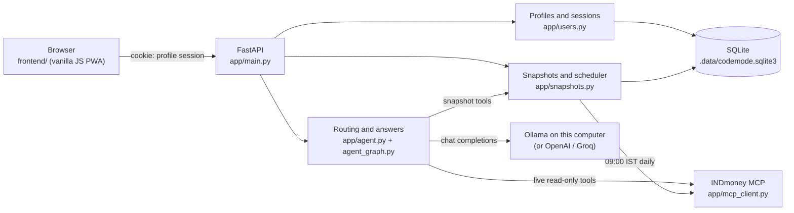
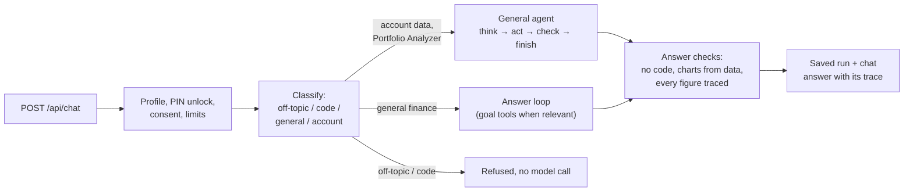
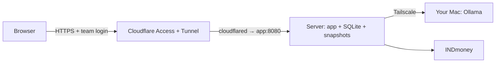

# CA Mode

CA Mode is a local finance assistant with two agents:

- **Finance Agent** answers general finance questions. It never sees your INDmoney account.
- **Portfolio Analyzer** answers questions about your INDmoney account. It reads a saved daily snapshot of your portfolio and calls INDmoney's read-only MCP tools for live data.

It runs its AI model on your computer through [Ollama](https://ollama.com), so your questions and portfolio data never leave it; OpenAI and Groq are optional. Several people can share one computer: each person has a PIN-protected profile with their own chats, INDmoney connection, and daily portfolio snapshots. To open it to other people, switch on [Google sign-in](docs/accounts-and-access.md#open-it-to-other-people-google-sign-in): each person signs in with their own Google account, and their PIN still unlocks their history. Everything is stored in a local SQLite database.

## Features

- A profile per person (name + PIN), with a profile picker and a quick **Switch profile** on a shared computer, or Google sign-in (one Google account per profile, no profile list) where other people can reach the app.
- A privacy notice each profile accepts before use, a choice between saving history on this computer and a private mode that saves no chats or snapshots, plus data export and history clearing.
- Optional profile details (risk appetite, investment horizon, primary goal, monthly investment, age band) that Portfolio Analyzer uses as context.
- Savings goals with projections calculated in code under your own return assumption, suitability rules per investment category, dated fund figures, holdings assigned to goals, and a list of decisions you record.
- A daily INDmoney portfolio snapshot at 09:00 IST, with net worth and a 30-day trend in the portfolio card.
- A general agent for account and market questions (option strategies, hedges, health checks, watchlist scans): the model plans every step, and code checks every call and every figure.
- Portfolio change investigations, run as a fixed workflow in code with consistency checks and an evidence card.
- Chats you can return to, each tied to Finance Agent or Portfolio Analyzer, and an Activity page with every answer's recorded steps.
- Read-only INDmoney access: net worth, allocation, holdings, SIPs, watchlists, stock and fund details, OHLC candles, option chains, and option Greeks. CA Mode cannot trade or move money.
- Charts (bar, donut, line, candlestick) when the data supports them. Candlestick charts are drawn from INDmoney's OHLC data by the app; candles the model typed out are replaced.
- Holdings at other brokers from a CAS statement, parsed offline.
- Light and dark themes, and an installable web app (PWA).

## How it works



A chat question goes through these stages:



The step-by-step flow, with every check and limit, is in [How it works](docs/how-it-works.md).

## Quick start

```bash
cp .env.example .env
ollama pull gpt-oss:20b && ollama create ca-mode -f ollama/Modelfile
docker compose up --build -d          # or: uvicorn --env-file .env app.main:app --host 127.0.0.1 --port 8003
```

Open [http://localhost:8003](http://localhost:8003), create a profile, accept the privacy notice and connect INDmoney. Details are in [Setup and first run](docs/setup.md).

## Documentation

| Page | What it covers |
| --- | --- |
| [Setup and first run](docs/setup.md) | Requirements, every environment variable, the local model and how it was chosen, running with Docker or Python, first run, upgrading |
| [How it works](docs/how-it-works.md) | The chat request end to end, request routing, which agent path answers, the general agent graph, the previous loop and planned answers, answer checks, task contracts, how numbers are computed, the daily snapshot |
| [Using CA Mode](docs/features.md) | The agents and their tools, daily snapshots, portfolio change investigations, Activity and the answer trace, goals and saved context, CAS statements |
| [Hosting](docs/hosting.md) | A team server with the model on your Mac: Tailscale, Cloudflare Tunnel and Access (exact setup), Caddy without Cloudflare, client IPs behind the proxy, backups, automatic updates |
| [Accounts, admin, plans and limits](docs/accounts-and-access.md) | Profiles and PINs, Google sign-in, the admin page, plans and pricing, daily caps, rate limits and Turnstile |
| [Privacy and data](docs/privacy-and-data.md) | What is stored and how it is protected, consent and storage modes, the full database reference, backups |
| [API](docs/api.md) | Every route and its access rules |
| [Measuring the answers](docs/evals.md) | The eval scripts, how they grade, and the recorded baselines |
| [Development](docs/development.md) | Checks, troubleshooting, project structure |
| [Future enhancements](docs/future-enhancements.md) | Proposed next steps, each tied to a known gap |

## Where Cloudflare comes in

Cloudflare is used only when CA Mode is hosted on a server, never on one computer. In `deploy/docker-compose.yml`, a `cloudflared` container opens an outbound tunnel, so the server opens no ports, and Cloudflare Access asks for a team login before any request reaches the app at `http://app:8080`. Setting `TRUSTED_PROXY=cloudflare` makes rate limits read each visitor's address from `CF-Connecting-IP`. Turnstile, an optional bot check on sign-up, is a separate Cloudflare product. Without a domain on Cloudflare, Caddy serves the app on ports 80 and 443 instead; the current hosted copy works that way. The exact steps are in [Hosting](docs/hosting.md#3a-cloudflare-tunnel-and-access).


