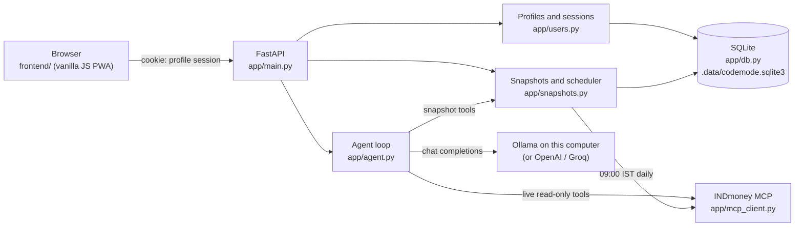
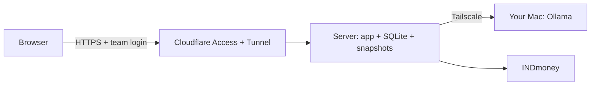

# CA Mode

CA Mode is a local finance assistant with two agents:

- **Finance Agent** answers general finance questions. It never sees your INDmoney account.
- **Portfolio Analyzer** answers questions about your INDmoney account. It reads a saved daily snapshot of your portfolio and calls INDmoney's read-only MCP tools for live data.

It runs its AI model on your computer through [Ollama](https://ollama.com), so your questions and portfolio data never leave it; OpenAI and Groq are optional. Several people can share one computer: each person has a PIN-protected profile with their own chats, INDmoney connection, and daily portfolio snapshots. To open it to other people, switch on [Google sign-in](#open-it-to-other-people-google-sign-in): each person signs in with their own Google account, and their PIN still unlocks their history. Everything is stored in a local SQLite database.

## Features

- A profile per person (name + PIN), with a profile picker and a quick **Switch profile** on a shared computer, or Google sign-in (one Google account per profile, no profile list) where other people can reach the app.
- A privacy notice each profile accepts before use, a choice between saving history on this computer and a private mode that saves no chats or snapshots, plus data export and history clearing.
- Optional profile details (risk appetite, investment horizon, primary goal, monthly investment, age band) that Portfolio Analyzer uses as context.
- Savings goals (amount, currency, target date, earmarked savings, monthly contribution, notes) with projections calculated in code under your own return assumption, and a list of decisions you record. Either agent sees the ones your question is about; both can also call two read-only tools, `get_goal_plans` and `plan_goal_what_if` (a what-if is never saved), when you have a goal. Only Portfolio Analyzer sees the value of assigned holdings.
- A daily INDmoney portfolio snapshot at 09:00 IST, with net worth and a 30-day trend in the portfolio card.
- Chats you can return to, each tied to Finance Agent or Portfolio Analyzer.
- Read-only INDmoney access: net worth, allocation, holdings, SIPs, watchlists, stock and fund details, OHLC candles, option chains, and option Greeks.
- Charts (bar, donut, line, candlestick) when the data supports them, plus a call trace for every answer. Candlestick charts are drawn from INDmoney's OHLC data by the app; candles the model typed out are replaced.
- Light and dark themes, and an installable web app (PWA).

## How it works



**A chat request** (`POST /api/chat`):

1. The session cookie identifies the signed-in profile. Without one, the API returns `401` with `profileRequired`, and the app shows the profile picker (or, with Google sign-in, the **Sign in with Google** screen).
2. A short AI call classifies the message as off-topic, a code request, a general finance question, or one that needs your account data. Off-topic and code requests are refused without calling the answer model. If that call fails or is rate-limited, offline keyword rules decide instead. The decision is the first step of the trace.
3. **Finance Agent** sends the conversation to the selected provider with no tools.
4. **Portfolio Analyzer** adds your profile details to the system prompt and always offers the snapshot tools; the live INDmoney tools are added when the question needs your account data:
   - **Snapshot tools** (`get_portfolio_snapshot`, `get_networth_history`) read today's saved snapshot and your net-worth history from SQLite.
   - **INDmoney tools** (the allowlisted read-only MCP tools below) fetch live data. When INDmoney's tool list was cached in the last 24 hours, the MCP session is opened only if the model actually calls one, so answers from the snapshot need no INDmoney MCP calls.
5. The answer is saved to the chat (the last 20 messages are kept) and returned as text, with the call trace in the `X-Agent-Trace` header.

**The daily snapshot:** a background task checks the clock every five minutes. For each profile connected to INDmoney whose last snapshot is older than today's 09:00 IST, it calls `networth_snapshot`, then `networth_holdings` once for each asset type the snapshot shows you hold (stocks, mutual funds, US stocks, EPF and so on), and stores one row per profile per day. Because it checks the wall clock, it catches up after the app starts or the laptop wakes. A failed attempt is retried at most once an hour.

Snapshots are SQLite rows, not vector-database chunks: net worth and holdings are exact numbers that need latest-value, date-range, and sorting queries, which similarity search cannot answer reliably.

## Requirements

- Docker Desktop, or Python 3.12 or newer
- [Ollama](https://ollama.com/download) and about 13 GB of disk and 16 GB of memory for the local model, or an OpenAI or Groq API key
- An INDmoney account to use Portfolio Analyzer

## Configure

Copy the example environment file. It uses the local model (see [Use the local model](#use-the-local-model)); add an OpenAI or Groq key only if you want a cloud model too:

```bash
cp .env.example .env
```

| Variable | Default | Purpose |
| --- | --- | --- |
| `OLLAMA_MODEL` | – | Enables the local model; `ca-mode` once built from `ollama/Modelfile` |
| `OLLAMA_BASE_URL` | `http://localhost:11434/v1` | Ollama's address (Docker Compose sets `host.docker.internal`) |
| `OLLAMA_TIMEOUT_SECONDS` | `300` | How long to wait for a local answer |
| `OPENAI_API_KEY` | – | Enables OpenAI |
| `OPENAI_MODEL` | `gpt-4o` | OpenAI model |
| `GROQ_API_KEY` | – | Enables Groq |
| `GROQ_MODEL` | `openai/gpt-oss-120b` | Groq model |
| `OPENAI_BASE_URL`, `GROQ_BASE_URL` | provider default | OpenAI-compatible endpoint override |
| `AI_PROVIDER` | `ollama` | Provider selected when the app opens (`ollama`, `openai` or `groq`) |
| `REQUEST_ROUTER` | `model` | How each message is classified before answering: `model` (an AI call) or `keywords` (offline rules) |
| `OLLAMA_ROUTER_MODEL`, `OPENAI_ROUTER_MODEL`, `GROQ_ROUTER_MODEL` | the chat model | Model for that classification; a smaller one is cheaper and faster |
| `GROQ_INPUT_TOKEN_BUDGET` | `5600` | Groq input budget; older chat history is dropped to fit |
| `GROQ_COMPLETION_TOKEN_LIMIT` | `1200` | Groq answer length limit |
| `MCP_SERVER_URL` | `https://mcp.indmoney.com/mcp` | INDmoney MCP endpoint |
| `APP_ORIGIN` | request host | Public address used for the INDmoney OAuth callback |
| `SNAPSHOT_TIME` | `09:00` | Daily snapshot time |
| `SNAPSHOT_TIMEZONE` | `Asia/Kolkata` | Time zone for `SNAPSHOT_TIME` |
| `SNAPSHOT_RETENTION_DAYS` | `365` | How long snapshots are kept |
| `SNAPSHOT_SCHEDULER_ENABLED` | `true` | Set to `false` to stop the background snapshot job |
| `INVESTIGATION_TOLERANCE_PCT` | `0.5` | Investigations: percentage part of the tolerance for two amounts to agree |
| `INVESTIGATION_TOLERANCE_INR` | `1` | Investigations: rupee floor of that tolerance |
| `INVESTIGATION_STALE_HOURS` | `36` | Investigations: age after which the latest snapshot is flagged as stale |
| `FUND_STALE_DAYS` | `5` | Fund figures: days after a scheme's NAV date before its returns are marked old |
| `APP_DATA_DIR` | `.data/` | Folder for the SQLite database |
| `BACKUP_DIR` | `~/ca-mode-backups` | Where daily database backups are written |
| `BACKUP_KEEP` | `14` | How many backups to keep |
| `BACKUP_ENABLED` | `true` | Set to `false` to stop daily backups |
| `APP_MASTER_KEY_FILE` | `~/.config/ca-mode/master.key` | File holding the key that encrypts stored INDmoney tokens (created on first start) |
| `APP_MASTER_KEY` | – | The key itself, instead of a file (a Fernet key) |
| `LOG_LEVEL` | `INFO` | Server log level |
| `PORT` | `8080` | Port inside the Docker container |
| `DAILY_QUESTION_LIMIT` | – (unlimited) | Answered chat questions per Free-plan profile per day in `SNAPSHOT_TIMEZONE` (the hosted copy uses `5`); see [Plans and pricing](#plans-and-pricing) |
| `PRICING_CONTACT_EMAIL` | – | Where the `/pricing` page's "Choose Individual" and "Contact us" buttons send an email; unset, the page says to ask whoever runs the copy |
| `RATE_LIMITS_ENABLED` | `false` | Request rate limits per IP and per profile on chat, sign-up, sign-in and investigations |
| `TRUSTED_PROXY` | – | `cloudflare`: take the client IP from `CF-Connecting-IP` (only when the app is reachable solely through Cloudflare) |
| `TURNSTILE_SITE_KEY`, `TURNSTILE_SECRET_KEY` | – | Both set: sign-up asks for a Cloudflare Turnstile check |

You can configure several providers and switch in the app. Provider keys stay in the server environment and are never sent to the browser. Leave `OPENAI_API_KEY` and `GROQ_API_KEY` empty to make sending data to an AI company impossible.

## Use the local model

CA Mode's local model is [gpt-oss-20b](https://huggingface.co/openai/gpt-oss-20b) (Apache 2.0), the smaller sibling of the `gpt-oss-120b` model used on Groq. Install [Ollama](https://ollama.com/download), then build the `ca-mode` model once:

```bash
ollama pull gpt-oss:20b                      # about 13 GB
ollama create ca-mode -f ollama/Modelfile    # same weights, with a 32k-token context window
```

Keep `OLLAMA_MODEL=ca-mode` in `.env`. The Modelfile matters: Ollama's default context window is 4,096 tokens on Macs with less GPU memory, and its OpenAI-compatible API silently drops the start of a longer prompt, including the instructions and your portfolio data. CA Mode checks the window of the loaded model and refuses to answer below 16,384 tokens.

The model loads on the first question (a few seconds) and stays in memory for five minutes. With Docker, Compose points the app at `host.docker.internal`; if the container cannot reach Ollama, start Ollama with `OLLAMA_HOST=0.0.0.0:11434`, which also makes it reachable from your network.

**How it was chosen.** Candidates had to run fully on the GPU of a 24 GB Mac (roughly 16–18 GB usable), which rules out the 27–35B models (Qwen3.8-27B, Qwen3.6-35B-A3B, GLM-4.7-Flash). Each remaining model was scored on this repo's two evals on an M5 Pro:

| Model (Ollama tag) | Memory at 32k context | Portfolio numbers (3 runs × 8) | Request routing (3 runs × 58) | Time per portfolio answer |
| --- | --- | --- | --- | --- |
| **`gpt-oss:20b`** | 12 GB | **23/24** | 88–93% | **~9 s** |
| `qwen3.5:9b` | 6.6 GB | 20/24 | **98.3%** | ~12 s |
| `qwen3:8b` | 9.8 GB | 21/24 | 96.6% (1 run) | ~30 s |

gpt-oss-20b gets the numbers right most often and answers fastest, which matters most for a finance assistant. The routing set has since grown to 64 cases (price-history and candlestick requests, and the concepts behind them); with the classifier call at temperature 0, gpt-oss-20b scores 60/64 on every run (59–61 at the model's default temperature, which once sent a candlestick request to the general-finance path). Its routing misses are mostly prompt-injection test cases sent to Finance Agent, which then declines anything that isn't finance, and a routing call that fails falls back to the keyword rules. On a Mac with 8–16 GB of memory, use `FROM qwen3.5:9b` in the Modelfile instead. `gemma4:26b` was shortlisted but not scored.

## Run with Docker

After configuring `.env`, build and start the app:

```bash
docker compose up --build -d
```

Open [http://localhost:8003](http://localhost:8003) and keep using this address for INDmoney sign-in (the OAuth callback is `http://localhost:8003/auth/indmoney/callback`). The database lives in `./.data` on your computer, and the snapshot job runs inside the container, so keep the container running for the daily 09:00 capture. The container also mounts `~/.config/ca-mode`, so it uses the same token encryption key as running with Python.

```bash
docker compose logs -f   # view logs
docker compose down      # stop
```

## Run with Python

```bash
python3 -m venv .venv
source .venv/bin/activate
python -m pip install -r requirements.txt
uvicorn --env-file .env app.main:app --host 127.0.0.1 --port 8003
```

Run `uvicorn` from the activated virtual environment (or call `.venv/bin/uvicorn` directly). A globally installed `uvicorn`, such as Homebrew's, does not have the project's packages. The server does not reload code changes on its own: restart it after pulling an update.

Open [http://localhost:8003](http://localhost:8003) and keep using this address during INDmoney sign-in.

## Host on a server (model on your Mac)

For a small team: the app, its database and the daily snapshot job run on a cheap Linux server, and answers come from Ollama on your Mac. The two are joined by [Tailscale](https://tailscale.com) (a private, encrypted network), and the site is published through a [Cloudflare Tunnel](https://developers.cloudflare.com/cloudflare-one/connections/connect-networks/) with [Cloudflare Access](https://developers.cloudflare.com/cloudflare-one/policies/access/) in front, so only your team can open it. The server opens no ports.



When the Mac sleeps, sign-in, the portfolio pages, calculators and daily snapshots keep working; chat answers say the model is offline. A server with 1 vCPU and 2 GB of memory is enough (about €5–10 a month), plus a domain on Cloudflare. Tailscale's and Cloudflare Access's free plans cover a small team.

**1. On the Mac.** Install Tailscale and sign in, then share Ollama with your tailnet only (Ollama itself keeps listening on `localhost`):

```bash
tailscale serve --bg --tcp 11434 tcp://localhost:11434
tailscale ip -4    # note this address
```

Keep Ollama opening at login, and stop the Mac sleeping on power (System Settings → Battery → Options → *Prevent automatic sleeping on power adapter when the display is off*; a closed MacBook still sleeps unless it has an external display).

**2. On the server.** Install Docker and Tailscale (`curl -fsSL https://tailscale.com/install.sh | sh`, then `sudo tailscale up` with the same account). Check that the Mac answers; Ollama refuses requests addressed to a Tailscale name or IP, hence the `Host` header (the app uses the same `ollama.internal` name):

```bash
curl -H "Host: ollama.internal:11434" http://<mac-tailscale-ip>:11434/api/version
```

**3. In Cloudflare.** With your domain on Cloudflare, create a tunnel (Zero Trust → Networks → Tunnels), copy its token, and add a public hostname such as `camode.example.com` pointing to `http://app:8080`. Then add a self-hosted Access application for that hostname with a policy that allows your team (for example emails ending in `@yourcompany.com`), and set its session duration to a month: when an Access session expires, the open app's requests fail until the page is reloaded.

**4. Start it.**

```bash
git clone <this repository> ca-mode && cd ca-mode/deploy
cp .env.example .env              # MAC_TAILSCALE_IP, CLOUDFLARE_TUNNEL_TOKEN
cp app.env.example app.env        # APP_ORIGIN=https://camode.example.com
sudo mkdir -p /srv/ca-mode/data /srv/ca-mode/key /srv/ca-mode/backups
docker compose up -d --build
```

The master key is created in `/srv/ca-mode/key` on first start; keep a copy somewhere safe, away from the backups. Daily backups go to `/srv/ca-mode/backups`, on the same disk, so also copy them off the server, for example from the Mac: `rsync -a <server>:/srv/ca-mode/backups/ ~/ca-mode-backups/server/`. To update: `git pull && docker compose up -d --build` (everyone enters their PIN again after a restart).

**Moving your existing data (optional).** On the Mac, run `python -m scripts.backup now` and stop the local app for good: two copies would both refresh the same INDmoney tokens. Before the server's first start, copy the backup file to `/srv/ca-mode/data/codemode.sqlite3` and `~/.config/ca-mode/master.key` to `/srv/ca-mode/key/master.key`. Otherwise everyone creates a profile on the server and connects INDmoney again.

The profile picker lists every profile to anyone who can open the site and the PIN is a lock, not network-grade sign-in, which is why Cloudflare Access must stay in front of it.

## First run

1. **Create a profile.** The first screen asks "Who's using CA Mode?". Enter your name and a PIN of at least four characters. Other people on the same computer add their own profiles with **+ Add a profile**. You then see a **recovery code** once: write it down. It is the only way back into your saved history if you forget your PIN.
2. **Review the privacy notice.** It explains what is saved, where, and what is sent to the AI provider. Choose **Save history** (chats and daily snapshots, with a snapshot retention of 30 days to 1 year) or **Private mode**, then accept. You can't chat or connect INDmoney until you accept.
3. **Fill in your profile (optional).** Click your name at the bottom of the sidebar to set risk appetite, horizon, goal, monthly investment, and age band. Portfolio Analyzer uses these to relate its analysis to your goals; it is not personalised investment advice.
4. **Connect INDmoney.** Select **Connect**, sign in to INDmoney, and approve read-only access. The first snapshot is saved straight away, and the portfolio card shows your net worth.

## Open it to other people: Google sign-in

The profile picker suits one shared computer: anyone at the screen sees every profile name and can try PINs. Where other people can reach CA Mode, set `AUTH_MODE=google` instead. Each person then signs in with their own Google account, which is linked to exactly one profile, and nobody is ever shown a list of profiles. Signing in only says who the person is: their history stays sealed until they enter their PIN, exactly as before (the PIN and recovery code are unchanged).

1. In the [Google Cloud console](https://console.cloud.google.com/apis/credentials), create an **OAuth client ID** of type **Web application**. Add `https://your.domain/auth/google/callback` (your `APP_ORIGIN` followed by `/auth/google/callback`) as an authorised redirect URI. The OAuth consent screen needs only the `openid`, `email` and `profile` scopes.
2. Set these in `.env` and restart the app:

   ```bash
   AUTH_MODE=google
   GOOGLE_CLIENT_ID=1234-abc.apps.googleusercontent.com
   GOOGLE_CLIENT_SECRET=...
   APP_ORIGIN=https://your.domain
   ```

   The app refuses to start with `AUTH_MODE=google` and no client ID or secret. Serve it over HTTPS so the session cookie is marked `Secure`.
3. **First sign-in.** A Google account with no profile chooses a profile name and PIN (names may repeat between people) and gets its recovery code, then accepts the privacy notice. A person who already had a profile on the shared computer selects **Claim that profile** and types that profile's name and PIN; from then on it signs in with that Google account. A profile can be claimed once. Unknown names, claimed profiles and wrong PINs get the same answer, and wrong PINs count towards the profile's five-attempt lockout.
4. **Returning.** **Sign in with Google**, then the PIN unlocks the history. **Sign out** replaces **Switch profile**.

How it works:

- The app uses OpenID Connect's authorization code flow with PKCE, a `state` tied to the browser session and a `nonce`, and asks Google to show the account chooser. The ID token comes straight from Google's token endpoint in exchange for the code and the client secret, so its issuer, audience, expiry and nonce are checked rather than its signature. Only accounts with a verified email address are accepted.
- The `accounts` table links Google's account ID to the profile and keeps the email address (encrypted with the master key, like INDmoney tokens) to show who is signed in; the Google name is only used to suggest a profile name. The link is in the export and is deleted with the profile. The session id rotates on every sign-in.
- Sessions from the profile picker do not carry over: a profile is reached only through its linked Google account.
- `ALLOW_PROFILE_CLAIMS=false` turns claiming off. Do this once everyone has claimed their profile, because an unclaimed profile can otherwise be claimed by any Google account that guesses its name and PIN (five guesses every five minutes).
- Leave `AUTH_MODE` unset (or `local`) on a single computer: nothing changes there. Profiles created with Google sign-in still appear in the picker if you switch back to local mode.

## Use the agents

Choose **Finance Agent** for general topics such as budgeting, saving, tax basics, and how financial products work.

Choose **Portfolio Analyzer** for questions about your account and the market. It needs a connected INDmoney account. It uses these tools when INDmoney's MCP server offers them; anything else the server exposes is ignored:

| Tool | What it retrieves |
| --- | --- |
| `get_portfolio_snapshot` | Figures computed from the saved daily snapshot: totals, P&L, splits by asset type and broker, concentration, holdings (local) |
| `get_networth_history` | Daily net worth from saved snapshots, up to 365 days (local) |
| `networth_snapshot` | Live portfolio and net-worth summary |
| `networth_allocation_breakdown` | Breakdown for an asset class |
| `networth_holdings` | Holdings for an asset class |
| `lookup_ind_keys` | Resolve stock, index, derivative, and fund names to INDmoney identifiers |
| `get_indian_stocks_ohlc` | Historical OHLC candles for Indian stocks, indices, and derivatives |
| `get_indian_stocks_details` | Indian market prices, analyst data, and news |
| `get_indian_stocks_option_chain` | Option-chain strikes, premiums, open interest, and implied volatility |
| `get_indian_stocks_greeks_history` | Historical option Greeks and volatility measures |
| `user_watchlist` | Indian and US stock watchlists |
| `indian_stocks_sips` | Indian stock SIPs |
| `get_mf_by_category` | Mutual-fund category search and ranking |
| `get_mf_funds_details` | Mutual-fund profiles, returns, benchmarks, and allocations |
| `mf_sips` | Mutual fund SIPs |
| `get_us_stocks_details` | US market prices, analyst data, and news |
| `us_stocks_sips` | US stock SIPs |

For net worth, allocation, holdings, and trends it reads the saved snapshot first and says when it was captured. For live prices, SIPs, watchlists, options, or anything the snapshot lacks, it calls INDmoney live. All INDmoney tools are read-only: CA Mode cannot place trades, change SIPs, move money, or change account settings.

**What the AI model sees:** your messages and recent chat history; for Portfolio Analyzer, also your profile details and the snapshot or INDmoney data needed to answer. With the local model this stays on your computer; with OpenAI or Groq it is sent to that company.

## Daily portfolio snapshots

- Captured right after you connect INDmoney, then every day at 09:00 IST (before the 09:15 market open, so values reflect the previous close).
- The app must be running to capture. If it was closed or the computer was asleep at 09:00, it captures within five minutes of starting or waking.
- **Refresh snapshot now** in the portfolio card captures one on demand.
- Kept for the retention the profile chose (30, 90, 180, or 365 days; never longer than `SNAPSHOT_RETENTION_DAYS`). **Disconnect** deletes the profile's snapshots.
- Not captured for profiles in private mode or profiles that haven't accepted the current privacy notice.
- The net-worth total is read from INDmoney's `networth_snapshot` result. If it cannot be read, the trend line is hidden and the agent works from the raw snapshot text.

## Portfolio change investigations

Ask Portfolio Analyzer "Why did my portfolio change?" (or "What changed since 2026-09-01?"), or call `POST /api/investigations`. A fixed, read-only workflow in code, not the model, then:

1. Loads the latest saved snapshot and the comparable earlier one (the previous saved day, or the snapshot on or before the date you name). With no earlier snapshot it says there is not enough history; it never reports that as "no change".
2. Normalises both (`app/investigation_math.py`): totals, holdings identified by asset type, INDmoney code and broker, duplicates merged, changed codes matched by name, and missing values kept distinct from zero.
3. Calculates the changes in net worth, current value, invested amount and liabilities, each asset type, and each holding (split into the effect of price and of units held), plus asset-type shares of the latest total. Everything uses exact decimals.
4. Runs the consistency checks (`app/investigation_checks.py`): same account scope and currency, freshness, totals that add up, holdings that match INDmoney's per-type totals, holdings missing from one snapshot, which total each percentage is measured against, valid percentages, change arithmetic, and USD kept apart from INR. Each check reports `passed`, `warning`, `failed` or `not_checked` with its evidence. A finding is marked verified only when every check it depends on passed.
5. Saves the run (status, steps with timings, checks and result, sealed with your PIN; the last 50) and returns the findings with their snapshot ids, warnings, limitations and suggested follow-ups.

The answer shows an evidence card with the findings, the change by asset type, the allocation chart, the largest movers, the data checks, the calculations, the source snapshots and the steps. Runs have a 10-second step timeout and a 30-second deadline; a saved-snapshot read is retried once if the database is briefly locked. Investigations report what changed, not why: they never claim a cause such as market news.

### Activity and the answer trace

**Activity** in the sidebar (`#/activity`) lists the saved investigations (newest 50) with their status, start time, duration, outcome and where they came from, filtered by All, Running, Completed or Failed. Open one to see its evidence card and step timeline, open the chat that ran it, or run a failed or cancelled one again (it only reads saved snapshots, and it never reruns on its own). Nothing in CA Mode waits for approval, so there is no approval filter.

Under each answer, *How this answer was made* is a timeline of the request: how it was classified, each model call, and each tool with its arguments and a preview of its output, with durations and statuses. A step that never reported back shows as *Did not finish*, never as completed. Tokens, secrets, PINs and PAN numbers are masked before the trace is saved or shown.

Answers are not streamed: the trace arrives with the finished answer. Activity reloads from the server on every visit, when the tab regains focus or the network returns, and every few seconds while a run is in progress; an older response never overwrites a newer status. Streaming the agent's own events (`agent.stream_agent()` already yields them) over server-sent events would make the answer trace live.

### Measuring the answers

`evals/portfolio_change.jsonl` holds 10 versioned cases (`portfolio_change.v1`): a consistent pair with a clear change, no earlier snapshot, a different account scope, holdings that don't add up to INDmoney's totals, a stale snapshot, a tool timeout, an ambiguous question, a question that needs news, a request to trade, and a date before any saved history. Each case gets its own throwaway profile and database with snapshots from `tests/fixtures/snapshot_pairs.py`; the script first checks that the investigation itself returns the expected status and flagged checks, then asks the real agent. Live INDmoney tools are offered but return an error, so only the AI provider is called.

```bash
set -a; source .env; set +a
python -m scripts.eval_investigations --provider ollama --delay 0 --runs 3
python -m scripts.eval_investigations   # fixtures only, no model calls
```

Answers are graded in code, not on how convincing they read:

- **Tool selection**: `investigate_portfolio_change` is called when the case needs it; for the ambiguous question, a clarifying question also counts.
- **Arithmetic**: every amount and percentage matches a number a tool returned (the same matching as the warning under answers). A correct figure the model worked out itself still fails, because the prompt tells it to quote, not compute.
- **Unsupported claims**: no external cause (news, RBI, rates, sentiment…) given as the reason unless the result contains it, and no "mainly market gains" when the market-effect estimate is under half of the change.
- **Warning mentioned**: the flagged scope, reconciliation, staleness or timeout problem appears in the answer.
- **Insufficient-data honesty**: a missing comparison is described as missing, never as "no change".
- **Case instructions**: the trade request is declined without claiming a trade; the news question says the cause was not checked.

The script also prints latency and tool and model calls per case. The phrase rules are regular expressions, so check a surprising failure with `--verbose`. `--out answers.jsonl` saves each answer with its tool results, and `--regrade answers.jsonl` scores them again without the model. By default the request router uses keywords (`REQUEST_ROUTER=model` includes the classifier), and the second account scope is injected by the script, since the app has one scope today.

**Baseline** (`ca-mode`, gpt-oss-20b, 3 runs × 10 cases, M5 Pro, 2026-10-15):

| Metric | Score |
| --- | --- |
| Tool selection | 22/24 |
| Evidence (net-worth change, top mover) | 3/3 |
| Arithmetic | 21/30 |
| Answers with an unsupported claim | 1/30 |
| Warning mentioned | 10/12 |
| Insufficient-data honesty | 8/9 |
| Case instructions | 6/6 |
| **Cases passed** | **21/30** (6–9 per run) |
| Latency | p50 21 s, max 71 s; 1.2 tool and 2.2 model calls per case |

Most failures are the model's own arithmetic: lakh amounts written 100 times too large (₹8,10,00,000 for ₹8.1 lakh), a ₹79,000 fall reported as ₹790,000, and its own sums (the ₹25,000 gap behind a reconciliation warning). It also skipped the investigation for "check whether my holdings add up" in 2 of 3 runs, and it attributed a fund's rise to price when buying more units drove most of it. Exit status is 1 when a run passes fewer than `--min-pass` cases (default 6).

## Goals and saved context

The **Goals** page keeps up to 10 goals and 50 decisions, sealed with your PIN like your chats.

- **A goal** has a name, a target amount in INR, USD, EUR or GBP, a target date, the savings you have already earmarked, a planned monthly contribution, an optional yearly return you assume, and optional notes. Amounts are never converted or added across currencies.
- **Its plan** is calculated in code (`app/goal_planning.py`, `Decimal`) each time the goal is shown or a question needs it, and never stored: the gap still to save, progress, months left, and for each scenario the projected amount, the shortfall or surplus, and the monthly contribution that would reach the target (rounded up) and how much more that is than planned. The scenarios are no growth, and when you give an assumption, that return and 2 points either side of it. Contributions are made at the start of each month, returns compound monthly, and inflation is added to the target only when you give a rate. Missing details give "missing details" rather than guesses, and a goal with no months left says so.
- **Drafts and horizons.** A goal can be saved as a draft with only a name and finished later. The target can be a date or "in N years", which is converted to a date when you save. Types include financial independence and custom. Optional answers (can the date move, might you need the money early, comfort with ups and downs, how badly a fall would hurt, yearly inflation) feed the suitability check; any you leave out are assumed in the cautious direction and CA Mode asks for them instead of guessing.
- **More in the plan.** Total planned contributions; the target raised by inflation when you give a rate (read as today's money); whether the plan is covered with no growth, depends on your assumed return, or falls short; and, when it is not covered, ways to close the gap (raise the monthly amount, move the date, lower the target, or earmark a lump sum), each tagged "no growth" (plain arithmetic) or "at your X%" (an illustration under your assumption).
- **Which kinds of investment fit** (`app/goal_suitability.py`): fixed rules, not a model, rate six broad categories (liquid and overnight, short-duration debt, conservative hybrid, balanced and multi-asset, large/flexi/index equity, mid and small cap) as allowed, caution or unsuitable from the time to the target date, risk tolerance, capacity for loss, liquidity need and flexibility, and say why. Equity is unsuitable under 36 months, and a fixed goal with low capacity for loss rules out equity at any horizon. This is not advice.
- **Fund figures, dated and sourced, never ranked** (`app/fund_data.py`). "Show fund figures" on a goal card (and Portfolio Analyzer's `get_goal_fund_comparison` tool) fetches INDmoney's listing for each category the goal does not rule out: the largest schemes by assets, shown by name, with expense ratio, 1/3/5-year returns, risk level and benchmark. Every figure shows its source and date: returns are as of the scheme's NAV date, figures older than `FUND_STALE_DAYS` (5) are marked old, and the expense ratio, risk label and benchmark, which INDmoney gives without a date, are shown as undated with the time they were fetched. A missing figure says why (not given, a return of 0, which INDmoney also sends for "no figure", or a period longer than the scheme has existed); it is never shown as zero. Only INDmoney categories that clearly fit one of the six are compared (for example flexi-cap and Nifty 50 index funds count as large/flexi/index equity; aggressive hybrid, multi-cap, sector and credit-risk funds are not compared), and a scheme INDmoney files elsewhere is left out with the reason. INDmoney's ratings and ranks are dropped. Nothing is stored: figures are cached in memory for six hours. This is not advice. The response layout was recorded with `python -m scripts.inspect_indmoney_shapes --funds --labels`. Overlap between holdings needs scheme holdings and is still reported as not assessable.
- **Assign what you hold to goals.** On the Goals page, "Your investments and goals" lists the holdings in your latest snapshot. Give each holding's value to goals in whole percent (the total for a holding cannot pass 100%); each share is valued from the snapshot, rounded down, and counted once. "Earmarked savings" is money not held in assigned holdings. Holdings that are no longer in the snapshot are listed as value unknown and not counted. Rupee holdings count only toward rupee goals. This is bookkeeping: nothing is bought or sold.
- **Decisions** are short notes in your own words (for example "keep six months of expenses in a liquid fund"), optionally dated and linked to a goal.
- **What the assistant can use** on the Goals page lists your profile details, decisions, and the observed data (snapshot and CAS dates) with when each was saved. You can delete any item, or remove all goals, decisions and profile details at once. Chats, snapshots and statements stay.

Before each answer, `app/context.py` picks what bears on the question with fixed keyword rules (no model, no vector store). It picks goals named in the question, or all goals when it is about goals or saving for something, plus related decisions and, for risk or allocation questions, your profile details. The earlier turns count only when the question reads as a follow-up. The selection goes into the prompt as "Confirmed by the user" and "Calculated in code" sections, and the answer trace shows a **Use your saved goals and details** step naming each item. CA Mode never saves anything the assistant infers from a chat. Goals saved by earlier versions (inside the profile, with a target year) move to the new store the next time you enter your PIN, with the target date set to 31 December of that year.

## Holdings at other brokers (CAS)

INDmoney may not see every broker you use. A **Consolidated Account Statement (CAS)** does: NSDL and CDSL email one each month listing every demat account at every broker, plus mutual fund folios and NPS. CAMS and KFintech statements (mutual funds only) are also accepted.

1. Find the latest CAS email from NSDL or CDSL (or request one on their websites) and save the PDF.
2. In the **Other brokers** card on the right (shown on windows at least 1280px wide), choose the PDF, enter its password (usually your PAN in capital letters), and select **Upload statement**.
3. Ask Portfolio Analyzer, for example "Using my latest CAS statement, list my holdings grouped by broker".

The PDF is read in memory with [`casparser`](https://github.com/codereverser/casparser), offline. Only the holdings are kept (name, ISIN, broker, units, price, value, and cost where the statement gives one), sealed with your PIN like snapshots; the last 12 statements are kept. The PDF, its password, and your name, PAN, address, contact details, and DP/client IDs are never stored. CAS figures are as of the statement date, not live, and overlap INDmoney's, so the agent never adds the two together. Demat statements usually give no purchase cost for shares, so their P&L covers only holdings with a cost.

## How the numbers are computed

Portfolio figures are calculated in code (`app/portfolio_math.py`, exact decimal arithmetic), not by the AI model. The model receives finished figures and is told to quote them, never to add up or work out percentages itself:

- Net worth, current value, invested amount, and liabilities as INDmoney reports them.
- P&L only over holdings with a reported invested amount. Linked (non-INDmoney) brokers often report it as 0; those holdings are left out of P&L instead of showing a 100% gain, and the answer says so.
- Shares of the whole portfolio for each holding, asset type, asset class, and broker. INDmoney's own `holding_percent` is a share of one asset type only.
- Concentration: the largest holding and the top 5 and top 10 as a share of the portfolio.
- US stocks in INR and USD separately; USD is never added to INR totals.

After each Portfolio Analyzer answer, every amount and percentage in it is checked against the numbers the tools returned, allowing for rounding and lakh/crore. Figures that match nothing get a warning under the answer ("I couldn't match these figures to your INDmoney data"). The check is a safety net, not proof: a wrong figure that happens to equal another number in the data is not caught.

To measure this against your model with made-up portfolio data (about two model calls per question):

```bash
set -a; source .env; set +a
python -m scripts.eval_numbers --provider ollama --delay 0
python -m scripts.eval_numbers --provider groq --delay 70   # the delay keeps within Groq's free-tier limits
```

## Answer records and task checks

Every chat answer records its steps as events: how the request was routed, the task it was given, each model call (with prompt and completion tokens), each tool call and how it failed if it did (`invalid_arguments`, `rejected`, `unavailable`, `auth` or `failed`), every retry and why, the checks on the answer, and how it ended. The trace under an answer shows them, and when the profile saves history the full record is kept for Activity (`#/activity`, the newest 200, none older than 30 days, sealed with your PIN like your chats).

Each request gets a task contract from fixed rules, not the model: a declined request, general finance, a goal calculation (the calculator, or a clarifying question when inputs are missing) or account data (a snapshot, investigation, CAS or INDmoney tool). The finished answer is checked against it. Contracts only report; the one rule they enforce is that an account question is not satisfied by the goal calculator alone.

```bash
python -m scripts.eval_tasks                                   # 21 cases on scripted model replies, offline (also in the test suite)
python -m scripts.eval_tasks --provider ollama --runs 3        # the 8 live cases on the real model
```

The scripted cases check CA Mode's own handling: the contract and verdict, how the run ended, retries, and how each tool failure was classified (timeouts, empty replies, unknown tools, rejected and malformed arguments, INDmoney outages and expired tokens). The live cases grade the model's answers in code: contract met, every figure traced to a tool, the expected figures stated, a clarifying question when inputs are missing, no invented amounts, no rejected tool calls, and how many model calls it took.

**Live baseline** (`ca-mode`, gpt-oss-20b, 3 runs × 8 cases, 2026-10-17; the clarification check was widened after the run to accept "I'll need ..." without a question mark, and the saved answers were re-graded):

| Metric | Score |
| --- | --- |
| Contract met | 15/15 |
| Figures traced to a tool | 13/15 |
| Expected figures stated | 9/9 |
| Clarifying question when inputs are missing | 3/6 (a goal with no amount or date: 0/3) |
| No invented amounts (that same goal) | 2/3 |
| No rejected tool calls (goal calculator) | 5/6 |
| **Cases passed** | **18/24** |
| Latency | p50 8.6 s, max 57.8 s; 1.5 model and 0.6 tool calls, about 3,400 tokens per case |

## Questions with several parts

A Portfolio Analyzer question that asks for account data and a goal calculation at once ("What is my net worth and how much must I invest monthly to reach ₹50 lakh in 8 years?") is answered from a plan instead of the usual one-call-at-a-time loop:

1. The model proposes up to 4 tool calls in one `submit_plan` call. CA Mode checks the plan in code: only offered tools, arguments that fit each tool (required fields, allowed values), each step waiting only for earlier steps, no repeated call, and at least one step that reads account data. A plan that fails a check is set aside and the usual loop answers instead.
2. Steps that don't depend on each other run at the same time, each with a time limit (`PLAN_STEP_TIMEOUT_SECONDS`, 60).
3. The model then answers, or adds up to 2 more calls (at most twice). A call the tool rejected for its arguments may be fixed once; a call that was unavailable is never repeated; an expired INDmoney sign-in ends the answer so the token can be refreshed.
4. At most 8 tool calls, 6 model calls and `PLAN_DEADLINE_SECONDS` (240). When a limit is reached, the answer says which part it could not complete.

The answer goes through the same checks as any other (figures traced to a tool, no code, charts from tool data), and the trace shows the plan, any rejected plan and why it stopped gathering data (complete, clarify, partial, budget, deadline or error). Every other question is answered exactly as before.

```bash
python -m scripts.eval_tasks --dataset evals/multi_step.jsonl                              # 15 scripted cases, offline (also in the test suite)
python -m scripts.eval_tasks --dataset evals/multi_step.jsonl --provider ollama --runs 3   # the 4 live cases on the real model
```

**Live results** (`ca-mode`, gpt-oss-20b, 3 runs × 4 cases, 2026-10-20, final code):

| Metric | Score |
| --- | --- |
| Plan accepted (not set aside) | 11/12 |
| Contract met | 9/9 |
| Expected figures stated | 9/9 |
| Clarifying question when the goal date is missing | 3/3 |
| A lookup ran before the call that needs its key | 3/3 |
| No repeated call; within 6 model and 8 tool calls | 12/12 |
| **Cases passed** | **11/12** |
| Latency | p50 15.1 s, max 33.0 s; 2.2 model and 2.0 tool calls, about 6,500 tokens per case |

The first live run passed 3/12: the local model writes `name` for `tool`, refers to steps as "step1", "0" or by tool name, and sometimes ends a plan one character wrong, which Ollama rejects with HTTP 500. These are now accepted or repaired in code, and the plan is still checked in full. The one miss above was a 500 that could not be repaired; the usual loop then answered. Two intermediate runs scored 8/12 and 7/12 on the way, so treat single runs as noisy.

## Plans and pricing

`/pricing` (linked from the sign-in screen, the profile dialog and the daily-limit message) shows three plans, kept in `app/plans.py` `PLANS`:

| Plan | Price | Questions | What it is |
| --- | --- | --- | --- |
| Free | ₹0 | `DAILY_QUESTION_LIMIT` a day (5 on the hosted copy) | The shared copy, every feature |
| Individual | ₹199 a month | Unlimited | The shared copy; answers come from the local open-source model (gpt-oss via Ollama), so there is no cloud AI bill and the price stays low |
| Team or organisation | Contact us | Unlimited | A dedicated hosted copy (own server, database and model, Google sign-in per member, backups); hosting costs more, so it is priced by size |

There is no checkout yet. Every profile starts on Free; after someone pays, give their profile a plan on the server:

```bash
python -m scripts.plans list
python -m scripts.plans set asha@example.com individual   # profile name, Google email or profile id
python -m scripts.plans set Asha free                     # back to the daily limit
```

(In the hosted setup: `docker compose exec app python -m scripts.plans …`.) The plan is the `users.plan` column; paid plans skip the daily question cap, while request rate limits still apply to everyone. `/api/session` returns `usage` (`plan`, `planName`, `limit`, `used`, `remaining`, `resetsAt`; `limit` is `null` when nothing caps the profile), a counted answer carries `X-Questions-Remaining`, and the daily-limit `429` adds `pricingUrl`. The profile dialog shows "5 of 5 questions left today" or "Unlimited questions". A copy on one computer with no `DAILY_QUESTION_LIMIT` stays unlimited on every plan. To change a price, edit `PLANS` and `PRICES_UPDATED` (the sitemap date).

## Admin page

`/admin` is for whoever runs the copy: every profile with its name, Google email address, plan, questions asked today, when it joined and was last seen, whether it accepted the current privacy notice, whether INDmoney is connected (and whether the last snapshot failed), and whether its PIN is locked. From it you can change a plan, clear a PIN lock, sign a profile out on every device, delete a profile (type its name to confirm), and back up the database now. It also shows backup status and the last 7 days of anonymous page views.

It never shows PIN-locked history: chats, goals, decisions, profile details and snapshot contents stay sealed, and no admin route opens them.

1. Use a Google OAuth web client (the same one as [Google sign-in](#open-it-to-other-people-google-sign-in), with `APP_ORIGIN/auth/google/callback` as the redirect URI). Admin sign-in works in either `AUTH_MODE`.
2. List the admins and restart:

   ```bash
   ADMIN_EMAILS=you@example.com,partner@example.com
   GOOGLE_CLIENT_ID=1234-abc.apps.googleusercontent.com
   GOOGLE_CLIENT_SECRET=...
   ```

   The app refuses to start with `ADMIN_EMAILS` set and no Google client.
3. Open `https://your.domain/admin` and choose **Sign in with Google**.

How it works:

- Without `ADMIN_EMAILS`, every admin path is a 404.
- Admin sign-in has its own cookie (`ca_admin`, 8 hours) and session row, never bound to a profile. Being an admin opens no profile, and signing in to a profile, even with the same Google account, gives no admin access.
- The address is checked against `ADMIN_EMAILS` on every request, so removing an address ends that admin's access at once.
- Every action is logged with the admin's email (`admin_plan_changed`, `admin_lockout_cleared`, `admin_profile_signed_out`, `admin_profile_deleted`, `admin_backup_created`).
- The privacy notice (version 2026-10-22.2) tells profiles what the admin page shows and can do.
- In the hosted setup, you can also put `/admin*` behind its own Cloudflare Access policy that allows only your email.

## Limits for a shared copy

A copy on one computer has no limits. Before opening a hosted copy to other people, turn these on so one person or bot cannot monopolise the model (one Mac running Ollama answers one question at a time) or run up OpenAI or Groq costs. Each is independent and off unless set.

- **Daily questions** (`DAILY_QUESTION_LIMIT=5` for the Free plan). Each Free-plan profile can get that many answers a day (paid plans are not capped, see [Plans and pricing](#plans-and-pricing)); the count starts again at midnight in `SNAPSHOT_TIMEZONE`. A question that gets no answer (the model failed, INDmoney needs reconnecting) does not count. Over the limit, `POST /api/chat` returns `429` with `Retry-After` and `{"error": "You've reached today's limit of 5 questions. It resets at midnight IST.", "dailyLimitReached": true, "limit", "resetsAt", "retryAfterSeconds", "pricingUrl"}`, and the chat shows that sentence with a link to the plans. Counts are kept in the `question_counts` table (profile, date, number; today and yesterday only) and deleted with the profile.
- **Request rate limits** (`RATE_LIMITS_ENABLED=true`). Sliding windows in `limits.RATE_RULES`:

  | Routes | Per IP | Per profile |
  | --- | --- | --- |
  | `POST /api/chat` | 30 a minute | 10 a minute |
  | `POST /api/users` (sign-up) | 5 an hour | – |
  | `POST /api/session/login`, `/unlock`, `/recover` | 20 per 10 minutes | 10 per 10 minutes (the profile signed in to) |
  | `POST /api/investigations` | 20 per 10 minutes | 10 per 10 minutes |

  Over a limit the route returns `429` with `Retry-After` and `{"error": "Too many requests. Try again in 2 minutes.", "rateLimited": true, "retryAfterSeconds"}`. The counters live in the app's memory (they reset on restart and assume a single app process, which is how CA Mode runs); IPv6 addresses are grouped by /64. These sit on top of the five-wrong-PINs lockout.
- **Client IP behind Cloudflare** (`TRUSTED_PROXY=cloudflare`). Behind a Cloudflare Tunnel every request reaches the app from `cloudflared`, so without this all visitors share one IP limit. With it the app reads `CF-Connecting-IP`. Set it only when the app's port is not reachable except through Cloudflare (the hosted Compose file publishes no ports); otherwise anyone can send the header and choose their own IP.
- **Turnstile on sign-up** (`TURNSTILE_SITE_KEY` and `TURNSTILE_SECRET_KEY`, from Cloudflare → Turnstile → Add widget, for your hostname). The sign-up form then loads the widget from `challenges.cloudflare.com` and the server checks each token with Cloudflare before creating the profile (`400 {"turnstileFailed": true}` when it fails, `503` when Cloudflare cannot be reached, so sign-up fails closed). Sign-in is not affected.

## Local data and privacy

The full notice is also published at `/privacy` (linked from the sign-in screen and **Your data and privacy**), so it can be read before creating a profile. The app has no third-party analytics or tracking; the only outside requests the browser makes on its own are to Google Fonts and the Plotly CDN.

**Page-view counts.** For profiles that save history, the app adds one to a daily count per page opened (`page_views` table: date, page name, number; nothing about the profile, browser or IP). Counts are kept 90 days, never leave the computer, and are not part of exports or profile deletion because they are not linked to a profile. Read them with `python -m scripts.page_views` (`--days 7`, `--daily`); set `PAGE_VIEWS_ENABLED=false` to stop counting.

The SQLite database at `.data/codemode.sqlite3` holds profiles, chats, INDmoney OAuth tokens, and portfolio snapshots. Each profile sees only its own data.

- PINs are stored as salted scrypt hashes. Five wrong PINs or recovery codes lock the profile for five minutes.
- **Saved chats, snapshots, goals, decisions, and profile details are locked with your PIN.** Each profile has its own keypair (X25519, via PyNaCl). Its private key is stored only encrypted with a key derived from your PIN, and a second copy with one derived from your recovery code (scrypt N=2^17). The daily snapshot job seals new snapshots with the public key, so it needs no PIN. Reading anything back needs the PIN: nobody else on the computer, and nobody with the database and the master key, can read it.
- After the app restarts, each browser asks for the PIN again ("Welcome back"), because unlocked keys are kept only in memory.
- **Forgot your PIN?** on the unlock screen sets a new PIN with your recovery code and gives you a new code (the old one stops working). **New recovery code** under **Your data and privacy** replaces a lost code. If both the PIN and the recovery code are lost, the profile's saved history cannot be recovered.
- Profiles from before this version get their keys and a recovery code the next time they enter their PIN; their existing chats, snapshots, and profile details are encrypted at that point. Until then, new snapshots for them are saved unencrypted.
- INDmoney tokens, and the OAuth data held while you sign in to INDmoney, are encrypted (Fernet: AES-128 with HMAC-SHA256) with a master key stored outside the database, at `~/.config/ca-mode/master.key` by default. A copy of `.data/` alone does not reveal them. Existing plaintext tokens are encrypted the first time the app starts. If the key is lost or replaced, stored tokens can't be read: those profiles show as disconnected and need to reconnect INDmoney, and the log shows `stored_secrets_unreadable`.
- **Disconnect** revokes the INDmoney access token and deletes the profile's snapshots; its chats are kept.
- **Delete this profile** (in the profile dialog, confirmed with the PIN) removes the profile with its chats, snapshots, goals, decisions, and INDmoney connection.
- Chats expire 30 days after their last message; each profile keeps at most 50 chats.

**Consent and storage modes.** Each profile must accept the privacy notice before it can chat, connect INDmoney, or have snapshots captured. Every acceptance, including a later change of storage settings, is recorded in the `consents` table with the notice version and a timestamp. When the notice changes (`POLICY_VERSION` in `app/privacy.py`), every profile is asked again, and its snapshots pause until it accepts.

- **Save history**: chats and daily snapshots are stored in SQLite as described above.
- **Private mode**: chats are kept only in server memory and disappear when you sign out or the app restarts. No snapshots are captured. Switching to private mode deletes the chats and snapshots already saved for the profile. INDmoney tokens, profile details, goals and decisions are still saved; **Disconnect** removes the tokens, and the Goals page removes the rest.

Under **Your data and privacy** in the profile dialog you can change these choices, read the notice, **Export my data** (a JSON file of your profile details, goals, decisions, consent history, chats, snapshots, and the email address you sign in with, without your PIN hash or tokens; confirmed with your PIN), or **Clear saved chats and snapshots** while keeping the profile and INDmoney connection.

In both modes, your messages, recent chat history, the profile details, goals and decisions relevant to the question (with figures calculated from them), and any INDmoney data Portfolio Analyzer reads go to the AI model you select: they stay on this computer with the local model and are sent to OpenAI or Groq if you pick one of those.

The PIN is a local lock for people sharing one computer, not internet-grade authentication: a short numeric PIN can be brute-forced offline by someone who has a copy of the database, so use a longer PIN if that matters to you. Profile names, settings, dates, and consent records are not encrypted. Before exposing CA Mode to a network, switch on [Google sign-in](#open-it-to-other-people-google-sign-in) so each person signs in with their own account.

Keep `.env`, `.data/`, and any database backups private; none of them should be committed to Git.

### Backups

While the app runs, it backs up the database once a day to `~/ca-mode-backups` (`BACKUP_DIR`) and keeps the last 14. **Back up now** under **Your data and privacy** makes one immediately. Backups use SQLite's online backup API, so they are consistent while the app is running, and each is checked with SQLite's integrity check before it is kept.

- Chats, snapshots, and profile details in a backup stay sealed with each profile's PIN, so the file is safe to copy to an external drive or cloud folder. Point `BACKUP_DIR` there for copies that survive losing this disk.
- The master key (`~/.config/ca-mode/master.key`) is never copied into backups, because keeping it beside the database would undo the token encryption. Losing it only means reconnecting INDmoney; keep a copy in a password manager if you want to avoid that.
- Keep your recovery code too: a restored profile unlocks with the PIN it had when the backup was made.

```bash
python -m scripts.backup list                 # backups, newest first
python -m scripts.backup verify FILE          # integrity check and row counts
python -m scripts.backup restore FILE         # stop the app first; the current database is moved aside, not deleted
```

### Upgrading from a version without profiles

The first start of the profiles version reorganises the database. Stop the server, back up the data folder, then start the new version:

```bash
cp -R .data .data-backup-$(date +%F)
```

Then create (or unlock) a profile **in the browser you used before**: that browser's existing chats and INDmoney connection move into the profile.

## API

| Method and path | Purpose |
| --- | --- |
| `GET /api/session` | Current profile, INDmoney status, `usage` (plan and today's questions), `authMode` (`local` or `google`), `account` (Google mode: the signed-in email, or `{email, name, pending, canClaim}` for a Google account without a profile), the list of profiles (local mode only; always empty with Google sign-in), and `turnstileSiteKey` when sign-up uses Turnstile |
| `POST /api/users` | Create a profile and sign in (body: `{"displayName", "pin", "turnstileToken"?}`); with Google sign-in, only for a Google account just signed in (else `401 {"signInRequired": true}`), and linked to it |
| `POST /api/session/login`, `POST /api/session/logout` | Sign in to a profile with its PIN (local mode only; `404` with Google sign-in); sign out |
| `GET /auth/google/start`, `GET /auth/google/callback` | Google sign-in (`AUTH_MODE=google`); the callback redirects to `/`, or to `/?signInError=cancelled\|expired\|failed` |
| `POST /api/account/claim` | Google sign-in: link the Google account just signed in to an unclaimed profile (body: `{"displayName", "pin"}`); `401` with one message for any unknown name, claimed profile or wrong PIN, `429` when locked, `403` when `ALLOW_PROFILE_CLAIMS=false` |
| `POST /api/session/unlock` | Unlock the signed-in profile's history after a restart (body: `{"pin": ...}`) |
| `POST /api/session/recover` | Set a new PIN with the recovery code and sign in (body: `{"userId", "recoveryCode", "newPin"}`; with Google sign-in `userId` may be left out and only the signed-in profile can be reset); returns a new recovery code |
| `POST /api/users/me/recovery-code` | Replace the recovery code (body: `{"pin": ...}`) |
| `GET /api/profile`, `PUT /api/profile` | Read or update the profile details (with `updatedAt`) |
| `GET /api/goals`, `POST /api/goals` | List goals, each with its `plan`, `suitability`, `followUps` and `mapping`, plus `fundData` and `portfolio` totals; create one (`201` with `Location`; `409` at 10 goals) |
| `GET /api/goals/{id}`, `PUT /api/goals/{id}`, `DELETE /api/goals/{id}` | Read, replace, or delete a goal |
| `POST /api/goals/plan` | Calculate a plan without saving (body: `currency`, `targetAmount`, one of `targetDate` or `horizonYears`, `savedAmount`, `monthlyContribution`, optional `assumedReturnPct`, `inflationPct`, `flexibility`, `liquidityNeed`, `riskTolerance`, `lossCapacity` and `annualReturnPcts` with 1 to 4 returns between -20 and 30); the response adds `suitability` and `followUps` |
| `GET /api/goals/allocations`, `PUT /api/goals/allocations` | Every holding in the latest snapshot with its split across goals; replace one holding's split (`{"holdingKey", "goals": [{"goalId", "pct"}], "generalWealthPct"}`; `422` over 100% or for an unknown goal or holding, `409` without a snapshot) |
| `GET /api/decisions`, `POST /api/decisions`, `PUT /api/decisions/{id}`, `DELETE /api/decisions/{id}` | Recorded decisions (body: `{"text", "decidedOn"?, "goalId"?}`) |
| `GET /api/context`, `DELETE /api/context` | Everything the assistant may use, grouped as `confirmed`, `observed` and `inferred` (always empty); remove all goals, decisions and profile details |
| `DELETE /api/users/me` | Delete the signed-in profile (body: `{"pin": ...}`) |
| `GET /api/privacy` | Privacy notice, its version, whether it needs accepting, and the profile's storage settings |
| `POST /api/privacy/consent` | Accept the notice and set storage settings (body: `{"policyVersion", "storageMode": "device" \| "private", "snapshotRetentionDays": 30 \| 90 \| 180 \| 365}`) |
| `POST /api/users/me/export` | Download the profile's data as JSON (body: `{"pin": ...}`) |
| `DELETE /api/users/me/history` | Delete the profile's chats, answer runs, snapshots, investigations, and CAS holdings |
| `POST /api/investigations` | Investigate the change between the latest snapshot and an earlier one (body: `{"baselineDate": "YYYY-MM-DD"}`, optional); `201` with `Location` when the run was saved, `200` when it was not (private mode) |
| `GET /api/runs?limit=50`, `GET /api/runs/{id}`, `DELETE /api/runs/{id}` | List, read, or delete saved answer runs: the steps behind each chat answer (model and tool calls with token counts, retries, checks, the task contract's verdict and how the answer ended). `POST /api/chat` returns the run's id in `X-Agent-Run` |
| `GET /api/investigations?limit=20`, `GET /api/investigations/{id}`, `DELETE /api/investigations/{id}` | List, read, or delete saved investigations; list items carry `updatedAt`, `durationMs`, `trigger`, `baselineDate`, `chatId`, `period`, `error`, `findingCount` and `warningCount` |
| `GET /api/cas`, `POST /api/cas`, `DELETE /api/cas/{id}` | List, upload (body: `{"password", "pdfBase64"}`), or delete CAS statements |
| `GET /api/chats`, `POST /api/chats` | List or create chats |
| `GET /api/chats/{id}`, `DELETE /api/chats/{id}` | Read or delete a chat |
| `POST /api/chat` | Send a message; returns the answer as text and the trace in `X-Agent-Trace`; `429` over a [usage limit](#limits-for-a-shared-copy) |
| `GET /api/snapshots?days=30` | Latest snapshot summary and net-worth history |
| `POST /api/snapshots/refresh` | Capture a snapshot now |
| `GET /api/providers` | Configured AI providers |
| `GET /api/tools` | INDmoney tools available to the signed-in profile |
| `GET /auth/indmoney/connect`, `GET /auth/indmoney/callback`, `POST /auth/indmoney/disconnect` | INDmoney OAuth |
| `GET /healthz` | Health check |
| `POST /api/page-views` | Count one anonymous page view (body: `{"route"}`, an app page name); returns `{"counted"}`, `false` in private mode, without current consent, or when disabled |
| `GET /admin`, `GET /auth/admin/start` | The [admin page](#admin-page) and its Google sign-in (the shared callback redirects to `/admin`, or `/admin?error=not_admin\|cancelled\|expired\|failed`); `404` without `ADMIN_EMAILS` |
| `GET /api/admin/session`, `POST /api/admin/sign-out` | The signed-in admin (`{"admin": {"email", "signedInAt"} \| null}`); end the admin session |
| `GET /api/admin/overview` | Totals, plans, the daily cap, backup status, page views and every profile (no sealed history) |
| `PUT /api/admin/profiles/{id}/plan`, `POST /api/admin/profiles/{id}/clear-lockout`, `POST /api/admin/profiles/{id}/sign-out`, `DELETE /api/admin/profiles/{id}` | Change a plan (`{"plan"}`), clear a PIN lock, end every session of a profile, delete a profile (`{"confirmName"}`, its name; `422` when it does not match) |
| `POST /api/admin/backups` | Back up the database now |
| `GET /privacy` | Privacy policy page, rendered from the same notice profiles accept (no profile needed) |
| `GET /pricing` | Pricing page, rendered from `plans.PLANS` (no profile needed) |
| `GET /robots.txt`, `GET /sitemap.xml` | Crawler rules (`/api/`, `/auth/` and `/admin` disallowed) and a sitemap listing only `/privacy` and `/pricing`; URLs use `APP_ORIGIN` |

Everything except `/healthz`, `/api/providers`, `/api/session`, the sign-up, sign-in, claim, and sign-out routes, the Google sign-in routes, the admin routes (which need an admin session instead: `401 {"adminRequired": true}`), and the public pages (`/`, `/privacy`, `/pricing`, `/robots.txt`, `/sitemap.xml`, static files) requires a signed-in profile. An unknown page returns an HTML 404 page; unknown `/api/` and `/auth/` paths keep the JSON `404 {"detail": "Not Found"}`. Creating chats, sending messages, saving goals and decisions, refreshing snapshots, listing tools, and connecting INDmoney also require the current privacy notice to be accepted; otherwise the API returns `403 {"consentRequired": true}`. Routes that read chats, snapshots, goals, decisions, or profile details return `403 {"unlockRequired": true}` until this browser session has entered the PIN. Profile creation, sign-in, and unlocking return `recoveryCode` when a new code was just created.

## Troubleshooting

- **"Could not sign in (HTTP 404)" or "(HTTP 405)"**: the server is running older code than the page. Restart it.
- **`ModuleNotFoundError: No module named 'httpx'`** when starting: you ran a global `uvicorn`. Activate `.venv` or run `.venv/bin/uvicorn`.
- **"Connect your INDmoney account"** in Portfolio Analyzer: the profile is not connected, or INDmoney expired the session. Select **Connect** again.
- **No net worth in the portfolio card**: no snapshot yet (select **Refresh snapshot now**), or the total could not be read from INDmoney's response. Check the server log for `snapshot_refresh_failed`.
- **"Too many incorrect attempts"**: wait five minutes and try again. Wrong PINs and wrong recovery codes count together.
- **Asked for your PIN after restarting**: expected. Your history is encrypted and the key is kept only in memory.
- **Everyone shows "Not connected" after moving the app or switching between Docker and Python**: the app is using a different master key from the one that encrypted the tokens (look for `stored_secrets_unreadable` in the log). Point `APP_MASTER_KEY_FILE` at the original key, or reconnect INDmoney.

## Development checks

```bash
python -m pip install -r requirements-dev.txt
python -m compileall -q app tests
for file in frontend/js/*.js; do node --check "$file"; done
python -m pytest -q
node --test tests/js/*.test.js   # finance math, tax rules, rail insights, trace and Activity rendering (Node 18+)
```

The tests use mocked AI, INDmoney, and OAuth responses and a temporary database, so they make no live calls.

To measure request routing on the labelled questions in `evals/request_routing.jsonl` (this calls your AI provider once per question):

```bash
set -a; source .env; set +a
python -m scripts.eval_router --provider ollama   # or openai, groq; omit --provider to score only the keyword rules
```

GitHub Actions runs the compile, pytest, script syntax and frontend unit test checks on pushes and pull requests.

## Project structure

```text
app/
  main.py          FastAPI app: routes, INDmoney OAuth, and the snapshot scheduler lifespan
  db.py            SQLite connection, schema, and migrations
  users.py         Profiles, PIN sign-in, sessions, and per-profile INDmoney tokens
  accounts.py      AUTH_MODE, Google sign-in (OpenID Connect) and the accounts linked to profiles
  privacy.py       Privacy notice, consent records, storage modes, export, and history clearing
  page_views.py    Anonymous local page-view counts
  admin.py         The operator's admin page: admin sign-in, profiles overview, plan/lockout/sign-out actions
  plans.py         Plans (Free, Individual, Team), the Free daily cap and today's usage
  public_pages.py  App shell with absolute Open Graph URLs, privacy policy, pricing, admin and 404 pages, robots.txt, sitemap.xml
  chats.py         Chat storage: SQLite rows, or process memory in private mode
  snapshots.py     Daily snapshots, history, scheduler, and the agent's snapshot tools
  agent.py         Provider selection, request filtering, and the tool-calling agent loop
  agent_events.py  The recorded events of each answer, and the redaction applied to them
  agent_runs.py    Saved answer runs (sealed) for the Activity page
  tasks.py         Task contracts: what each kind of request must do, and the check on each answer
  tool_results.py  Tool failure kinds and the argument check before INDmoney calls
  charts.py        Candlestick charts rebuilt from the OHLC tool result, never from the model's copy
  mcp_client.py    INDmoney MCP session, tool calls, and the read-only tool allowlist
  vault.py         Master key and encryption for stored INDmoney tokens
  backup.py        Daily database backups, verification, pruning, and restore
  cas.py           CAS statement parsing (holdings only) and sealed storage
  portfolio_math.py  Portfolio figures computed in code
  investigation_math.py    Normalised snapshots, change and allocation calculations
  investigation_checks.py  Consistency checks for comparing two snapshots
  investigations.py        The investigation workflow, its storage, and its agent tool
  number_check.py  Checks that answer figures match tool data
  sealing.py       Per-profile keypairs, PIN and recovery-code key wrapping, sealing
  unlock.py        Key setup, unlocking, recovery, and the in-memory unlocked sessions
  memory.py        Goals and recorded decisions the user confirmed, sealed per profile
  goal_planning.py Goal gap, required contribution, scenarios, feasibility and alternatives, in Decimal
  goal_suitability.py Fixed rules for which investment categories fit a goal
  fund_data.py     INDmoney fund figures for a goal's suitable categories, each with source and date
  goal_portfolio.py  Holdings assigned to goals, their valuation and the goal tools for the agents
  context.py       Picks the saved context relevant to a request and renders it for the prompt
frontend/
  index.html       App shell, profile picker, and profile dialog
  js/app.js        Chat UI, profiles, snapshot card, Markdown and Plotly charts
  js/trace.js      Answer trace timeline, investigation evidence card, Activity list helpers
  css/app.css      Styles and light/dark themes
  sw.js            Service worker (offline app shell)
tests/
  test_api.py        Routes, OAuth, chats, snapshot endpoints
  test_agent.py      Request filtering, agent loop, snapshot tools, lazy MCP, recorded events
  test_tasks.py      Task contracts, tool error kinds and argument checks, the event recorder
  test_agent_runs.py Saved answer runs: sealing, gates, deletion paths, export, pruning
  test_users.py      PINs, lockout, sessions, migration, profile isolation
  test_snapshots.py  Capture, schedule, history, retention
  test_privacy.py    Consent gate, storage modes, export, history clearing, retention choices
  test_page_views.py   Page-view counting, retention and gates
  test_admin.py        Admin page: off by default, its own sign-in, the overview, account actions
  test_plans.py        Plan caps, usage in the session, the pricing page, the plans CLI
  test_public_pages.py Meta tags, privacy page, robots/sitemap, HTML vs JSON 404s, icons and manifest
  test_mcp_client.py MCP protocol handling and tool filtering
  test_vault.py      Master key handling, token encryption, startup migration
  test_unlock.py     PIN-locked history, restart locking, recovery codes, upgrading old profiles
  test_investigation_math.py, test_investigation_checks.py, test_investigations.py
                     Change maths, consistency checks, and the investigation API, storage and agent tool
  test_goal_planning.py, test_goal_suitability.py, test_goal_portfolio.py, test_memory.py, test_context.py
                     Goal maths, the goals/decisions/context API and its access rules, context selection
.github/workflows/ GitHub Actions CI
Dockerfile, docker-compose.yml  Container image and local Docker setup
deploy/                        Hosted setup: app + Cloudflare Tunnel, Ollama on the Mac over Tailscale
```
