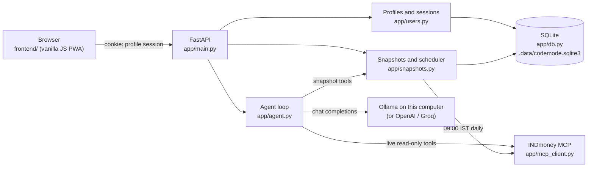
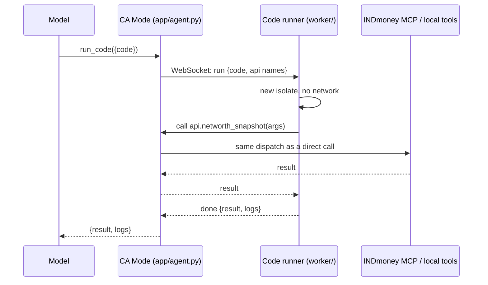

# CA Mode

CA Mode is a local finance assistant with two agents:

- **Finance Agent** answers general finance questions. It never sees your INDmoney account.
- **Portfolio Analyzer** answers questions about your INDmoney account. It reads a saved daily snapshot of your portfolio and calls INDmoney's read-only MCP tools for live data.

It runs its AI model on your computer through [Ollama](https://ollama.com), so your questions and portfolio data never leave it; OpenAI and Groq are optional. Several people can share one computer: each person has a PIN-protected profile with their own chats, INDmoney connection, and daily portfolio snapshots. Everything is stored in a local SQLite database.

## Features

- A profile per person (name + PIN), with a profile picker and a quick **Switch profile**.
- A privacy notice each profile accepts before use, a choice between saving history on this computer and a private mode that saves no chats or snapshots, plus data export and history clearing.
- Optional profile details (risk appetite, investment horizon, primary goal, monthly investment, age band) that Portfolio Analyzer uses as context.
- Savings goals (amount, currency, target date, earmarked savings, monthly contribution, notes) with projections calculated in code under your own return assumption, and a list of decisions you record. Either agent sees the ones your question is about; both can also call two read-only tools, `get_goal_plans` and `plan_goal_what_if` (a what-if is never saved), when you have a goal. Only Portfolio Analyzer sees the value of assigned holdings.
- A daily INDmoney portfolio snapshot at 09:00 IST, with net worth and a 30-day trend in the portfolio card.
- Chats you can return to, each tied to Finance Agent or Portfolio Analyzer.
- Read-only INDmoney access: net worth, allocation, holdings, SIPs, watchlists, stock and fund details, OHLC candles, option chains, and option Greeks.
- Charts (bar, donut, line, candlestick) when the data supports them, plus a call trace for every answer. Candlestick charts are drawn from INDmoney's OHLC data by the app; candles the model typed out are replaced.
- Light and dark themes, and an installable web app (PWA).

## How it works



**A chat request** (`POST /api/chat`):

1. The session cookie identifies the signed-in profile. Without one, the API returns `401` with `profileRequired`, and the app shows the profile picker.
2. A short AI call classifies the message as off-topic, a code request, a general finance question, or one that needs your account data. Off-topic and code requests are refused without calling the answer model. If that call fails or is rate-limited, offline keyword rules decide instead. The decision is the first step of the trace.
3. **Finance Agent** sends the conversation to the selected provider with no tools.
4. **Portfolio Analyzer** adds your profile details to the system prompt and always offers the snapshot tools; the live INDmoney tools are added when the question needs your account data:
   - **Snapshot tools** (`get_portfolio_snapshot`, `get_networth_history`) read today's saved snapshot and your net-worth history from SQLite.
   - **INDmoney tools** (the allowlisted read-only MCP tools below) fetch live data. When INDmoney's tool list was cached in the last 24 hours, the MCP session is opened only if the model actually calls one, so answers from the snapshot need no INDmoney MCP calls.
5. The answer is saved to the chat (the last 20 messages are kept) and returned as text, with the call trace in the `X-Agent-Trace` header.

**The daily snapshot:** a background task checks the clock every five minutes. For each profile connected to INDmoney whose last snapshot is older than today's 09:00 IST, it calls `networth_snapshot`, then `networth_holdings` once for each asset type the snapshot shows you hold (stocks, mutual funds, US stocks, EPF and so on), and stores one row per profile per day. Because it checks the wall clock, it catches up after the app starts or the laptop wakes. A failed attempt is retried at most once an hour.

Snapshots are SQLite rows, not vector-database chunks: net worth and holdings are exact numbers that need latest-value, date-range, and sorting queries, which similarity search cannot answer reliably.

## Requirements

- Docker Desktop, or Python 3.12 or newer
- [Ollama](https://ollama.com/download) and about 13 GB of disk and 16 GB of memory for the local model, or an OpenAI or Groq API key
- An INDmoney account to use Portfolio Analyzer

## Configure

Copy the example environment file. It uses the local model (see [Use the local model](#use-the-local-model)); add an OpenAI or Groq key only if you want a cloud model too:

```bash
cp .env.example .env
```

| Variable | Default | Purpose |
| --- | --- | --- |
| `OLLAMA_MODEL` | – | Enables the local model; `ca-mode` once built from `ollama/Modelfile` |
| `OLLAMA_BASE_URL` | `http://localhost:11434/v1` | Ollama's address (Docker Compose sets `host.docker.internal`) |
| `OLLAMA_TIMEOUT_SECONDS` | `300` | How long to wait for a local answer |
| `OPENAI_API_KEY` | – | Enables OpenAI |
| `OPENAI_MODEL` | `gpt-4o` | OpenAI model |
| `GROQ_API_KEY` | – | Enables Groq |
| `GROQ_MODEL` | `openai/gpt-oss-120b` | Groq model |
| `OPENAI_BASE_URL`, `GROQ_BASE_URL` | provider default | OpenAI-compatible endpoint override |
| `AI_PROVIDER` | `ollama` | Provider selected when the app opens (`ollama`, `openai` or `groq`) |
| `REQUEST_ROUTER` | `model` | How each message is classified before answering: `model` (an AI call) or `keywords` (offline rules) |
| `OLLAMA_ROUTER_MODEL`, `OPENAI_ROUTER_MODEL`, `GROQ_ROUTER_MODEL` | the chat model | Model for that classification; a smaller one is cheaper and faster |
| `GROQ_INPUT_TOKEN_BUDGET` | `5600` | Groq input budget; older chat history is dropped to fit |
| `GROQ_COMPLETION_TOKEN_LIMIT` | `1200` | Groq answer length limit |
| `MCP_SERVER_URL` | `https://mcp.indmoney.com/mcp` | INDmoney MCP endpoint |
| `APP_ORIGIN` | request host | Public address used for the INDmoney OAuth callback |
| `SNAPSHOT_TIME` | `09:00` | Daily snapshot time |
| `SNAPSHOT_TIMEZONE` | `Asia/Kolkata` | Time zone for `SNAPSHOT_TIME` |
| `SNAPSHOT_RETENTION_DAYS` | `365` | How long snapshots are kept |
| `SNAPSHOT_SCHEDULER_ENABLED` | `true` | Set to `false` to stop the background snapshot job |
| `INVESTIGATION_TOLERANCE_PCT` | `0.5` | Investigations: percentage part of the tolerance for two amounts to agree |
| `INVESTIGATION_TOLERANCE_INR` | `1` | Investigations: rupee floor of that tolerance |
| `INVESTIGATION_STALE_HOURS` | `36` | Investigations: age after which the latest snapshot is flagged as stale |
| `FUND_STALE_DAYS` | `5` | Fund figures: days after a scheme's NAV date before its returns are marked old |
| `APP_DATA_DIR` | `.data/` | Folder for the SQLite database |
| `BACKUP_DIR` | `~/ca-mode-backups` | Where daily database backups are written |
| `BACKUP_KEEP` | `14` | How many backups to keep |
| `BACKUP_ENABLED` | `true` | Set to `false` to stop daily backups |
| `APP_MASTER_KEY_FILE` | `~/.config/ca-mode/master.key` | File holding the key that encrypts stored INDmoney tokens (created on first start) |
| `APP_MASTER_KEY` | – | The key itself, instead of a file (a Fernet key) |
| `LOG_LEVEL` | `INFO` | Server log level |
| `PORT` | `8080` | Port inside the Docker container |

You can configure several providers and switch in the app. Provider keys stay in the server environment and are never sent to the browser. Leave `OPENAI_API_KEY` and `GROQ_API_KEY` empty to make sending data to an AI company impossible.

## Use the local model

CA Mode's local model is [gpt-oss-20b](https://huggingface.co/openai/gpt-oss-20b) (Apache 2.0), the smaller sibling of the `gpt-oss-120b` model used on Groq. Install [Ollama](https://ollama.com/download), then build the `ca-mode` model once:

```bash
ollama pull gpt-oss:20b                      # about 13 GB
ollama create ca-mode -f ollama/Modelfile    # same weights, with a 32k-token context window
```

Keep `OLLAMA_MODEL=ca-mode` in `.env`. The Modelfile matters: Ollama's default context window is 4,096 tokens on Macs with less GPU memory, and its OpenAI-compatible API silently drops the start of a longer prompt, including the instructions and your portfolio data. CA Mode checks the window of the loaded model and refuses to answer below 16,384 tokens.

The model loads on the first question (a few seconds) and stays in memory for five minutes. With Docker, Compose points the app at `host.docker.internal`; if the container cannot reach Ollama, start Ollama with `OLLAMA_HOST=0.0.0.0:11434`, which also makes it reachable from your network.

**How it was chosen.** Candidates had to run fully on the GPU of a 24 GB Mac (roughly 16–18 GB usable), which rules out the 27–35B models (Qwen3.8-27B, Qwen3.6-35B-A3B, GLM-4.7-Flash). Each remaining model was scored on this repo's two evals on an M5 Pro:

| Model (Ollama tag) | Memory at 32k context | Portfolio numbers (3 runs × 8) | Request routing (3 runs × 58) | Time per portfolio answer |
| --- | --- | --- | --- | --- |
| **`gpt-oss:20b`** | 12 GB | **23/24** | 88–93% | **~9 s** |
| `qwen3.5:9b` | 6.6 GB | 20/24 | **98.3%** | ~12 s |
| `qwen3:8b` | 9.8 GB | 21/24 | 96.6% (1 run) | ~30 s |

gpt-oss-20b gets the numbers right most often and answers fastest, which matters most for a finance assistant. The routing set has since grown to 64 cases (price-history and candlestick requests, and the concepts behind them); with the classifier call at temperature 0, gpt-oss-20b scores 60/64 on every run (59–61 at the model's default temperature, which once sent a candlestick request to the general-finance path). Its routing misses are mostly prompt-injection test cases sent to Finance Agent, which then declines anything that isn't finance, and a routing call that fails falls back to the keyword rules. On a Mac with 8–16 GB of memory, use `FROM qwen3.5:9b` in the Modelfile instead. `gemma4:26b` was shortlisted but not scored.

## Code mode (Cloudflare Worker)

By default the model calls each tool directly (one function call per INDmoney or local tool). With `TOOL_MODE=code` it gets a single `run_code` tool instead and writes a short JavaScript snippet against a typed `api` object, so one step can fetch several things and keep only the fields it needs:

```javascript
const snap = await api.networth_snapshot({});
const funds = await api.networth_holdings({ asset_type: "MF" });
return { total: snap.total_current_value, top: funds.holdings.slice(0, 3).map((h) => h.name) };
```

The snippet runs on the code runner in `worker/`, a Cloudflare Worker that starts a fresh [Dynamic Worker](https://developers.cloudflare.com/dynamic-workers/) isolate for each snippet with no network access (`globalOutbound: null`). Each `api.<tool>()` call goes back to CA Mode over a WebSocket that CA Mode opened, and CA Mode runs it exactly as a direct call: the same allowlist, argument checks, error kinds, trace steps, task contract and number check. So the INDmoney token and the MCP session never leave this computer, and no tunnel is needed. What passes through Cloudflare is the snippet, its arguments and the results it reads. That is why turning it on changes the privacy notice (policy `2026-10-20`).



**Deploy the runner** (needs a Cloudflare account with Dynamic Workers):

```bash
cd worker
npm install
npx wrangler secret put CODE_RUNNER_SECRET   # a long random string, e.g. openssl rand -hex 32
npx wrangler deploy
```

Then in `.env`:

```bash
TOOL_MODE=code
CODE_RUNNER_URL=https://ca-mode-code-runner.<your-subdomain>.workers.dev
CODE_RUNNER_SECRET=<the same secret>
```

To try it without deploying, put `CODE_RUNNER_SECRET=...` in `worker/.dev.vars`, run `npm run dev` in `worker/` (workerd runs Dynamic Workers locally) and set `CODE_RUNNER_URL=http://127.0.0.1:8787`.

**Limits and failures.** A snippet may make 12 `api` calls, may be 8,000 characters long, and runs for at most `CODE_RUNNER_TIMEOUT_SECONDS` (60). Its result is cut to 5,500 characters (Groq's tool-result limit). A failed call throws an `Error` naming the error kind and what to do next, so the code can catch it; code that throws or doesn't compile comes back to the model as a `rejected` error it can fix. If the runner can't be reached on the first snippet of an answer (wrong URL or secret, Cloudflare down), the answer is rerun with direct tool calls, with a `direct_tools_fallback` retry step in the trace. INDmoney rejecting the token stops the snippet and the answer, as in direct mode. The answer trace shows each snippet as a "Run the model's code" step, followed by the calls it made.

The runner's protocol is in `worker/src/bridge.ts` (unit tests: `cd worker && npm test`). Before making code mode the default, run the evals in both modes on the local model (see "Measuring the answers") and compare.

## Deploy on Cloudflare

`cloudflare/` runs the whole app on Cloudflare: a Worker named `camode` serves `frontend/` and sends every other request (`/api/*`, `/auth/*`, `/privacy`, ...) to one [Cloudflare Container](https://developers.cloudflare.com/containers/) running the FastAPI app. Container disks are erased on every restart, so [Litestream](https://litestream.io) restores SQLite from an R2 bucket when the container starts and streams every write back to it. A cron at 09:00 IST wakes the container for the daily snapshot.

It needs the **Workers Paid** plan ($5/month; with `SLEEP_AFTER=30m` a small team mostly stays inside its included container usage). Because unlocked PIN keys live in the app's memory, everyone enters their PIN again after the container sleeps or Cloudflare restarts it, and the first request after a sleep takes about 10 to 20 seconds.

```bash
cd cloudflare
npm install
npx wrangler login
npx wrangler r2 bucket create camode-db
# R2 → Manage API tokens: Object Read & Write, limited to camode-db. It gives the access key id and secret.
python3 -c "import base64, secrets; print(base64.urlsafe_b64encode(secrets.token_bytes(32)).decode())"   # master key: save it in a password manager
npx wrangler secret put APP_MASTER_KEY
npx wrangler secret put GROQ_API_KEY
npx wrangler secret put LITESTREAM_ENDPOINT          # https://<account-id>.r2.cloudflarestorage.com
npx wrangler secret put LITESTREAM_ACCESS_KEY_ID
npx wrangler secret put LITESTREAM_SECRET_ACCESS_KEY
npx wrangler deploy
```

Non-secret settings (`APP_ORIGIN`, `AI_PROVIDER`, `GROQ_MODEL`, `REQUEST_ROUTER`, `TOOL_MODE`, `SLEEP_AFTER`, `LITESTREAM_BUCKET`) are `vars` in `cloudflare/wrangler.jsonc`; `src/shell.ts` lists every setting passed into the container. Until the secrets are set, API requests return `503` with the list of missing settings instead of starting an app that would lose its writes.

**Before sharing the address,** turn on Cloudflare Access for it (Worker → Settings → Domains & Routes → `workers.dev` → enable Cloudflare Access, then limit the policy to your team's emails). The PIN is only a local lock and the sign-in screen lists every profile name. Also update the privacy notice: data is now stored in your Cloudflare account and answers go to Groq.

Losing the master key means every profile reconnects INDmoney; losing the R2 bucket loses all data. Locally, `npm run dev` builds and runs the container with Docker (put the secrets in `cloudflare/.dev.vars`, see `.dev.vars.example`), and `npm test` checks the Worker's routing helpers.

## Run with Docker

After configuring `.env`, build and start the app:

```bash
docker compose up --build -d
```

Open [http://localhost:8003](http://localhost:8003) and keep using this address for INDmoney sign-in (the OAuth callback is `http://localhost:8003/auth/indmoney/callback`). The database lives in `./.data` on your computer, and the snapshot job runs inside the container, so keep the container running for the daily 09:00 capture. The container also mounts `~/.config/ca-mode`, so it uses the same token encryption key as running with Python.

The image runs as a non-root user (uid 10001) with one uvicorn worker. Docker Desktop on a Mac lets it write to `./.data` as it is; on Linux, give uid 10001 the bind-mounted folders (`sudo chown -R 10001:10001 .data ~/.config/ca-mode ~/ca-mode-backups`), or use the team setup below.

```bash
docker compose logs -f   # view logs
docker compose down      # stop
```

## Run with Python

```bash
python3 -m venv .venv
source .venv/bin/activate
python -m pip install -r requirements.txt
uvicorn --env-file .env app.main:app --host 127.0.0.1 --port 8003
```

Run `uvicorn` from the activated virtual environment (or call `.venv/bin/uvicorn` directly). A globally installed `uvicorn`, such as Homebrew's, does not have the project's packages. The server does not reload code changes on its own: restart it after pulling an update.

Open [http://localhost:8003](http://localhost:8003) and keep using this address during INDmoney sign-in.

## Host it for a team

`docker-compose.prod.yml` runs CA Mode for a small team on one always-on Linux VM, reachable only through [Cloudflare Tunnel](https://developers.cloudflare.com/cloudflare-one/connections/connect-networks/) with [Cloudflare Access](https://developers.cloudflare.com/cloudflare-one/policies/access/) in front. It publishes no host ports: `cloudflared` connects out to Cloudflare and forwards requests to the app container.

**Constraints that shape the setup**

- **One instance, one worker.** Unlocked PIN keys, private-mode chats, per-profile locks and the snapshot scheduler live in the app process's memory. Run exactly one container with one uvicorn worker (the image does); never put two instances behind a load balancer, run `--scale`, or use a serverless or scale-to-zero platform. A restart is safe but locks everyone's history until they enter their PIN again.
- **Persistent disk.** SQLite (`/data`) and its daily backups (`/backups`) are bind mounts from the VM's persistent disk (`CA_MODE_DATA_DIR`, default `/srv/ca-mode/data`; `CA_MODE_BACKUP_DIR`, default `/srv/ca-mode/backups`). Don't use a network file system for `/data`: SQLite's WAL locking needs a local disk.
- **Always on.** The 09:00 IST snapshot job runs inside the app, so the VM must not sleep or stop overnight.
- **The master key stays outside the data.** It is mounted read-only from a root-only directory as a Compose secret (`CA_MODE_MASTER_KEY_FILE`, default `/etc/ca-mode/master.key`). It is never in `/data`, `/backups`, the image, or the off-site copies.
- **Cloudflare Access is the real authentication.** The PIN is only a local lock, and the sign-in screen lists every profile name, so nobody may reach the app without passing Access first.

**One-time VM setup** (Docker Engine with the Compose plugin):

```bash
sudo install -d -o 10001 -g 10001 -m 700 /srv/ca-mode/data /srv/ca-mode/backups
sudo install -d -o root -g root -m 700 /etc/ca-mode
docker build -t ca-mode:local .
docker run --rm --entrypoint python ca-mode:local -c "from cryptography.fernet import Fernet; print(Fernet.generate_key().decode())" | sudo tee /etc/ca-mode/master.key >/dev/null
sudo chown 10001:10001 /etc/ca-mode/master.key && sudo chmod 400 /etc/ca-mode/master.key
```

Keep a copy of the key in your team's password manager. Moving an existing database here? Copy its key file too (default `~/.config/ca-mode/master.key`), or every profile has to reconnect INDmoney.

**Cloudflare** (Zero Trust dashboard):

1. Create a tunnel (Networks → Tunnels, connector type `cloudflared`), copy its token, and add a public hostname, e.g. `ca-mode.example.com`, with service `http://app:8080`.
2. Create an Access self-hosted application for the same hostname, with Google as the identity provider and an Allow policy limited to your team's email domain. Keep the session short (e.g. 24 h).
3. Don't add any route that bypasses Access. `/healthz` is checked inside the container and needs no public route.

**Configure and start.** Fill in `.env` next to the compose file (see the "Team hosting" block in `.env.example`): `APP_ORIGIN=https://ca-mode.example.com` (INDmoney's OAuth callback goes to `APP_ORIGIN/auth/indmoney/callback`), `CLOUDFLARE_TUNNEL_TOKEN`, the model provider, and `CA_MODE_TAG` (e.g. the git commit) so each release is a distinct image tag you can roll back to (leave it out when you [deploy from GitHub](#deploy-from-github), which sets it).

```bash
docker compose -f docker-compose.prod.yml config -q   # fails early if APP_ORIGIN or the tunnel token is missing
docker compose -f docker-compose.prod.yml up --build -d
docker compose -f docker-compose.prod.yml ps          # app should be "healthy", cloudflared running
docker compose -f docker-compose.prod.yml logs -f app
```

The app container runs as uid 10001 with a read-only root file system, all Linux capabilities dropped, `no-new-privileges`, a 1 GB memory limit and a process limit. `docker compose stop` gives uvicorn 30 seconds to finish requests and stop the scheduler. To roll back, set `CA_MODE_TAG` to the previous tag and run `up -d` again; take a backup before each upgrade (`docker compose -f docker-compose.prod.yml exec app python -m scripts.backup now`), because the new release may migrate the database at startup, and restore it if you roll back across such a change. The backup CLI works inside the container (`docker compose -f docker-compose.prod.yml exec app python -m scripts.backup list`); stop the app before `restore` and run it with `docker compose -f docker-compose.prod.yml run --rm app python -m scripts.backup restore /backups/FILE`.

Before people start using it, update the privacy notice: it still says data stays "on this computer", which isn't true for a shared server (`NOTICE` in `app/privacy.py`; changing it needs a `POLICY_VERSION` bump so everyone accepts the new wording).

**Choosing the model.** A server usually has no GPU, so pick one of:

- **Groq** (`GROQ_API_KEY`, `GROQ_MODEL=openai/gpt-oss-120b`, `AI_PROVIDER=groq`) or **OpenAI** (`OPENAI_API_KEY`, `AI_PROVIDER=openai`). Messages and the portfolio data each answer reads are sent to that company. One key serves the whole team, so watch the provider's rate limits (`GROQ_INPUT_TOKEN_BUDGET` keeps each request small).
- **Ollama on a separate GPU VM**: build the `ca-mode` model there (see [Use the local model](#use-the-local-model)), then set `OLLAMA_MODEL=ca-mode`, `OLLAMA_BASE_URL=http://<gpu-vm-private-address>:11434/v1` and `AI_PROVIDER=ollama`. Ollama has no authentication: expose it only on a private network or VPN between the two VMs, never the internet. Leave the cloud keys empty to make sending data to an AI company impossible.

Whatever you pick, measure it before the team relies on it, from a checkout with the same `.env` values (the evals are not in the image):

```bash
set -a; source .env; set +a
python -m scripts.eval_router --provider groq              # or openai, ollama
python -m scripts.eval_tasks --provider groq --runs 3
```

Compare with the scores in [Use the local model](#use-the-local-model) and [Answer records and task checks](#answer-records-and-task-checks).

**Code mode (optional).** The code runner Worker in `worker/` is deployed separately to Cloudflare (see [Code mode](#code-mode-cloudflare-worker)); set `TOOL_MODE=code`, `CODE_RUNNER_URL` and `CODE_RUNNER_SECRET` in `.env`. The app opens the WebSocket to the Worker, so the Worker needs no route to the VM, and Cloudflare Access doesn't need to cover it (the Worker checks the shared secret).

**Off-site backups.** The daily backups in `/backups` hold the whole database. Chats, snapshots, goals and profile details in them are sealed with each profile's PIN, and INDmoney tokens are encrypted with the master key, which is never copied with them. To keep copies off the VM, enable the optional `backup-offsite` service: it runs `rclone copy` every 6 hours from `/backups` (mounted read-only; it never sees the master key) to an R2 or S3 bucket.

```bash
# In .env: OFFSITE_ENDPOINT=https://<account-id>.r2.cloudflarestorage.com, OFFSITE_BUCKET,
# OFFSITE_ACCESS_KEY_ID, OFFSITE_SECRET_ACCESS_KEY (an R2 token limited to that bucket)
docker compose -f docker-compose.prod.yml --profile offsite up -d
```

It uses `copy`, not `sync`, so pruning on the VM never deletes off-site copies: add a lifecycle rule on the bucket (e.g. delete after 30 days) instead. For S3, set `OFFSITE_PROVIDER=AWS`, `OFFSITE_REGION` and leave `OFFSITE_ENDPOINT` empty. To restore, download a file into `/srv/ca-mode/backups` and use `scripts.backup restore` as above, with the original master key in place.

[Litestream](https://litestream.io) is an alternative when losing up to a day of data is too much: it streams the WAL of `/data/codemode.sqlite3` to the bucket continuously. It needs write access to `/data` (run it as uid 10001 beside the app), and a Litestream restore replaces the database outside `scripts.backup`, so stop the app first. Keep the daily backups either way; they are the integrity-checked copies.

### Deploy from GitHub

`.github/workflows/deploy.yml` deploys each push to `main` (or a manual run from the Actions tab, on `main`) to the VM. It costs nothing on a public repository: it runs on GitHub's standard runners and builds on the VM. It runs the CI checks first, then connects over SSH, checks out that exact commit in the deploy checkout (`/srv/ca-mode/app`; it refuses a commit that is not on `main`) and runs `deploy/vm-deploy.sh` there, which:

1. backs up the running app (`scripts.backup now`; skipped on the first deploy, when nothing is running),
2. builds `ca-mode:<first 12 characters of the commit>` on the VM (arm64 on an Ampere VM; Actions builds nothing),
3. starts it with `up -d`, waits up to 5 minutes for the app to report healthy and checks that `cloudflared` is running; otherwise the job fails and prints the last 200 lines of the app's logs,
4. keeps the 5 newest `ca-mode` images for rollback and removes older ones.

The VM's `.env` and master key stay on the VM; the workflow never writes them. Only one deploy runs at a time: a push during a deploy waits, and of several waiting pushes only the newest is deployed. If `.env` sets `COMPOSE_PROFILES=offsite`, every deploy also keeps the off-site backup service running.

**One-time setup on the VM**, after the setup above. The deploy user is in the `docker` group, which is as powerful as root on this VM, so its key is used for nothing else:

```bash
sudo adduser --disabled-password --gecos "" deploy
sudo usermod -aG docker deploy
sudo install -d -o deploy -g deploy -m 750 /srv/ca-mode/app
sudo -u deploy git clone https://github.com/Nishaanth419/CAMode.git /srv/ca-mode/app
sudo install -o deploy -g deploy -m 600 .env /srv/ca-mode/app/.env   # the .env from "Configure and start"
```

Leave `CA_MODE_TAG` out of that `.env`: each deploy sets it to the commit. For commands you run by hand in `/srv/ca-mode/app`, set it first with `export CA_MODE_TAG=$(git rev-parse --short=12 HEAD)`, or Compose looks for (and builds) `ca-mode:local`.

Create a key pair for GitHub on your computer and allow it on the VM. `restrict` turns off port forwarding and terminals for this key:

```bash
ssh-keygen -t ed25519 -N "" -C "ca-mode-deploy" -f ca-mode-deploy
# Copy ca-mode-deploy.pub to the VM, then on the VM:
sudo install -d -o deploy -g deploy -m 700 /home/deploy/.ssh
echo "restrict $(cat ca-mode-deploy.pub)" | sudo -u deploy tee -a /home/deploy/.ssh/authorized_keys >/dev/null
```

GitHub's runners have no fixed addresses, so the VM's SSH port has to accept connections from the internet: keep password login off (`PasswordAuthentication no`, the default on Ubuntu cloud images).

Read the VM's host key on the VM itself (not over the network), with the address GitHub will connect to:

```bash
awk -v host=<vm-public-address> '{print host, $1, $2}' /etc/ssh/ssh_host_ed25519_key.pub
```

**GitHub settings.** Under Settings → Environments, create an environment named `production`:

- Deployment branches and tags: selected branches, `main` only.
- Required reviewers (optional): add yourself if each deploy should wait for your approval.
- Environment secrets: `DEPLOY_HOST` (the VM's public address, as in the host key line), `DEPLOY_USER` (`deploy`), `DEPLOY_SSH_KEY` (the whole private key file `ca-mode-deploy`), `DEPLOY_KNOWN_HOSTS` (the line printed by `awk` above). The workflow pins that host key and never turns host key checking off, so a reinstalled VM needs this secret updated.
- Environment variable `DEPLOY_DIR`, only if the deploy checkout is not `/srv/ca-mode/app`.

Then delete the private key from your computer. To deploy the code runner Worker as well (it needs Cloudflare Workers Paid, so it is off by default), set the repository variable `DEPLOY_CODE_RUNNER` to `true` (Settings → Secrets and variables → Actions → Variables) and add the environment secrets `CLOUDFLARE_API_TOKEN` (an API token from the "Edit Cloudflare Workers" template) and `CLOUDFLARE_ACCOUNT_ID`. The job runs `npm ci` and `npx wrangler deploy` in `worker/`; set `CODE_RUNNER_SECRET` once yourself with `npx wrangler secret put` (see [Code mode](#code-mode-cloudflare-worker)), and deploys keep it.

**Rolling back.** Re-run an older successful Deploy run (Actions → Deploy → the run → Re-run all jobs; GitHub allows re-runs for 30 days). It checks out that commit again, backs up, rebuilds (quickly, from cached layers) and waits for the app to be healthy. Without GitHub, on the VM:

```bash
cd /srv/ca-mode/app
docker image ls ca-mode                     # the kept releases, tagged by commit
git checkout --detach <commit>
CA_MODE_TAG=$(git rev-parse --short=12 HEAD) docker compose -f docker-compose.prod.yml up -d
```

This uses the kept image for that commit, or builds it if it was removed. If the newer release changed the database at startup, restore the backup taken before it (see "Configure and start" above). The next push to `main` deploys again; to pause deploys while you look into a problem, disable the Deploy workflow in the Actions tab.

## First run

1. **Create a profile.** The first screen asks "Who's using CA Mode?". Enter your name and a PIN of at least four characters. Other people on the same computer add their own profiles with **+ Add a profile**. You then see a **recovery code** once: write it down. It is the only way back into your saved history if you forget your PIN.
2. **Review the privacy notice.** It explains what is saved on this computer and what is sent to the AI provider. Choose **Save on this computer** (chats and daily snapshots, with a snapshot retention of 30 days to 1 year) or **Private mode**, then accept. You can't chat or connect INDmoney until you accept.
3. **Fill in your profile (optional).** Click your name at the bottom of the sidebar to set risk appetite, horizon, goal, monthly investment, and age band. Portfolio Analyzer uses these to relate its analysis to your goals; it is not personalised investment advice.
4. **Connect INDmoney.** Select **Connect**, sign in to INDmoney, and approve read-only access. The first snapshot is saved straight away, and the portfolio card shows your net worth.

## Use the agents

Choose **Finance Agent** for general topics such as budgeting, saving, tax basics, and how financial products work.

Choose **Portfolio Analyzer** for questions about your account and the market. It needs a connected INDmoney account. It uses these tools when INDmoney's MCP server offers them; anything else the server exposes is ignored:

| Tool | What it retrieves |
| --- | --- |
| `get_portfolio_snapshot` | Figures computed from the saved daily snapshot: totals, P&L, splits by asset type and broker, concentration, holdings (local) |
| `get_networth_history` | Daily net worth from saved snapshots, up to 365 days (local) |
| `networth_snapshot` | Live portfolio and net-worth summary |
| `networth_allocation_breakdown` | Breakdown for an asset class |
| `networth_holdings` | Holdings for an asset class |
| `lookup_ind_keys` | Resolve stock, index, derivative, and fund names to INDmoney identifiers |
| `get_indian_stocks_ohlc` | Historical OHLC candles for Indian stocks, indices, and derivatives |
| `get_indian_stocks_details` | Indian market prices, analyst data, and news |
| `get_indian_stocks_option_chain` | Option-chain strikes, premiums, open interest, and implied volatility |
| `get_indian_stocks_greeks_history` | Historical option Greeks and volatility measures |
| `user_watchlist` | Indian and US stock watchlists |
| `indian_stocks_sips` | Indian stock SIPs |
| `get_mf_by_category` | Mutual-fund category search and ranking |
| `get_mf_funds_details` | Mutual-fund profiles, returns, benchmarks, and allocations |
| `mf_sips` | Mutual fund SIPs |
| `get_us_stocks_details` | US market prices, analyst data, and news |
| `us_stocks_sips` | US stock SIPs |

For net worth, allocation, holdings, and trends it reads the saved snapshot first and says when it was captured. For live prices, SIPs, watchlists, options, or anything the snapshot lacks, it calls INDmoney live. All INDmoney tools are read-only: CA Mode cannot place trades, change SIPs, move money, or change account settings.

**What the AI model sees:** your messages and recent chat history; for Portfolio Analyzer, also your profile details and the snapshot or INDmoney data needed to answer. With the local model this stays on your computer; with OpenAI or Groq it is sent to that company.

## Daily portfolio snapshots

- Captured right after you connect INDmoney, then every day at 09:00 IST (before the 09:15 market open, so values reflect the previous close).
- The app must be running to capture. If it was closed or the computer was asleep at 09:00, it captures within five minutes of starting or waking.
- **Refresh snapshot now** in the portfolio card captures one on demand.
- Kept for the retention the profile chose (30, 90, 180, or 365 days; never longer than `SNAPSHOT_RETENTION_DAYS`). **Disconnect** deletes the profile's snapshots.
- Not captured for profiles in private mode or profiles that haven't accepted the current privacy notice.
- The net-worth total is read from INDmoney's `networth_snapshot` result. If it cannot be read, the trend line is hidden and the agent works from the raw snapshot text.

## Portfolio change investigations

Ask Portfolio Analyzer "Why did my portfolio change?" (or "What changed since 2026-09-01?"), or call `POST /api/investigations`. A fixed, read-only workflow in code, not the model, then:

1. Loads the latest saved snapshot and the comparable earlier one (the previous saved day, or the snapshot on or before the date you name). With no earlier snapshot it says there is not enough history; it never reports that as "no change".
2. Normalises both (`app/investigation_math.py`): totals, holdings identified by asset type, INDmoney code and broker, duplicates merged, changed codes matched by name, and missing values kept distinct from zero.
3. Calculates the changes in net worth, current value, invested amount and liabilities, each asset type, and each holding (split into the effect of price and of units held), plus asset-type shares of the latest total. Everything uses exact decimals.
4. Runs the consistency checks (`app/investigation_checks.py`): same account scope and currency, freshness, totals that add up, holdings that match INDmoney's per-type totals, holdings missing from one snapshot, which total each percentage is measured against, valid percentages, change arithmetic, and USD kept apart from INR. Each check reports `passed`, `warning`, `failed` or `not_checked` with its evidence. A finding is marked verified only when every check it depends on passed.
5. Saves the run (status, steps with timings, checks and result, sealed with your PIN; the last 50) and returns the findings with their snapshot ids, warnings, limitations and suggested follow-ups.

The answer shows an evidence card with the findings, the change by asset type, the allocation chart, the largest movers, the data checks, the calculations, the source snapshots and the steps. Runs have a 10-second step timeout and a 30-second deadline; a saved-snapshot read is retried once if the database is briefly locked. Investigations report what changed, not why: they never claim a cause such as market news.

### Activity and the answer trace

**Activity** in the sidebar (`#/activity`) lists the saved investigations (newest 50) with their status, start time, duration, outcome and where they came from, filtered by All, Running, Completed or Failed. Open one to see its evidence card and step timeline, open the chat that ran it, or run a failed or cancelled one again (it only reads saved snapshots, and it never reruns on its own). Nothing in CA Mode waits for approval, so there is no approval filter.

Under each answer, *How this answer was made* is a timeline of the request: how it was classified, each model call, and each tool with its arguments and a preview of its output, with durations and statuses. A step that never reported back shows as *Did not finish*, never as completed. Tokens, secrets, PINs and PAN numbers are masked before the trace is saved or shown.

Answers are not streamed: the trace arrives with the finished answer. Activity reloads from the server on every visit, when the tab regains focus or the network returns, and every few seconds while a run is in progress; an older response never overwrites a newer status. Streaming the agent's own events (`agent.stream_agent()` already yields them) over server-sent events would make the answer trace live.

### Measuring the answers

`evals/portfolio_change.jsonl` holds 10 versioned cases (`portfolio_change.v1`): a consistent pair with a clear change, no earlier snapshot, a different account scope, holdings that don't add up to INDmoney's totals, a stale snapshot, a tool timeout, an ambiguous question, a question that needs news, a request to trade, and a date before any saved history. Each case gets its own throwaway profile and database with snapshots from `tests/fixtures/snapshot_pairs.py`; the script first checks that the investigation itself returns the expected status and flagged checks, then asks the real agent. Live INDmoney tools are offered but return an error, so only the AI provider is called.

```bash
set -a; source .env; set +a
python -m scripts.eval_investigations --provider ollama --delay 0 --runs 3
python -m scripts.eval_investigations   # fixtures only, no model calls
```

Answers are graded in code, not on how convincing they read:

- **Tool selection**: `investigate_portfolio_change` is called when the case needs it; for the ambiguous question, a clarifying question also counts.
- **Arithmetic**: every amount and percentage matches a number a tool returned (the same matching as the warning under answers). A correct figure the model worked out itself still fails, because the prompt tells it to quote, not compute.
- **Unsupported claims**: no external cause (news, RBI, rates, sentiment…) given as the reason unless the result contains it, and no "mainly market gains" when the market-effect estimate is under half of the change.
- **Warning mentioned**: the flagged scope, reconciliation, staleness or timeout problem appears in the answer.
- **Insufficient-data honesty**: a missing comparison is described as missing, never as "no change".
- **Case instructions**: the trade request is declined without claiming a trade; the news question says the cause was not checked.

The script also prints latency and tool and model calls per case. The phrase rules are regular expressions, so check a surprising failure with `--verbose`. `--out answers.jsonl` saves each answer with its tool results, and `--regrade answers.jsonl` scores them again without the model. By default the request router uses keywords (`REQUEST_ROUTER=model` includes the classifier), and the second account scope is injected by the script, since the app has one scope today.

**Baseline** (`ca-mode`, gpt-oss-20b, 3 runs × 10 cases, M5 Pro, 2026-10-15):

| Metric | Score |
| --- | --- |
| Tool selection | 22/24 |
| Evidence (net-worth change, top mover) | 3/3 |
| Arithmetic | 21/30 |
| Answers with an unsupported claim | 1/30 |
| Warning mentioned | 10/12 |
| Insufficient-data honesty | 8/9 |
| Case instructions | 6/6 |
| **Cases passed** | **21/30** (6–9 per run) |
| Latency | p50 21 s, max 71 s; 1.2 tool and 2.2 model calls per case |

Most failures are the model's own arithmetic: lakh amounts written 100 times too large (₹8,10,00,000 for ₹8.1 lakh), a ₹79,000 fall reported as ₹790,000, and its own sums (the ₹25,000 gap behind a reconciliation warning). It also skipped the investigation for "check whether my holdings add up" in 2 of 3 runs, and it attributed a fund's rise to price when buying more units drove most of it. Exit status is 1 when a run passes fewer than `--min-pass` cases (default 6).

## Goals and saved context

The **Goals** page keeps up to 10 goals and 50 decisions, sealed with your PIN like your chats.

- **A goal** has a name, a target amount in INR, USD, EUR or GBP, a target date, the savings you have already earmarked, a planned monthly contribution, an optional yearly return you assume, and optional notes. Amounts are never converted or added across currencies.
- **Its plan** is calculated in code (`app/goal_planning.py`, `Decimal`) each time the goal is shown or a question needs it, and never stored: the gap still to save, progress, months left, and for each scenario the projected amount, the shortfall or surplus, and the monthly contribution that would reach the target (rounded up) and how much more that is than planned. The scenarios are no growth, and when you give an assumption, that return and 2 points either side of it. Contributions are made at the start of each month, returns compound monthly, and inflation is added to the target only when you give a rate. Missing details give "missing details" rather than guesses, and a goal with no months left says so.
- **Drafts and horizons.** A goal can be saved as a draft with only a name and finished later. The target can be a date or "in N years", which is converted to a date when you save. Types include financial independence and custom. Optional answers (can the date move, might you need the money early, comfort with ups and downs, how badly a fall would hurt, yearly inflation) feed the suitability check; any you leave out are assumed in the cautious direction and CA Mode asks for them instead of guessing.
- **More in the plan.** Total planned contributions; the target raised by inflation when you give a rate (read as today's money); whether the plan is covered with no growth, depends on your assumed return, or falls short; and, when it is not covered, ways to close the gap (raise the monthly amount, move the date, lower the target, or earmark a lump sum), each tagged "no growth" (plain arithmetic) or "at your X%" (an illustration under your assumption).
- **Which kinds of investment fit** (`app/goal_suitability.py`): fixed rules, not a model, rate six broad categories (liquid and overnight, short-duration debt, conservative hybrid, balanced and multi-asset, large/flexi/index equity, mid and small cap) as allowed, caution or unsuitable from the time to the target date, risk tolerance, capacity for loss, liquidity need and flexibility, and say why. Equity is unsuitable under 36 months, and a fixed goal with low capacity for loss rules out equity at any horizon. This is not advice.
- **Fund figures, dated and sourced, never ranked** (`app/fund_data.py`). "Show fund figures" on a goal card (and Portfolio Analyzer's `get_goal_fund_comparison` tool) fetches INDmoney's listing for each category the goal does not rule out: the largest schemes by assets, shown by name, with expense ratio, 1/3/5-year returns, risk level and benchmark. Every figure shows its source and date: returns are as of the scheme's NAV date, figures older than `FUND_STALE_DAYS` (5) are marked old, and the expense ratio, risk label and benchmark, which INDmoney gives without a date, are shown as undated with the time they were fetched. A missing figure says why (not given, a return of 0, which INDmoney also sends for "no figure", or a period longer than the scheme has existed); it is never shown as zero. Only INDmoney categories that clearly fit one of the six are compared (for example flexi-cap and Nifty 50 index funds count as large/flexi/index equity; aggressive hybrid, multi-cap, sector and credit-risk funds are not compared), and a scheme INDmoney files elsewhere is left out with the reason. INDmoney's ratings and ranks are dropped. Nothing is stored: figures are cached in memory for six hours. This is not advice. The response layout was recorded with `python -m scripts.inspect_indmoney_shapes --funds --labels`. Overlap between holdings needs scheme holdings and is still reported as not assessable.
- **Assign what you hold to goals.** On the Goals page, "Your investments and goals" lists the holdings in your latest snapshot. Give each holding's value to goals in whole percent (the total for a holding cannot pass 100%); each share is valued from the snapshot, rounded down, and counted once. "Earmarked savings" is money not held in assigned holdings. Holdings that are no longer in the snapshot are listed as value unknown and not counted. Rupee holdings count only toward rupee goals. This is bookkeeping: nothing is bought or sold.
- **Decisions** are short notes in your own words (for example "keep six months of expenses in a liquid fund"), optionally dated and linked to a goal.
- **What the assistant can use** on the Goals page lists your profile details, decisions, and the observed data (snapshot and CAS dates) with when each was saved. You can delete any item, or remove all goals, decisions and profile details at once. Chats, snapshots and statements stay.

Before each answer, `app/context.py` picks what bears on the question with fixed keyword rules (no model, no vector store). It picks goals named in the question, or all goals when it is about goals or saving for something, plus related decisions and, for risk or allocation questions, your profile details. The earlier turns count only when the question reads as a follow-up. The selection goes into the prompt as "Confirmed by the user" and "Calculated in code" sections, and the answer trace shows a **Use your saved goals and details** step naming each item. CA Mode never saves anything the assistant infers from a chat. Goals saved by earlier versions (inside the profile, with a target year) move to the new store the next time you enter your PIN, with the target date set to 31 December of that year.

## Holdings at other brokers (CAS)

INDmoney may not see every broker you use. A **Consolidated Account Statement (CAS)** does: NSDL and CDSL email one each month listing every demat account at every broker, plus mutual fund folios and NPS. CAMS and KFintech statements (mutual funds only) are also accepted.

1. Find the latest CAS email from NSDL or CDSL (or request one on their websites) and save the PDF.
2. In the **Other brokers** card on the right (shown on windows at least 1280px wide), choose the PDF, enter its password (usually your PAN in capital letters), and select **Upload statement**.
3. Ask Portfolio Analyzer, for example "Using my latest CAS statement, list my holdings grouped by broker".

The PDF is read in memory with [`casparser`](https://github.com/codereverser/casparser), offline. Only the holdings are kept (name, ISIN, broker, units, price, value, and cost where the statement gives one), sealed with your PIN like snapshots; the last 12 statements are kept. The PDF, its password, and your name, PAN, address, contact details, and DP/client IDs are never stored. CAS figures are as of the statement date, not live, and overlap INDmoney's, so the agent never adds the two together. Demat statements usually give no purchase cost for shares, so their P&L covers only holdings with a cost.

## How the numbers are computed

Portfolio figures are calculated in code (`app/portfolio_math.py`, exact decimal arithmetic), not by the AI model. The model receives finished figures and is told to quote them, never to add up or work out percentages itself:

- Net worth, current value, invested amount, and liabilities as INDmoney reports them.
- P&L only over holdings with a reported invested amount. Linked (non-INDmoney) brokers often report it as 0; those holdings are left out of P&L instead of showing a 100% gain, and the answer says so.
- Shares of the whole portfolio for each holding, asset type, asset class, and broker. INDmoney's own `holding_percent` is a share of one asset type only.
- Concentration: the largest holding and the top 5 and top 10 as a share of the portfolio.
- US stocks in INR and USD separately; USD is never added to INR totals.

After each Portfolio Analyzer answer, every amount and percentage in it is checked against the numbers the tools returned, allowing for rounding and lakh/crore. Figures that match nothing get a warning under the answer ("I couldn't match these figures to your INDmoney data"). The check is a safety net, not proof: a wrong figure that happens to equal another number in the data is not caught.

To measure this against your model with made-up portfolio data (about two model calls per question):

```bash
set -a; source .env; set +a
python -m scripts.eval_numbers --provider ollama --delay 0
python -m scripts.eval_numbers --provider groq --delay 70   # the delay keeps within Groq's free-tier limits
```

## Answer records and task checks

Every chat answer records its steps as events: how the request was routed, the task it was given, each model call (with prompt and completion tokens), each tool call and how it failed if it did (`invalid_arguments`, `rejected`, `unavailable`, `auth` or `failed`), every retry and why, the checks on the answer, and how it ended. The trace under an answer shows them, and when the profile saves history the full record is kept for Activity (`#/activity`, the newest 200, none older than 30 days, sealed with your PIN like your chats).

Each request gets a task contract from fixed rules, not the model: a declined request, general finance, a goal calculation (the calculator, or a clarifying question when inputs are missing) or account data (a snapshot, investigation, CAS or INDmoney tool). The finished answer is checked against it. Contracts only report; the one rule they enforce is that an account question is not satisfied by the goal calculator alone.

```bash
python -m scripts.eval_tasks                                   # 21 cases on scripted model replies, offline (also in the test suite)
python -m scripts.eval_tasks --provider ollama --runs 3        # the 8 live cases on the real model
```

The scripted cases check CA Mode's own handling: the contract and verdict, how the run ended, retries, and how each tool failure was classified (timeouts, empty replies, unknown tools, rejected and malformed arguments, INDmoney outages and expired tokens). The live cases grade the model's answers in code: contract met, every figure traced to a tool, the expected figures stated, a clarifying question when inputs are missing, no invented amounts, no rejected tool calls, and how many model calls it took.

**Live baseline** (`ca-mode`, gpt-oss-20b, 3 runs × 8 cases, 2026-10-17; the clarification check was widened after the run to accept "I'll need ..." without a question mark, and the saved answers were re-graded):

| Metric | Score |
| --- | --- |
| Contract met | 15/15 |
| Figures traced to a tool | 13/15 |
| Expected figures stated | 9/9 |
| Clarifying question when inputs are missing | 3/6 (a goal with no amount or date: 0/3) |
| No invented amounts (that same goal) | 2/3 |
| No rejected tool calls (goal calculator) | 5/6 |
| **Cases passed** | **18/24** |
| Latency | p50 8.6 s, max 57.8 s; 1.5 model and 0.6 tool calls, about 3,400 tokens per case |

## Local data and privacy

The full notice is also published at `/privacy` (linked from the sign-in screen and **Your data and privacy**), so it can be read before creating a profile. The app has no third-party analytics or tracking; the only outside requests the browser makes on its own are to Google Fonts and the Plotly CDN.

**Page-view counts.** For profiles that save history, the app adds one to a daily count per page opened (`page_views` table: date, page name, number; nothing about the profile, browser or IP). Counts are kept 90 days, never leave the computer, and are not part of exports or profile deletion because they are not linked to a profile. Read them with `python -m scripts.page_views` (`--days 7`, `--daily`); set `PAGE_VIEWS_ENABLED=false` to stop counting.

The SQLite database at `.data/codemode.sqlite3` holds profiles, chats, INDmoney OAuth tokens, and portfolio snapshots. Each profile sees only its own data.

- PINs are stored as salted scrypt hashes. Five wrong PINs or recovery codes lock the profile for five minutes.
- **Saved chats, snapshots, goals, decisions, and profile details are locked with your PIN.** Each profile has its own keypair (X25519, via PyNaCl). Its private key is stored only encrypted with a key derived from your PIN, and a second copy with one derived from your recovery code (scrypt N=2^17). The daily snapshot job seals new snapshots with the public key, so it needs no PIN. Reading anything back needs the PIN: nobody else on the computer, and nobody with the database and the master key, can read it.
- After the app restarts, each browser asks for the PIN again ("Welcome back"), because unlocked keys are kept only in memory.
- **Forgot your PIN?** on the unlock screen sets a new PIN with your recovery code and gives you a new code (the old one stops working). **New recovery code** under **Your data and privacy** replaces a lost code. If both the PIN and the recovery code are lost, the profile's saved history cannot be recovered.
- Profiles from before this version get their keys and a recovery code the next time they enter their PIN; their existing chats, snapshots, and profile details are encrypted at that point. Until then, new snapshots for them are saved unencrypted.
- INDmoney tokens, and the OAuth data held while you sign in to INDmoney, are encrypted (Fernet: AES-128 with HMAC-SHA256) with a master key stored outside the database, at `~/.config/ca-mode/master.key` by default. A copy of `.data/` alone does not reveal them. Existing plaintext tokens are encrypted the first time the app starts. If the key is lost or replaced, stored tokens can't be read: those profiles show as disconnected and need to reconnect INDmoney, and the log shows `stored_secrets_unreadable`.
- **Disconnect** revokes the INDmoney access token and deletes the profile's snapshots; its chats are kept.
- **Delete this profile** (in the profile dialog, confirmed with the PIN) removes the profile with its chats, snapshots, goals, decisions, and INDmoney connection.
- Chats expire 30 days after their last message; each profile keeps at most 50 chats.

**Consent and storage modes.** Each profile must accept the privacy notice before it can chat, connect INDmoney, or have snapshots captured. Every acceptance, including a later change of storage settings, is recorded in the `consents` table with the notice version and a timestamp. When the notice changes (`POLICY_VERSION` in `app/privacy.py`), every profile is asked again, and its snapshots pause until it accepts.

- **Save on this computer**: chats and daily snapshots are stored in SQLite as described above.
- **Private mode**: chats are kept only in server memory and disappear when you sign out or the app restarts. No snapshots are captured. Switching to private mode deletes the chats and snapshots already saved for the profile. INDmoney tokens, profile details, goals and decisions are still saved; **Disconnect** removes the tokens, and the Goals page removes the rest.

Under **Your data and privacy** in the profile dialog you can change these choices, read the notice, **Export my data** (a JSON file of your profile details, goals, decisions, consent history, chats, and snapshots, without your PIN hash or tokens; confirmed with your PIN), or **Clear saved chats and snapshots** while keeping the profile and INDmoney connection.

In both modes, your messages, recent chat history, the profile details, goals and decisions relevant to the question (with figures calculated from them), and any INDmoney data Portfolio Analyzer reads go to the AI model you select: they stay on this computer with the local model and are sent to OpenAI or Groq if you pick one of those.

The PIN is a local lock for people sharing one computer, not internet-grade authentication: a short numeric PIN can be brute-forced offline by someone who has a copy of the database, so use a longer PIN if that matters to you. Profile names, settings, dates, and consent records are not encrypted. Add real authentication before exposing CA Mode to a network, such as Cloudflare Access in [Host it for a team](#host-it-for-a-team).

Keep `.env`, `.data/`, and any database backups private; none of them should be committed to Git.

### Backups

While the app runs, it backs up the database once a day to `~/ca-mode-backups` (`BACKUP_DIR`) and keeps the last 14. **Back up now** under **Your data and privacy** makes one immediately. Backups use SQLite's online backup API, so they are consistent while the app is running, and each is checked with SQLite's integrity check before it is kept.

- Chats, snapshots, and profile details in a backup stay sealed with each profile's PIN, so the file is safe to copy to an external drive or cloud folder. Point `BACKUP_DIR` there for copies that survive losing this disk.
- The master key (`~/.config/ca-mode/master.key`) is never copied into backups, because keeping it beside the database would undo the token encryption. Losing it only means reconnecting INDmoney; keep a copy in a password manager if you want to avoid that.
- Keep your recovery code too: a restored profile unlocks with the PIN it had when the backup was made.

```bash
python -m scripts.backup list                 # backups, newest first
python -m scripts.backup verify FILE          # integrity check and row counts
python -m scripts.backup restore FILE         # stop the app first; the current database is moved aside, not deleted
```

### Upgrading from a version without profiles

The first start of the profiles version reorganises the database. Stop the server, back up the data folder, then start the new version:

```bash
cp -R .data .data-backup-$(date +%F)
```

Then create (or unlock) a profile **in the browser you used before**: that browser's existing chats and INDmoney connection move into the profile.

## API

| Method and path | Purpose |
| --- | --- |
| `GET /api/session` | Current profile, INDmoney status, and the list of profiles |
| `POST /api/users` | Create a profile and sign in |
| `POST /api/session/login`, `POST /api/session/logout` | Sign in to a profile with its PIN; sign out |
| `POST /api/session/unlock` | Unlock the signed-in profile's history after a restart (body: `{"pin": ...}`) |
| `POST /api/session/recover` | Set a new PIN with the recovery code and sign in (body: `{"userId", "recoveryCode", "newPin"}`); returns a new recovery code |
| `POST /api/users/me/recovery-code` | Replace the recovery code (body: `{"pin": ...}`) |
| `GET /api/profile`, `PUT /api/profile` | Read or update the profile details (with `updatedAt`) |
| `GET /api/goals`, `POST /api/goals` | List goals, each with its `plan`, `suitability`, `followUps` and `mapping`, plus `fundData` and `portfolio` totals; create one (`201` with `Location`; `409` at 10 goals) |
| `GET /api/goals/{id}`, `PUT /api/goals/{id}`, `DELETE /api/goals/{id}` | Read, replace, or delete a goal |
| `POST /api/goals/plan` | Calculate a plan without saving (body: `currency`, `targetAmount`, one of `targetDate` or `horizonYears`, `savedAmount`, `monthlyContribution`, optional `assumedReturnPct`, `inflationPct`, `flexibility`, `liquidityNeed`, `riskTolerance`, `lossCapacity` and `annualReturnPcts` with 1 to 4 returns between -20 and 30); the response adds `suitability` and `followUps` |
| `GET /api/goals/allocations`, `PUT /api/goals/allocations` | Every holding in the latest snapshot with its split across goals; replace one holding's split (`{"holdingKey", "goals": [{"goalId", "pct"}], "generalWealthPct"}`; `422` over 100% or for an unknown goal or holding, `409` without a snapshot) |
| `GET /api/decisions`, `POST /api/decisions`, `PUT /api/decisions/{id}`, `DELETE /api/decisions/{id}` | Recorded decisions (body: `{"text", "decidedOn"?, "goalId"?}`) |
| `GET /api/context`, `DELETE /api/context` | Everything the assistant may use, grouped as `confirmed`, `observed` and `inferred` (always empty); remove all goals, decisions and profile details |
| `DELETE /api/users/me` | Delete the signed-in profile (body: `{"pin": ...}`) |
| `GET /api/privacy` | Privacy notice, its version, whether it needs accepting, and the profile's storage settings |
| `POST /api/privacy/consent` | Accept the notice and set storage settings (body: `{"policyVersion", "storageMode": "device" \| "private", "snapshotRetentionDays": 30 \| 90 \| 180 \| 365}`) |
| `POST /api/users/me/export` | Download the profile's data as JSON (body: `{"pin": ...}`) |
| `DELETE /api/users/me/history` | Delete the profile's chats, answer runs, snapshots, investigations, and CAS holdings |
| `POST /api/investigations` | Investigate the change between the latest snapshot and an earlier one (body: `{"baselineDate": "YYYY-MM-DD"}`, optional); `201` with `Location` when the run was saved, `200` when it was not (private mode) |
| `GET /api/runs?limit=50`, `GET /api/runs/{id}`, `DELETE /api/runs/{id}` | List, read, or delete saved answer runs: the steps behind each chat answer (model and tool calls with token counts, retries, checks, the task contract's verdict and how the answer ended). `POST /api/chat` returns the run's id in `X-Agent-Run` |
| `GET /api/investigations?limit=20`, `GET /api/investigations/{id}`, `DELETE /api/investigations/{id}` | List, read, or delete saved investigations; list items carry `updatedAt`, `durationMs`, `trigger`, `baselineDate`, `chatId`, `period`, `error`, `findingCount` and `warningCount` |
| `GET /api/cas`, `POST /api/cas`, `DELETE /api/cas/{id}` | List, upload (body: `{"password", "pdfBase64"}`), or delete CAS statements |
| `GET /api/chats`, `POST /api/chats` | List or create chats |
| `GET /api/chats/{id}`, `DELETE /api/chats/{id}` | Read or delete a chat |
| `POST /api/chat` | Send a message; returns the answer as text and the trace in `X-Agent-Trace` |
| `GET /api/snapshots?days=30` | Latest snapshot summary and net-worth history |
| `POST /api/snapshots/refresh` | Capture a snapshot now |
| `GET /api/providers` | Configured AI providers |
| `GET /api/tools` | INDmoney tools available to the signed-in profile |
| `GET /auth/indmoney/connect`, `GET /auth/indmoney/callback`, `POST /auth/indmoney/disconnect` | INDmoney OAuth |
| `GET /healthz` | Health check |
| `POST /api/page-views` | Count one anonymous page view (body: `{"route"}`, an app page name); returns `{"counted"}`, `false` in private mode, without current consent, or when disabled |
| `GET /privacy` | Privacy policy page, rendered from the same notice profiles accept (no profile needed) |
| `GET /robots.txt`, `GET /sitemap.xml` | Crawler rules (`/api/` and `/auth/` disallowed) and a sitemap listing only `/privacy`; URLs use `APP_ORIGIN` |

Everything except `/healthz`, `/api/providers`, `/api/session`, the sign-up, sign-in, and sign-out routes, and the public pages (`/`, `/privacy`, `/robots.txt`, `/sitemap.xml`, static files) requires a signed-in profile. An unknown page returns an HTML 404 page; unknown `/api/` and `/auth/` paths keep the JSON `404 {"detail": "Not Found"}`. Creating chats, sending messages, saving goals and decisions, refreshing snapshots, listing tools, and connecting INDmoney also require the current privacy notice to be accepted; otherwise the API returns `403 {"consentRequired": true}`. Routes that read chats, snapshots, goals, decisions, or profile details return `403 {"unlockRequired": true}` until this browser session has entered the PIN. Profile creation, sign-in, and unlocking return `recoveryCode` when a new code was just created.

## Troubleshooting

- **"Could not sign in (HTTP 404)" or "(HTTP 405)"**: the server is running older code than the page. Restart it.
- **`ModuleNotFoundError: No module named 'httpx'`** when starting: you ran a global `uvicorn`. Activate `.venv` or run `.venv/bin/uvicorn`.
- **"Connect your INDmoney account"** in Portfolio Analyzer: the profile is not connected, or INDmoney expired the session. Select **Connect** again.
- **No net worth in the portfolio card**: no snapshot yet (select **Refresh snapshot now**), or the total could not be read from INDmoney's response. Check the server log for `snapshot_refresh_failed`.
- **"Too many incorrect attempts"**: wait five minutes and try again. Wrong PINs and wrong recovery codes count together.
- **Asked for your PIN after restarting**: expected. Your history is encrypted and the key is kept only in memory.
- **Everyone shows "Not connected" after moving the app or switching between Docker and Python**: the app is using a different master key from the one that encrypted the tokens (look for `stored_secrets_unreadable` in the log). Point `APP_MASTER_KEY_FILE` at the original key, or reconnect INDmoney.

## Development checks

```bash
python -m pip install -r requirements-dev.txt
python -m compileall -q app tests
for file in frontend/js/*.js; do node --check "$file"; done
python -m pytest -q
node --test tests/js/*.test.js   # finance math, tax rules, rail insights, trace and Activity rendering (Node 18+)
(cd worker && npm test)          # code runner protocol (Node 23.6+, runs the TypeScript directly)
```

The tests use mocked AI, INDmoney, and OAuth responses and a temporary database, so they make no live calls.

To measure request routing on the labelled questions in `evals/request_routing.jsonl` (this calls your AI provider once per question):

```bash
set -a; source .env; set +a
python -m scripts.eval_router --provider ollama   # or openai, groq; omit --provider to score only the keyword rules
```

GitHub Actions runs the compile, pytest, script syntax and frontend unit test checks on pushes and pull requests, and again before each deploy from `main` (see [Deploy from GitHub](#deploy-from-github)).

## Project structure

```text
app/
  main.py          FastAPI app: routes, INDmoney OAuth, and the snapshot scheduler lifespan
  db.py            SQLite connection, schema, and migrations
  users.py         Profiles, PIN sign-in, sessions, and per-profile INDmoney tokens
  privacy.py       Privacy notice, consent records, storage modes, export, and history clearing
  page_views.py    Anonymous local page-view counts
  public_pages.py  App shell with absolute Open Graph URLs, privacy policy and 404 pages, robots.txt, sitemap.xml
  chats.py         Chat storage: SQLite rows, or process memory in private mode
  snapshots.py     Daily snapshots, history, scheduler, and the agent's snapshot tools
  agent.py         Provider selection, request filtering, and the tool-calling agent loop
  agent_events.py  The recorded events of each answer, and the redaction applied to them
  agent_runs.py    Saved answer runs (sealed) for the Activity page
  tasks.py         Task contracts: what each kind of request must do, and the check on each answer
  tool_results.py  Tool failure kinds and the argument check before INDmoney calls
  code_runner.py   Code mode: the run_code tool, api declarations, and the WebSocket client for the Worker
  charts.py        Candlestick charts rebuilt from the OHLC tool result, never from the model's copy
  mcp_client.py    INDmoney MCP session, tool calls, and the read-only tool allowlist
  vault.py         Master key and encryption for stored INDmoney tokens
  backup.py        Daily database backups, verification, pruning, and restore
  cas.py           CAS statement parsing (holdings only) and sealed storage
  portfolio_math.py  Portfolio figures computed in code
  investigation_math.py    Normalised snapshots, change and allocation calculations
  investigation_checks.py  Consistency checks for comparing two snapshots
  investigations.py        The investigation workflow, its storage, and its agent tool
  number_check.py  Checks that answer figures match tool data
  sealing.py       Per-profile keypairs, PIN and recovery-code key wrapping, sealing
  unlock.py        Key setup, unlocking, recovery, and the in-memory unlocked sessions
  memory.py        Goals and recorded decisions the user confirmed, sealed per profile
  goal_planning.py Goal gap, required contribution, scenarios, feasibility and alternatives, in Decimal
  goal_suitability.py Fixed rules for which investment categories fit a goal
  fund_data.py     INDmoney fund figures for a goal's suitable categories, each with source and date
  goal_portfolio.py  Holdings assigned to goals, their valuation and the goal tools for the agents
  context.py       Picks the saved context relevant to a request and renders it for the prompt
frontend/
  index.html       App shell, profile picker, and profile dialog
  js/app.js        Chat UI, profiles, snapshot card, Markdown and Plotly charts
  js/trace.js      Answer trace timeline, investigation evidence card, Activity list helpers
  css/app.css      Styles and light/dark themes
  sw.js            Service worker (offline app shell)
tests/
  test_api.py        Routes, OAuth, chats, snapshot endpoints
  test_agent.py      Request filtering, agent loop, snapshot tools, lazy MCP, recorded events
  test_tasks.py      Task contracts, tool error kinds and argument checks, the event recorder
  test_agent_runs.py Saved answer runs: sealing, gates, deletion paths, export, pruning
  test_users.py      PINs, lockout, sessions, migration, profile isolation
  test_snapshots.py  Capture, schedule, history, retention
  test_privacy.py    Consent gate, storage modes, export, history clearing, retention choices
  test_page_views.py   Page-view counting, retention and gates
  test_public_pages.py Meta tags, privacy page, robots/sitemap, HTML vs JSON 404s, icons and manifest
  test_mcp_client.py MCP protocol handling and tool filtering
  test_code_runner.py  Code mode: the Worker protocol against a fake runner, fallback, auth, agent wiring
  test_vault.py      Master key handling, token encryption, startup migration
  test_unlock.py     PIN-locked history, restart locking, recovery codes, upgrading old profiles
  test_investigation_math.py, test_investigation_checks.py, test_investigations.py
                     Change maths, consistency checks, and the investigation API, storage and agent tool
  test_goal_planning.py, test_goal_suitability.py, test_goal_portfolio.py, test_memory.py, test_context.py
                     Goal maths, the goals/decisions/context API and its access rules, context selection
cloudflare/
  wrangler.jsonc   The camode Worker: frontend assets, one Container, the daily cron
  src/index.ts     Serves the app shell and forwards everything else to the container
  container/       Image for Cloudflare Containers (the app plus Litestream to R2) and its entrypoint
worker/
  src/index.ts     Code runner Worker: one Dynamic Worker isolate per snippet, api calls sent back over the WebSocket
  src/bridge.ts    The WebSocket protocol, call limits and the secret check (runs under node --test too)
  wrangler.jsonc   Worker config with the LOADER (Dynamic Workers) binding
.github/workflows/ GitHub Actions: ci.yml (checks) and deploy.yml (deploys main to the team VM)
deploy/vm-deploy.sh  Runs on the VM for each deploy: backup, build, start, health check
Dockerfile, docker-compose.yml  Container image and local Docker setup
```
