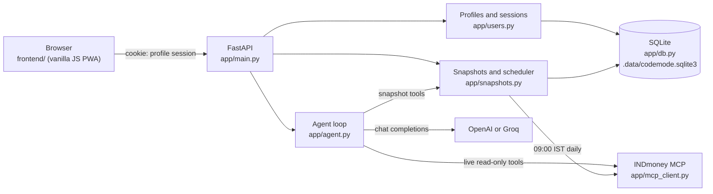

# CA Mode

CA Mode is a local finance assistant with two agents:

- **Finance Agent** answers general finance questions. It never sees your INDmoney account.
- **Portfolio Analyzer** answers questions about your INDmoney account. It reads a saved daily snapshot of your portfolio and calls INDmoney's read-only MCP tools for live data.

It supports OpenAI and Groq. Several people can share one computer: each person has a PIN-protected profile with their own chats, INDmoney connection, and daily portfolio snapshots. Everything is stored in a local SQLite database.

## Features

- A profile per person (name + PIN), with a profile picker and a quick **Switch profile**.
- A privacy notice each profile accepts before use, a choice between saving history on this computer and a private mode that saves no chats or snapshots, plus data export and history clearing.
- Optional profile details (risk appetite, investment horizon, primary goal, monthly investment, age band) that Portfolio Analyzer uses as context.
- A daily INDmoney portfolio snapshot at 09:00 IST, with net worth and a 30-day trend in the portfolio card.
- Chats you can return to, each tied to Finance Agent or Portfolio Analyzer.
- Read-only INDmoney access: net worth, allocation, holdings, SIPs, watchlists, stock and fund details, OHLC candles, option chains, and option Greeks.
- Charts (bar, donut, line, candlestick) when the data supports them, plus a call trace for every answer.
- Light and dark themes, and an installable web app (PWA).

## How it works



**A chat request** (`POST /api/chat`):

1. The session cookie identifies the signed-in profile. Without one, the API returns `401` with `profileRequired`, and the app shows the profile picker.
2. The agent checks the message is a finance question (code requests and off-topic messages are refused before any model call).
3. **Finance Agent** sends the conversation to the selected provider with no tools.
4. **Portfolio Analyzer** adds your profile details to the system prompt and offers two kinds of tools:
   - **Snapshot tools** (`get_portfolio_snapshot`, `get_networth_history`) read today's saved snapshot and your net-worth history from SQLite.
   - **INDmoney tools** (the allowlisted read-only MCP tools below) fetch live data. When INDmoney's tool list was cached in the last 24 hours, the MCP session is opened only if the model actually calls one, so answers from the snapshot need no INDmoney MCP calls.
5. The answer is saved to the chat (the last 20 messages are kept) and returned as text, with the call trace in the `X-Agent-Trace` header.

**The daily snapshot:** a background task checks the clock every five minutes. For each profile connected to INDmoney whose last snapshot is older than today's 09:00 IST, it calls `networth_snapshot`, `networth_allocation_breakdown`, and `networth_holdings` and stores one row per profile per day. Because it checks the wall clock, it catches up after the app starts or the laptop wakes. A failed attempt is retried at most once an hour.

Snapshots are SQLite rows, not vector-database chunks: net worth and holdings are exact numbers that need latest-value, date-range, and sorting queries, which similarity search cannot answer reliably.

## Requirements

- Docker Desktop, or Python 3.12 or newer
- An OpenAI or Groq API key
- An INDmoney account to use Portfolio Analyzer

## Configure

Copy the example environment file and add at least one provider key:

```bash
cp .env.example .env
```

| Variable | Default | Purpose |
| --- | --- | --- |
| `OPENAI_API_KEY` | – | Enables OpenAI |
| `OPENAI_MODEL` | `gpt-4o` | OpenAI model |
| `GROQ_API_KEY` | – | Enables Groq |
| `GROQ_MODEL` | `openai/gpt-oss-120b` | Groq model |
| `OPENAI_BASE_URL`, `GROQ_BASE_URL` | provider default | OpenAI-compatible endpoint override |
| `AI_PROVIDER` | `openai` | Provider selected when the app opens (`openai` or `groq`) |
| `GROQ_INPUT_TOKEN_BUDGET` | `5600` | Groq input budget; older chat history is dropped to fit |
| `GROQ_COMPLETION_TOKEN_LIMIT` | `1200` | Groq answer length limit |
| `MCP_SERVER_URL` | `https://mcp.indmoney.com/mcp` | INDmoney MCP endpoint |
| `APP_ORIGIN` | request host | Public address used for the INDmoney OAuth callback |
| `SNAPSHOT_TIME` | `09:00` | Daily snapshot time |
| `SNAPSHOT_TIMEZONE` | `Asia/Kolkata` | Time zone for `SNAPSHOT_TIME` |
| `SNAPSHOT_RETENTION_DAYS` | `365` | How long snapshots are kept |
| `SNAPSHOT_SCHEDULER_ENABLED` | `true` | Set to `false` to stop the background snapshot job |
| `APP_DATA_DIR` | `.data/` | Folder for the SQLite database |
| `APP_MASTER_KEY_FILE` | `~/.config/ca-mode/master.key` | File holding the key that encrypts stored INDmoney tokens (created on first start) |
| `APP_MASTER_KEY` | – | The key itself, instead of a file (a Fernet key) |
| `LOG_LEVEL` | `INFO` | Server log level |
| `PORT` | `8080` | Port inside the Docker container |

You can add both provider keys and switch providers in the app. Provider keys stay in the server environment and are never sent to the browser.

## Run with Docker

After configuring `.env`, build and start the app:

```bash
docker compose up --build -d
```

Open [http://localhost:8003](http://localhost:8003) and keep using this address for INDmoney sign-in (the OAuth callback is `http://localhost:8003/auth/indmoney/callback`). The database lives in `./.data` on your computer, and the snapshot job runs inside the container, so keep the container running for the daily 09:00 capture. The container also mounts `~/.config/ca-mode`, so it uses the same token encryption key as running with Python.

```bash
docker compose logs -f   # view logs
docker compose down      # stop
```

## Run with Python

```bash
python3 -m venv .venv
source .venv/bin/activate
python -m pip install -r requirements.txt
uvicorn --env-file .env app.main:app --host 127.0.0.1 --port 8003
```

Run `uvicorn` from the activated virtual environment (or call `.venv/bin/uvicorn` directly). A globally installed `uvicorn`, such as Homebrew's, does not have the project's packages. The server does not reload code changes on its own: restart it after pulling an update.

Open [http://localhost:8003](http://localhost:8003) and keep using this address during INDmoney sign-in.

## First run

1. **Create a profile.** The first screen asks "Who's using CA Mode?". Enter your name and a PIN of at least four characters. Other people on the same computer add their own profiles with **+ Add a profile**. You then see a **recovery code** once: write it down. It is the only way back into your saved history if you forget your PIN.
2. **Review the privacy notice.** It explains what is saved on this computer and what is sent to the AI provider. Choose **Save on this computer** (chats and daily snapshots, with a snapshot retention of 30 days to 1 year) or **Private mode**, then accept. You can't chat or connect INDmoney until you accept.
3. **Fill in your profile (optional).** Click your name at the bottom of the sidebar to set risk appetite, horizon, goal, monthly investment, and age band. Portfolio Analyzer uses these to relate its analysis to your goals; it is not personalised investment advice.
4. **Connect INDmoney.** Select **Connect**, sign in to INDmoney, and approve read-only access. The first snapshot is saved straight away, and the portfolio card shows your net worth.

## Use the agents

Choose **Finance Agent** for general topics such as budgeting, saving, tax basics, and how financial products work.

Choose **Portfolio Analyzer** for questions about your account and the market. It needs a connected INDmoney account. It uses these tools when INDmoney's MCP server offers them; anything else the server exposes is ignored:

| Tool | What it retrieves |
| --- | --- |
| `get_portfolio_snapshot` | Saved daily snapshot: net worth, allocation, and holdings (local) |
| `get_networth_history` | Daily net worth from saved snapshots, up to 365 days (local) |
| `networth_snapshot` | Live portfolio and net-worth summary |
| `networth_allocation_breakdown` | Breakdown for an asset class |
| `networth_holdings` | Holdings for an asset class |
| `lookup_ind_keys` | Resolve stock, index, derivative, and fund names to INDmoney identifiers |
| `get_indian_stocks_ohlc` | Historical OHLC candles for Indian stocks, indices, and derivatives |
| `get_indian_stocks_details` | Indian market prices, analyst data, and news |
| `get_indian_stocks_option_chain` | Option-chain strikes, premiums, open interest, and implied volatility |
| `get_indian_stocks_greeks_history` | Historical option Greeks and volatility measures |
| `user_watchlist` | Indian and US stock watchlists |
| `indian_stocks_sips` | Indian stock SIPs |
| `get_mf_by_category` | Mutual-fund category search and ranking |
| `get_mf_funds_details` | Mutual-fund profiles, returns, benchmarks, and allocations |
| `mf_sips` | Mutual fund SIPs |
| `get_us_stocks_details` | US market prices, analyst data, and news |
| `us_stocks_sips` | US stock SIPs |

For net worth, allocation, holdings, and trends it reads the saved snapshot first and says when it was captured. For live prices, SIPs, watchlists, options, or anything the snapshot lacks, it calls INDmoney live. All INDmoney tools are read-only: CA Mode cannot place trades, change SIPs, move money, or change account settings.

**What is sent to the AI provider:** your messages and recent chat history; for Portfolio Analyzer, also your profile details and the snapshot or INDmoney data needed to answer.

## Daily portfolio snapshots

- Captured right after you connect INDmoney, then every day at 09:00 IST (before the 09:15 market open, so values reflect the previous close).
- The app must be running to capture. If it was closed or the computer was asleep at 09:00, it captures within five minutes of starting or waking.
- **Refresh snapshot now** in the portfolio card captures one on demand.
- Kept for the retention the profile chose (30, 90, 180, or 365 days; never longer than `SNAPSHOT_RETENTION_DAYS`). **Disconnect** deletes the profile's snapshots.
- Not captured for profiles in private mode or profiles that haven't accepted the current privacy notice.
- The net-worth total is read from INDmoney's `networth_snapshot` result. If it cannot be read, the trend line is hidden and the agent works from the raw snapshot text.

## Local data and privacy

The SQLite database at `.data/codemode.sqlite3` holds profiles, chats, INDmoney OAuth tokens, and portfolio snapshots. Each profile sees only its own data.

- PINs are stored as salted scrypt hashes. Five wrong PINs or recovery codes lock the profile for five minutes.
- **Saved chats, snapshots, and profile details are locked with your PIN.** Each profile has its own keypair (X25519, via PyNaCl). Its private key is stored only encrypted with a key derived from your PIN, and a second copy with one derived from your recovery code (scrypt N=2^17). The daily snapshot job seals new snapshots with the public key, so it needs no PIN. Reading anything back needs the PIN: nobody else on the computer, and nobody with the database and the master key, can read it.
- After the app restarts, each browser asks for the PIN again ("Welcome back"), because unlocked keys are kept only in memory.
- **Forgot your PIN?** on the unlock screen sets a new PIN with your recovery code and gives you a new code (the old one stops working). **New recovery code** under **Your data and privacy** replaces a lost code. If both the PIN and the recovery code are lost, the profile's saved history cannot be recovered.
- Profiles from before this version get their keys and a recovery code the next time they enter their PIN; their existing chats, snapshots, and profile details are encrypted at that point. Until then, new snapshots for them are saved unencrypted.
- INDmoney tokens, and the OAuth data held while you sign in to INDmoney, are encrypted (Fernet: AES-128 with HMAC-SHA256) with a master key stored outside the database, at `~/.config/ca-mode/master.key` by default. A copy of `.data/` alone does not reveal them. Existing plaintext tokens are encrypted the first time the app starts. If the key is lost or replaced, stored tokens can't be read: those profiles show as disconnected and need to reconnect INDmoney, and the log shows `stored_secrets_unreadable`.
- **Disconnect** revokes the INDmoney access token and deletes the profile's snapshots; its chats are kept.
- **Delete this profile** (in the profile dialog, confirmed with the PIN) removes the profile with its chats, snapshots, and INDmoney connection.
- Chats expire 30 days after their last message; each profile keeps at most 50 chats.

**Consent and storage modes.** Each profile must accept the privacy notice before it can chat, connect INDmoney, or have snapshots captured. Every acceptance, including a later change of storage settings, is recorded in the `consents` table with the notice version and a timestamp. When the notice changes (`POLICY_VERSION` in `app/privacy.py`), every profile is asked again, and its snapshots pause until it accepts.

- **Save on this computer**: chats and daily snapshots are stored in SQLite as described above.
- **Private mode**: chats are kept only in server memory and disappear when you sign out or the app restarts. No snapshots are captured. Switching to private mode deletes the chats and snapshots already saved for the profile. INDmoney tokens are still saved so the connection survives; **Disconnect** removes them.

Under **Your data and privacy** in the profile dialog you can change these choices, read the notice, **Export my data** (a JSON file of your profile details, consent history, chats, and snapshots, without your PIN hash or tokens; confirmed with your PIN), or **Clear saved chats and snapshots** while keeping the profile and INDmoney connection.

In both modes, your messages, recent chat history, profile details, and any INDmoney data Portfolio Analyzer reads are sent to the AI provider you select.

The PIN is a local lock for people sharing one computer, not internet-grade authentication: a short numeric PIN can be brute-forced offline by someone who has a copy of the database, so use a longer PIN if that matters to you. Profile names, settings, dates, and consent records are not encrypted. Add real authentication before exposing CA Mode to a network.

Keep `.env`, `.data/`, and any database backups private; none of them should be committed to Git.

### Upgrading from a version without profiles

The first start of the profiles version reorganises the database. Stop the server, back up the data folder, then start the new version:

```bash
cp -R .data .data-backup-$(date +%F)
```

Then create (or unlock) a profile **in the browser you used before**: that browser's existing chats and INDmoney connection move into the profile.

## API

| Method and path | Purpose |
| --- | --- |
| `GET /api/session` | Current profile, INDmoney status, and the list of profiles |
| `POST /api/users` | Create a profile and sign in |
| `POST /api/session/login`, `POST /api/session/logout` | Sign in to a profile with its PIN; sign out |
| `POST /api/session/unlock` | Unlock the signed-in profile's history after a restart (body: `{"pin": ...}`) |
| `POST /api/session/recover` | Set a new PIN with the recovery code and sign in (body: `{"userId", "recoveryCode", "newPin"}`); returns a new recovery code |
| `POST /api/users/me/recovery-code` | Replace the recovery code (body: `{"pin": ...}`) |
| `GET /api/profile`, `PUT /api/profile` | Read or update the profile details |
| `DELETE /api/users/me` | Delete the signed-in profile (body: `{"pin": ...}`) |
| `GET /api/privacy` | Privacy notice, its version, whether it needs accepting, and the profile's storage settings |
| `POST /api/privacy/consent` | Accept the notice and set storage settings (body: `{"policyVersion", "storageMode": "device" \| "private", "snapshotRetentionDays": 30 \| 90 \| 180 \| 365}`) |
| `POST /api/users/me/export` | Download the profile's data as JSON (body: `{"pin": ...}`) |
| `DELETE /api/users/me/history` | Delete the profile's chats and snapshots |
| `GET /api/chats`, `POST /api/chats` | List or create chats |
| `GET /api/chats/{id}`, `DELETE /api/chats/{id}` | Read or delete a chat |
| `POST /api/chat` | Send a message; returns the answer as text and the trace in `X-Agent-Trace` |
| `GET /api/snapshots?days=30` | Latest snapshot summary and net-worth history |
| `POST /api/snapshots/refresh` | Capture a snapshot now |
| `GET /api/providers` | Configured AI providers |
| `GET /api/tools` | INDmoney tools available to the signed-in profile |
| `GET /auth/indmoney/connect`, `GET /auth/indmoney/callback`, `POST /auth/indmoney/disconnect` | INDmoney OAuth |
| `GET /healthz` | Health check |

Everything except `/healthz`, `/api/providers`, `/api/session`, and the sign-up, sign-in, and sign-out routes requires a signed-in profile. Creating chats, sending messages, refreshing snapshots, listing tools, and connecting INDmoney also require the current privacy notice to be accepted; otherwise the API returns `403 {"consentRequired": true}`. Routes that read chats, snapshots, or profile details return `403 {"unlockRequired": true}` until this browser session has entered the PIN. Profile creation, sign-in, and unlocking return `recoveryCode` when a new code was just created.

## Troubleshooting

- **"Could not sign in (HTTP 404)" or "(HTTP 405)"**: the server is running older code than the page. Restart it.
- **`ModuleNotFoundError: No module named 'httpx'`** when starting: you ran a global `uvicorn`. Activate `.venv` or run `.venv/bin/uvicorn`.
- **"Connect your INDmoney account"** in Portfolio Analyzer: the profile is not connected, or INDmoney expired the session. Select **Connect** again.
- **No net worth in the portfolio card**: no snapshot yet (select **Refresh snapshot now**), or the total could not be read from INDmoney's response. Check the server log for `snapshot_refresh_failed`.
- **"Too many incorrect attempts"**: wait five minutes and try again. Wrong PINs and wrong recovery codes count together.
- **Asked for your PIN after restarting**: expected. Your history is encrypted and the key is kept only in memory.
- **Everyone shows "Not connected" after moving the app or switching between Docker and Python**: the app is using a different master key from the one that encrypted the tokens (look for `stored_secrets_unreadable` in the log). Point `APP_MASTER_KEY_FILE` at the original key, or reconnect INDmoney.

## Development checks

```bash
python -m pip install -r requirements-dev.txt
python -m compileall -q app tests
node --check frontend/js/app.js
python -m pytest -q
```

The tests use mocked AI, INDmoney, and OAuth responses and a temporary database, so they make no live calls. GitHub Actions runs the compile and pytest checks on pushes and pull requests.

## Project structure

```text
app/
  main.py          FastAPI app: routes, INDmoney OAuth, and the snapshot scheduler lifespan
  db.py            SQLite connection, schema, and migrations
  users.py         Profiles, PIN sign-in, sessions, and per-profile INDmoney tokens
  privacy.py       Privacy notice, consent records, storage modes, export, and history clearing
  chats.py         Chat storage: SQLite rows, or process memory in private mode
  snapshots.py     Daily snapshots, history, scheduler, and the agent's snapshot tools
  agent.py         Provider selection, request filtering, and the tool-calling agent loop
  mcp_client.py    INDmoney MCP session, tool calls, and the read-only tool allowlist
  vault.py         Master key and encryption for stored INDmoney tokens
  sealing.py       Per-profile keypairs, PIN and recovery-code key wrapping, sealing
  unlock.py        Key setup, unlocking, recovery, and the in-memory unlocked sessions
frontend/
  index.html       App shell, profile picker, and profile dialog
  js/app.js        Chat UI, profiles, snapshot card, Markdown and Plotly charts
  css/app.css      Styles and light/dark themes
  sw.js            Service worker (offline app shell)
tests/
  test_api.py        Routes, OAuth, chats, snapshot endpoints
  test_agent.py      Request filtering, agent loop, snapshot tools, lazy MCP
  test_users.py      PINs, lockout, sessions, migration, profile isolation
  test_snapshots.py  Capture, schedule, history, retention
  test_privacy.py    Consent gate, storage modes, export, history clearing, retention choices
  test_mcp_client.py MCP protocol handling and tool filtering
  test_vault.py      Master key handling, token encryption, startup migration
  test_unlock.py     PIN-locked history, restart locking, recovery codes, upgrading old profiles
.github/workflows/ GitHub Actions CI
Dockerfile, docker-compose.yml  Container image and local Docker setup
```
