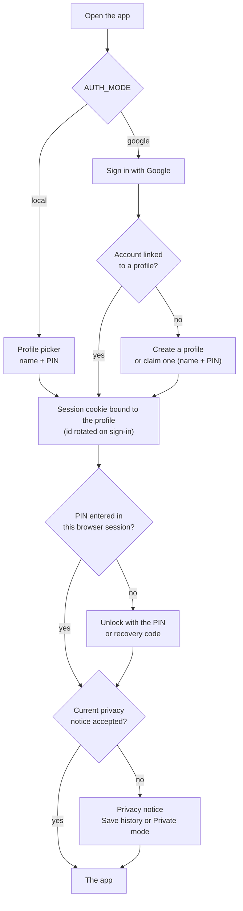
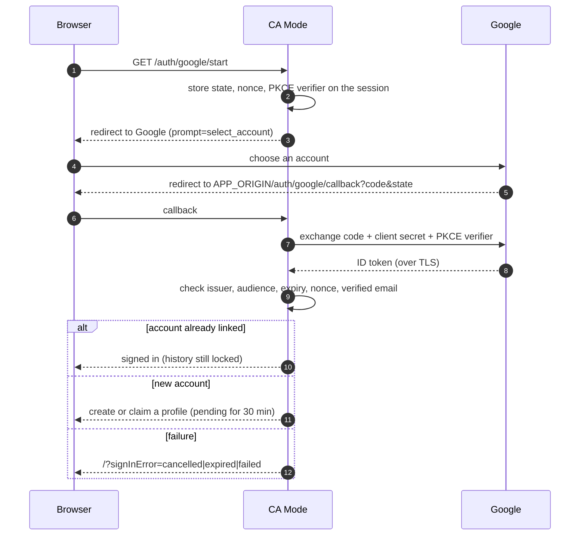
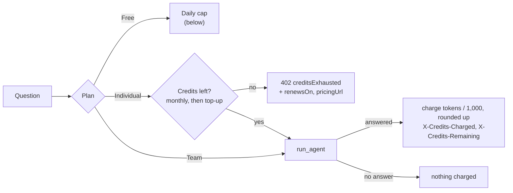
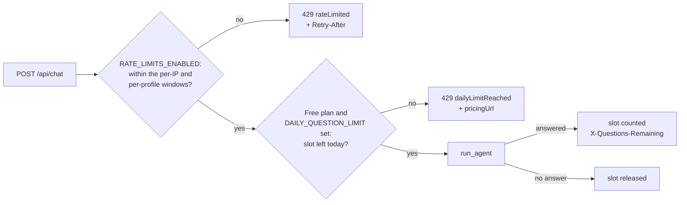

# Accounts, admin, plans and limits

[← Back to the README](../README.md)

- [Profiles and PINs](#profiles-and-pins)
- [Open it to other people: Google sign-in](#open-it-to-other-people-google-sign-in)
- [Admin page](#admin-page)
- [Plans and pricing](#plans-and-pricing)
- [Limits for a shared copy](#limits-for-a-shared-copy)

## Profiles and PINs



Each person has a profile that owns its chats, INDmoney connection, profile fields, goals and portfolio snapshots. PINs are scrypt hashes; five wrong PINs or recovery codes lock the profile for five minutes (checked and recorded in one `BEGIN IMMEDIATE` transaction, so concurrent guesses cannot bypass it). The PIN also unlocks the profile's sealed history; see [Privacy and data](privacy-and-data.md).

## Open it to other people: Google sign-in

The profile picker suits one shared computer: anyone at the screen sees every profile name and can try PINs. Where other people can reach CA Mode, set `AUTH_MODE=google` instead. Each person then signs in with their own Google account, which is linked to exactly one profile, and nobody is ever shown a list of profiles. Signing in only says who the person is: their history stays sealed until they enter their PIN, exactly as before (the PIN and recovery code are unchanged).

1. In the [Google Cloud console](https://console.cloud.google.com/apis/credentials), create an **OAuth client ID** of type **Web application**. Add `https://your.domain/auth/google/callback` (your `APP_ORIGIN` followed by `/auth/google/callback`) as an authorised redirect URI. The OAuth consent screen needs only the `openid`, `email` and `profile` scopes.
2. Set these in `.env` and restart the app:

   ```bash
   AUTH_MODE=google
   GOOGLE_CLIENT_ID=1234-abc.apps.googleusercontent.com
   GOOGLE_CLIENT_SECRET=...
   APP_ORIGIN=https://your.domain
   ```

   The app refuses to start with `AUTH_MODE=google` and no client ID or secret. Serve it over HTTPS so the session cookie is marked `Secure`.
3. **First sign-in.** A Google account with no profile chooses a profile name and PIN (names may repeat between people) and gets its recovery code, then accepts the privacy notice. A person who already had a profile on the shared computer selects **Claim that profile** and types that profile's name and PIN; from then on it signs in with that Google account. A profile can be claimed once. Unknown names, claimed profiles and wrong PINs get the same answer, and wrong PINs count towards the profile's five-attempt lockout.
4. **Returning.** **Sign in with Google**, then the PIN unlocks the history. **Sign out** replaces **Switch profile**.



How it works:

- The app uses OpenID Connect's authorization code flow with PKCE, a `state` tied to the browser session and a `nonce`, and asks Google to show the account chooser. The ID token comes straight from Google's token endpoint in exchange for the code and the client secret, so its issuer, audience, expiry and nonce are checked rather than its signature. Only accounts with a verified email address are accepted.
- The `accounts` table links Google's account ID to the profile and keeps the email address (encrypted with the master key, like INDmoney tokens) to show who is signed in; the Google name is only used to suggest a profile name. The link is in the export and is deleted with the profile. The session id rotates on every sign-in.
- Sessions from the profile picker do not carry over: a profile is reached only through its linked Google account.
- `ALLOW_PROFILE_CLAIMS=false` turns claiming off. Do this once everyone has claimed their profile, because an unclaimed profile can otherwise be claimed by any Google account that guesses its name and PIN (five guesses every five minutes).
- Leave `AUTH_MODE` unset (or `local`) on a single computer: nothing changes there. Profiles created with Google sign-in still appear in the picker if you switch back to local mode.

## Admin page

`/admin` is for whoever runs the copy: every profile with its name, Google email address, plan, questions asked today, credits left this month on the Individual plan (with top-ups and the renewal day), when it joined and was last seen, whether it accepted the current privacy notice, whether INDmoney is connected (and whether the last snapshot failed), and whether its PIN is locked. From it you can change a plan, clear a PIN lock, sign a profile out on every device, delete a profile (type its name to confirm), and back up the database now. It also shows backup status and the last 7 days of anonymous page views.

It never shows PIN-locked history: chats, goals, decisions, profile details and snapshot contents stay sealed, and no admin route opens them.

1. Use a Google OAuth web client (the same one as [Google sign-in](#open-it-to-other-people-google-sign-in), with `APP_ORIGIN/auth/google/callback` as the redirect URI). Admin sign-in works in either `AUTH_MODE`.
2. List the admins and restart:

   ```bash
   ADMIN_EMAILS=you@example.com,partner@example.com
   GOOGLE_CLIENT_ID=1234-abc.apps.googleusercontent.com
   GOOGLE_CLIENT_SECRET=...
   ```

   The app refuses to start with `ADMIN_EMAILS` set and no Google client.
3. Open `https://your.domain/admin` and choose **Sign in with Google**.

How it works:

- Without `ADMIN_EMAILS`, every admin path is a 404.
- Admin sign-in has its own cookie (`ca_admin`, 8 hours) and session row, never bound to a profile. Being an admin opens no profile, and signing in to a profile, even with the same Google account, gives no admin access. The shared `/auth/google/callback` tells the two apart by `state`.
- The address is checked against `ADMIN_EMAILS` on every request, so removing an address ends that admin's access at once.
- Every action is logged with the admin's email (`admin_plan_changed`, `admin_lockout_cleared`, `admin_profile_signed_out`, `admin_profile_deleted`, `admin_backup_created`).
- The privacy notice (version 2026-10-22.2) tells profiles what the admin page shows and can do.
- In the hosted setup, you can also put `/admin*` behind its own Cloudflare Access policy that allows only your email (see [Hosting](hosting.md#3a-cloudflare-tunnel-and-access)).

## Plans and pricing

`/pricing` (linked from the sign-in screen, the profile dialog and the daily-limit message) shows three plans, kept in `app/plans.py` `PLANS`:

| Plan | Price | Questions | What it is |
| --- | --- | --- | --- |
| Free | ₹0 | `DAILY_QUESTION_LIMIT` a day (10 on the hosted copy) | The shared copy, every feature |
| Individual | ₹599 a month, excluding GST | 3,000 credits a month (1 credit = 1,000 tokens), top up any time once they are used | The shared copy; answers come from a privately hosted language model. Full refund within 30 days of paying, one per user |
| Team or organisation | Contact us | Unlimited | A dedicated hosted copy (own server, database and model, Google sign-in per member, backups); hosting costs more, so it is priced by size |

There is no checkout yet. Every profile starts on Free; after someone pays, give their profile a plan on the server:

```bash
python -m scripts.plans list
python -m scripts.plans set asha@example.com individual   # profile name, Google email or profile id
python -m scripts.plans set Asha free                     # back to the daily limit
python -m scripts.plans topup Asha 500                    # add 500 top-up credits after a top-up payment
```

**Credits (Individual plan).** Each answered question costs the tokens its model calls used (prompt plus completion, as the provider reports them), rounded up to whole credits of 1,000 tokens, and at least one; a question that gets no answer costs nothing. The month runs from the day the plan was given (a plan given on the 14th renews on the 14th, or the last day of a shorter month); monthly credits are used first and don't carry over, and top-up credits are used next and kept until used. With nothing left, `POST /api/chat` returns `402` `{error, creditsExhausted, renewsOn, pricingUrl}` and the chat says when credits renew, with a link to the plans. An answer carries `X-Credits-Charged` and `X-Credits-Remaining`, `/api/session` `usage.credits` has `monthly`, `used`, `monthlyRemaining`, `topUp`, `remaining` and `renewsOn`, and the profile card shows "2,840 of 3,000 credits left · renews 14 Nov". The balance is kept on the `users` row (`plan_started_at`, `credit_period_start`, `credits_used`, `topup_credits`); see `app/credits.py`. Moving a profile onto the Individual plan starts a fresh month from that day.



(In the hosted setup: `docker compose exec app python -m scripts.plans …`, or the admin page.) The plan is the `users.plan` column; paid plans skip the daily question cap, while request rate limits still apply to everyone. `/api/session` returns `usage` (`plan`, `planName`, `limit`, `used`, `remaining`, `resetsAt`; `limit` is `null` when nothing caps the profile), a counted answer carries `X-Questions-Remaining`, and the daily-limit `429` adds `pricingUrl`. The profile dialog shows "10 of 10 questions left today", the Individual plan's credits, or "Unlimited questions" (Team). A copy on one computer with no `DAILY_QUESTION_LIMIT` stays unlimited on every plan. To change a price, edit `PLANS` and `PRICES_UPDATED` (the sitemap date). To change the free allowance, edit `FREE_DAILY_QUESTIONS` in `app/limits.py`: the cap never goes above it, so a lower allowance reaches the hosted copy with the next image. To raise it there, also raise `DAILY_QUESTION_LIMIT` in `app.env` (or set it high and let the code decide).

## Limits for a shared copy

A copy on one computer has no limits. Before opening a hosted copy to other people, turn these on so one person or bot cannot monopolise the model (one Mac running Ollama answers one question at a time) or run up OpenAI or Groq costs. Each is independent and off unless set.



- **Daily questions** (`DAILY_QUESTION_LIMIT=10` for the Free plan, never above `FREE_DAILY_QUESTIONS`). Each Free-plan profile can get that many answers a day (paid plans are not capped, see [Plans and pricing](#plans-and-pricing)); the count starts again at midnight in `SNAPSHOT_TIMEZONE`. A question that gets no answer (the model failed, INDmoney needs reconnecting) does not count. Over the limit, `POST /api/chat` returns `429` with `Retry-After` and `{"error": "You've reached today's limit of 10 questions. It resets at midnight IST.", "dailyLimitReached": true, "limit", "resetsAt", "retryAfterSeconds", "pricingUrl"}`, and the chat shows that sentence with a link to the plans. Counts are kept in the `question_counts` table (profile, date, number; today and yesterday only) and deleted with the profile.
- **Request rate limits** (`RATE_LIMITS_ENABLED=true`). Sliding windows in `limits.RATE_RULES`:

  | Routes | Per IP | Per profile |
  | --- | --- | --- |
  | `POST /api/chat` | 30 a minute | 10 a minute |
  | `POST /api/users` (sign-up) | 5 an hour | – |
  | `POST /api/session/login`, `/unlock`, `/recover` | 20 per 10 minutes | 10 per 10 minutes (the profile signed in to) |
  | `POST /api/investigations` | 20 per 10 minutes | 10 per 10 minutes |

  Over a limit the route returns `429` with `Retry-After` and `{"error": "Too many requests. Try again in 2 minutes.", "rateLimited": true, "retryAfterSeconds"}`. The counters live in the app's memory (they reset on restart and assume a single app process, which is how CA Mode runs); IPv6 addresses are grouped by /64. These sit on top of the five-wrong-PINs lockout.
- **Client IP behind a proxy** (`TRUSTED_PROXY=cloudflare` or `caddy`). Behind a Cloudflare Tunnel every request reaches the app from `cloudflared`, so without this all visitors share one IP limit. See [Client addresses behind the proxy](hosting.md#client-addresses-behind-the-proxy).
- **Turnstile on sign-up** (`TURNSTILE_SITE_KEY` and `TURNSTILE_SECRET_KEY`, from Cloudflare → Turnstile → Add widget, for your hostname). The sign-up form then loads the widget from `challenges.cloudflare.com` and the server checks each token with Cloudflare after the name and PIN pass, before creating the profile (`400 {"turnstileFailed": true}` when it fails, `503` when Cloudflare cannot be reached, so sign-up fails closed). Sign-in is not affected.
