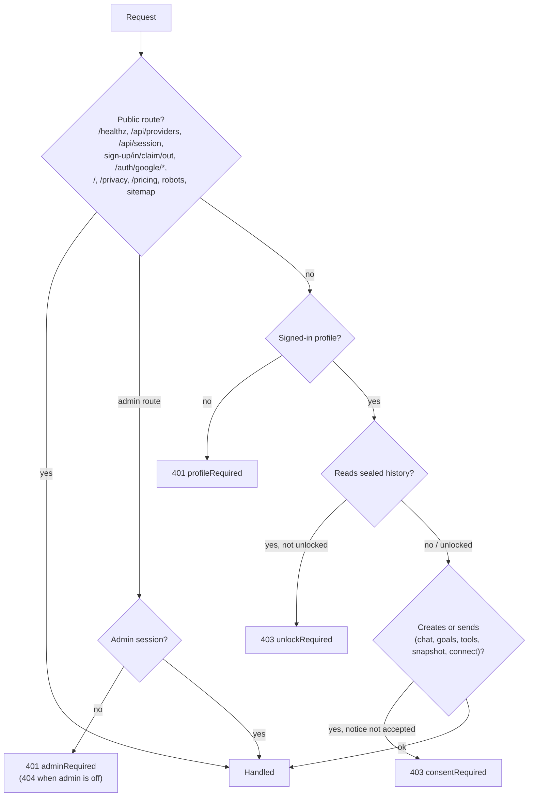

# API

[← Back to the README](../README.md)

| Method and path | Purpose |
| --- | --- |
| `GET /api/session` | Current profile, INDmoney status, `usage` (plan and today's questions), `authMode` (`local` or `google`), `account` (Google mode: the signed-in email, or `{email, name, pending, canClaim}` for a Google account without a profile), the list of profiles (local mode only; always empty with Google sign-in), `backupsInApp` (`false` with `ADMIN_EMAILS` set, so the profile dialog hides backups), and `turnstileSiteKey` when sign-up uses Turnstile |
| `POST /api/users` | Create a profile and sign in (body: `{"displayName", "pin", "turnstileToken"?}`); with Google sign-in, only for a Google account just signed in (else `401 {"signInRequired": true}`), and linked to it |
| `POST /api/session/login`, `POST /api/session/logout` | Sign in to a profile with its PIN (local mode only; `404` with Google sign-in); sign out |
| `GET /auth/google/start`, `GET /auth/google/callback` | Google sign-in (`AUTH_MODE=google`); the callback redirects to `/`, or to `/?signInError=cancelled\|expired\|failed` |
| `POST /api/account/claim` | Google sign-in: link the Google account just signed in to an unclaimed profile (body: `{"displayName", "pin"}`); `401` with one message for any unknown name, claimed profile or wrong PIN, `429` when locked, `403` when `ALLOW_PROFILE_CLAIMS=false` |
| `POST /api/session/unlock` | Unlock the signed-in profile's history after a restart (body: `{"pin": ...}`) |
| `POST /api/session/recover` | Set a new PIN with the recovery code and sign in (body: `{"userId", "recoveryCode", "newPin"}`; with Google sign-in `userId` may be left out and only the signed-in profile can be reset); returns a new recovery code |
| `POST /api/users/me/recovery-code` | Replace the recovery code (body: `{"pin": ...}`) |
| `GET /api/profile`, `PUT /api/profile` | Read or update the profile details (with `updatedAt`) |
| `GET /api/goals`, `POST /api/goals` | List goals, each with its `plan`, `suitability`, `followUps` and `mapping`, plus `fundData` and `portfolio` totals; create one (`201` with `Location`; `409` at 10 goals) |
| `GET /api/goals/{id}`, `PUT /api/goals/{id}`, `DELETE /api/goals/{id}` | Read, replace, or delete a goal |
| `GET /api/goals/{id}/funds?category=` | INDmoney fund figures for one of the goal's suitable categories (`422` for an unknown or unsuitable category) |
| `POST /api/goals/plan` | Calculate a plan without saving (body: `currency`, `targetAmount`, one of `targetDate` or `horizonYears`, `savedAmount`, `monthlyContribution`, optional `assumedReturnPct`, `inflationPct`, `flexibility`, `liquidityNeed`, `riskTolerance`, `lossCapacity` and `annualReturnPcts` with 1 to 4 returns between -20 and 30); the response adds `suitability` and `followUps` |
| `GET /api/goals/allocations`, `PUT /api/goals/allocations` | Every holding in the latest snapshot with its split across goals; replace one holding's split (`{"holdingKey", "goals": [{"goalId", "pct"}], "generalWealthPct"}`; `422` over 100% or for an unknown goal or holding, `409` without a snapshot) |
| `GET /api/decisions`, `POST /api/decisions`, `PUT /api/decisions/{id}`, `DELETE /api/decisions/{id}` | Recorded decisions (body: `{"text", "decidedOn"?, "goalId"?}`) |
| `GET /api/context`, `DELETE /api/context` | Everything the assistant may use, grouped as `confirmed`, `observed` and `inferred` (always empty); remove all goals, decisions and profile details |
| `DELETE /api/users/me` | Delete the signed-in profile (body: `{"pin": ...}`) |
| `GET /api/privacy` | Privacy notice, its version, whether it needs accepting, and the profile's storage settings |
| `POST /api/privacy/consent` | Accept the notice and set storage settings (body: `{"policyVersion", "storageMode": "device" \| "private", "snapshotRetentionDays": 30 \| 90 \| 180 \| 365}`) |
| `POST /api/users/me/export` | Download the profile's data as JSON (body: `{"pin": ...}`) |
| `DELETE /api/users/me/history` | Delete the profile's chats, answer runs, snapshots, investigations, and CAS holdings |
| `POST /api/investigations` | Investigate the change between the latest snapshot and an earlier one (body: `{"baselineDate": "YYYY-MM-DD"}`, optional); `201` with `Location` when the run was saved, `200` when it was not (private mode) |
| `GET /api/runs?limit=50`, `GET /api/runs/{id}`, `DELETE /api/runs/{id}` | List, read, or delete saved answer runs: the steps behind each chat answer (model and tool calls with token counts, retries, checks, the task contract's verdict and how the answer ended). `POST /api/chat` returns the run's id in `X-Agent-Run` |
| `GET /api/investigations?limit=20`, `GET /api/investigations/{id}`, `DELETE /api/investigations/{id}` | List, read, or delete saved investigations; list items carry `updatedAt`, `durationMs`, `trigger`, `baselineDate`, `chatId`, `period`, `error`, `findingCount` and `warningCount` |
| `GET /api/cas`, `POST /api/cas`, `DELETE /api/cas/{id}` | List, upload (body: `{"password", "pdfBase64"}`), or delete CAS statements |
| `GET /api/chats`, `POST /api/chats` | List or create chats |
| `GET /api/chats/{id}`, `DELETE /api/chats/{id}` | Read or delete a chat |
| `POST /api/chat` | Send a message; returns the answer as text and the trace in `X-Agent-Trace` (and `X-Credits-Charged` / `X-Credits-Remaining` on the Individual plan); `429` over a [usage limit](accounts-and-access.md#limits-for-a-shared-copy), `402 {"creditsExhausted": true}` with no [credits](accounts-and-access.md#plans-and-pricing) left. See [the request flow](how-it-works.md#a-chat-request-end-to-end) |
| `GET /api/portfolio` | The latest snapshot's computed `figures` and every holding, or `{available: false}` |
| `GET /api/snapshots?days=30` | Latest snapshot summary and net-worth history |
| `POST /api/snapshots/refresh` | Capture a snapshot now |
| `GET /api/backups`, `POST /api/backups` | Backup status (directory, count, latest, schedule) or back up the whole database now; any signed-in profile on a copy without an admin page, `404` with `ADMIN_EMAILS` set (use `/api/admin/backups`) |
| `GET /api/providers` | Configured AI providers |
| `GET /api/tools` | INDmoney tools available to the signed-in profile |
| `GET /auth/indmoney/connect`, `GET /auth/indmoney/callback`, `POST /auth/indmoney/disconnect` | INDmoney OAuth |
| `GET /healthz` | Health check |
| `POST /api/page-views` | Count one anonymous page view (body: `{"route"}`, an app page name); returns `{"counted"}`, `false` in private mode, without current consent, or when disabled |
| `GET /admin`, `GET /auth/admin/start` | The [admin page](accounts-and-access.md#admin-page) and its Google sign-in (the shared callback redirects to `/admin`, or `/admin?error=not_admin\|cancelled\|expired\|failed`); `404` without `ADMIN_EMAILS` |
| `GET /api/admin/session`, `POST /api/admin/sign-out` | The signed-in admin (`{"admin": {"email", "signedInAt"} \| null}`); end the admin session |
| `GET /api/admin/overview` | Totals, plans, the daily cap, backup status, page views and every profile (no sealed history) |
| `PUT /api/admin/profiles/{id}/plan`, `POST /api/admin/profiles/{id}/clear-lockout`, `POST /api/admin/profiles/{id}/sign-out`, `DELETE /api/admin/profiles/{id}` | Change a plan (`{"plan"}`), clear a PIN lock, end every session of a profile, delete a profile (`{"confirmName"}`, its name; `422` when it does not match) |
| `POST /api/admin/backups` | Back up the database now |
| `GET /privacy` | Privacy policy page, rendered from the same notice profiles accept (no profile needed) |
| `GET /pricing` | Pricing page, rendered from `plans.PLANS` (no profile needed) |
| `GET /robots.txt`, `GET /sitemap.xml` | Crawler rules (`/api/`, `/auth/` and `/admin` disallowed) and a sitemap listing only `/privacy` and `/pricing`; URLs use `APP_ORIGIN` |

Everything except `/healthz`, `/api/providers`, `/api/session`, the sign-up, sign-in, claim, and sign-out routes, the Google sign-in routes, the admin routes (which need an admin session instead: `401 {"adminRequired": true}`), and the public pages (`/`, `/privacy`, `/pricing`, `/robots.txt`, `/sitemap.xml`, static files) requires a signed-in profile. An unknown page returns an HTML 404 page; unknown `/api/` and `/auth/` paths keep the JSON `404 {"detail": "Not Found"}`. Creating chats, sending messages, saving goals and decisions, refreshing snapshots, listing tools, and connecting INDmoney also require the current privacy notice to be accepted; otherwise the API returns `403 {"consentRequired": true}`. Routes that read chats, snapshots, goals, decisions, or profile details return `403 {"unlockRequired": true}` until this browser session has entered the PIN. Profile creation, sign-in, and unlocking return `recoveryCode` when a new code was just created.
