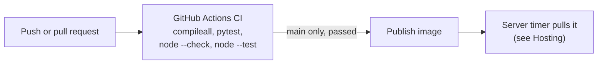

# Development

[← Back to the README](../README.md)

- [Checks](#checks)
- [Troubleshooting](#troubleshooting)
- [Project structure](#project-structure)

## Checks

```bash
python -m pip install -r requirements-dev.txt
python -m compileall -q app tests
for file in frontend/js/*.js; do node --check "$file"; done
python -m pytest -q
node --test tests/js/*.test.js   # finance math, tax rules, rail insights, trace and Activity rendering (Node 18+)
python -m scripts.eval_tasks     # task contracts on scripted replies, offline
python -m scripts.eval_workflows # the general agent on scripted replies and fake INDmoney data, offline
```

The tests use mocked AI, INDmoney, and OAuth responses and a temporary database, so they make no live calls. `tests/conftest.py` sets `REQUEST_ROUTER=keywords`, `AGENT_GRAPH_ENABLED=false` (scripted cases follow the previous loop; `test_agent_graph.py` turns it on), a generated `APP_MASTER_KEY`, a lower scrypt cost, and a temporary `BACKUP_DIR`. Never point tests at `.data/codemode.sqlite3`, which holds live data.



GitHub Actions runs the compile, pytest, script syntax and frontend unit test checks on pushes and pull requests. Model-quality evals are in [Measuring the answers](evals.md). When changing frontend assets, bump the `?v=` cache-busters in `index.html` and `CACHE_NAME` in `sw.js`.

## Troubleshooting

- **"Could not sign in (HTTP 404)" or "(HTTP 405)"**: the server is running older code than the page. Restart it.
- **`ModuleNotFoundError: No module named 'httpx'`** when starting: you ran a global `uvicorn`. Activate `.venv` or run `.venv/bin/uvicorn`.
- **"Connect your INDmoney account"** in Portfolio Analyzer: the profile is not connected, or INDmoney expired the session. Select **Connect** again.
- **No net worth in the portfolio card**: no snapshot yet (select **Refresh snapshot now**), or the total could not be read from INDmoney's response. Check the server log for `snapshot_refresh_failed`.
- **"Too many incorrect attempts"**: wait five minutes and try again. Wrong PINs and wrong recovery codes count together.
- **Asked for your PIN after restarting**: expected. Your history is encrypted and the key is kept only in memory.
- **Everyone shows "Not connected" after moving the app or switching between Docker and Python**: the app is using a different master key from the one that encrypted the tokens (look for `stored_secrets_unreadable` in the log). Point `APP_MASTER_KEY_FILE` at the original key, or reconnect INDmoney.
- **"Could not reach the local model (Ollama)"** on a hosted copy: the Mac is asleep or offline, or `tailscale serve` is not running. Check with the `curl -H "Host: ollama.internal:11434"` command in [Hosting](hosting.md#2-on-the-server).
- **The hosted site shows a Cloudflare error (1033, 502)**: the `tunnel` container is down or its token is wrong. Check `docker compose logs tunnel` for "Registered tunnel connection".
- **API requests fail after weeks of use behind Cloudflare Access**: the Access session expired. Reload the page to sign in again.

## Project structure

```text
app/
  main.py          FastAPI app: routes, INDmoney OAuth, and the snapshot scheduler lifespan
  db.py            SQLite connection, schema, and migrations
  users.py         Profiles, PIN sign-in, sessions, and per-profile INDmoney tokens
  accounts.py      AUTH_MODE, Google sign-in (OpenID Connect) and the accounts linked to profiles
  privacy.py       Privacy notice, consent records, storage modes, export, and history clearing
  page_views.py    Anonymous local page-view counts
  admin.py         The operator's admin page: admin sign-in, profiles overview, plan/lockout/sign-out actions
  plans.py         Plans (Free, Individual, Team), the Free daily cap and today's usage
  limits.py        Daily question cap, rate limits, client IP behind a proxy, Turnstile
  public_pages.py  App shell with absolute Open Graph URLs, privacy policy, pricing, admin and 404 pages, robots.txt, sitemap.xml
  chats.py         Chat storage: SQLite rows, or process memory in private mode
  snapshots.py     Daily snapshots, history, scheduler, and the agent's snapshot tools
  router.py        The request classifier (one model call) and its prompt
  agent.py         Provider selection, request filtering, the previous tool-calling loop and the answer checks
  agent_graph.py   The general Portfolio Analyzer agent on LangGraph: think, act, check, finish
  analysis_tools.py  The agent's general tools: result store and inspect_result, calculate, option_strategy, price_levels, date_facts
  planner.py       Planned answers for messages with several kinds of task (previous loop only)
  agent_events.py  The recorded events of each answer, and the redaction applied to them
  agent_runs.py    Saved answer runs (sealed) for the Activity page
  tasks.py         Task contracts: what each kind of request must do, and the check on each answer
  tool_results.py  Tool failure kinds and the argument check before INDmoney calls
  charts.py        Candlestick charts rebuilt from the OHLC tool result, never from the model's copy
  mcp_client.py    INDmoney MCP session, tool calls, and the read-only tool allowlist
  vault.py         Master key and encryption for stored INDmoney tokens
  backup.py        Daily database backups, verification, pruning, and restore
  cas.py           CAS statement parsing (holdings only) and sealed storage
  portfolio_math.py  Portfolio figures computed in code
  investigation_math.py    Normalised snapshots, change and allocation calculations
  investigation_checks.py  Consistency checks for comparing two snapshots
  investigations.py        The investigation workflow, its storage, and its agent tool
  options_math.py  Exact payoff analysis of any option position, in Decimal
  price_action.py  Prior-session highs and lows over daily candles
  number_check.py  Checks that answer figures match tool data
  sealing.py       Per-profile keypairs, PIN and recovery-code key wrapping, sealing
  unlock.py        Key setup, unlocking, recovery, and the in-memory unlocked sessions
  memory.py        Goals and recorded decisions the user confirmed, sealed per profile
  goal_planning.py Goal gap, required contribution, scenarios, feasibility and alternatives, in Decimal
  goal_suitability.py Fixed rules for which investment categories fit a goal
  fund_data.py     INDmoney fund figures for a goal's suitable categories, each with source and date
  goal_portfolio.py  Holdings assigned to goals, their valuation and the goal tools for the agents
  context.py       Picks the saved context relevant to a request and renders it for the prompt
frontend/
  index.html       App shell, profile picker, and profile dialog
  js/finance.js    Pure money, goal, tax and insight helpers (loaded first)
  js/app.js        Chat UI, profiles, snapshot card, Markdown and Plotly charts
  js/pages.js      Hash routes: Home, Activity, Portfolio, Investments, Planning, Markets, Goals, Reports
  js/trace.js      Answer trace timeline, investigation evidence card, Activity list helpers
  js/rail.js       The right rail: portfolio, goals, market insights, quick tools
  css/app.css      Styles and light/dark themes
  sw.js            Service worker (offline app shell)
docs/              This documentation
evals/             Versioned eval datasets (JSONL)
scripts/           Evals, backups, plans, page views, icon build, INDmoney shape inspection
tests/             pytest suites and fixtures; tests/js for the Node tests
ollama/Modelfile   The ca-mode local model (gpt-oss:20b, 32k context)
.github/workflows/ CI and "Publish image"
Dockerfile, docker-compose.yml  Container image and local Docker setup
deploy/            Hosted setup: app + Cloudflare Tunnel (or Caddy), Ollama on the Mac over Tailscale, auto-update timer
```

Main test files:

```text
tests/
  test_api.py        Routes, OAuth, chats, snapshot endpoints, Google sign-in
  test_agent.py      Request filtering, agent loop, snapshot tools, lazy MCP, recorded events
  test_agent_graph.py  The general agent: what reaches the model, sourced figures, parallel calls, deadline, the enable flag
  test_analysis_tools.py, test_options_math.py, test_price_action.py
                     Result outlines and inspect, safe calculate, option payoffs, prior-session levels
  test_planner.py    Planned answers: plan checks, parallel steps, budgets, timeouts
  test_tasks.py      Task contracts, tool error kinds and argument checks, the event recorder
  test_agent_runs.py Saved answer runs: sealing, gates, deletion paths, export, pruning
  test_eval_tasks.py, test_eval_workflows.py, test_eval_investigations.py
                     The scripted eval cases behave as their datasets expect
  test_users.py      PINs, lockout, sessions, migration, profile isolation
  test_privacy.py    Consent gate, storage modes, export, history clearing, retention choices
  test_unlock.py     PIN-locked history, restart locking, recovery codes, upgrading old profiles
  test_vault.py      Master key handling, token encryption, startup migration
  test_snapshots.py  Capture, schedule, history, retention
  test_cas.py        CAS parsing, upload API and gates, the agent tool
  test_investigation_math.py, test_investigation_checks.py, test_investigations.py
                     Change maths, consistency checks, and the investigation API, storage and agent tool
  test_goal_planning.py, test_goal_suitability.py, test_goal_portfolio.py, test_fund_data.py, test_memory.py, test_context.py
                     Goal maths, suitability, fund figures, the goals/decisions/context API, context selection
  test_limits.py, test_plans.py, test_admin.py, test_page_views.py, test_public_pages.py, test_backup.py
                     Usage limits, plans, the admin page, page views, public pages, backups
  test_portfolio_math.py, test_number_check.py, test_charts.py, test_router.py, test_mcp_client.py
                     Computed figures, the number check, charts from OHLC data, routing, MCP protocol
  js/trace.test.js, js/finance.test.js
                     Trace and Activity rendering; money, goal and tax maths (node --test)
```

The full per-file coverage list is in `.claude/CLAUDE.md` under "Testing Strategy".
