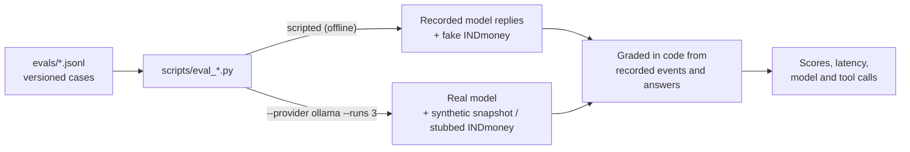

# Measuring the answers (evals)

[← Back to the README](../README.md)

Every eval grades in code, not on how convincing an answer reads. Scripted modes replay recorded model replies offline (and most run in the test suite); live modes call your provider.



| Eval | Dataset | Re-run before changing |
| --- | --- | --- |
| `scripts.eval_router` | `evals/request_routing.jsonl` (64) | `ROUTER_PROMPT` (bump `ROUTER_PROMPT_VERSION`) |
| `scripts.eval_numbers` | fixture portfolio | the portfolio prompt, the model |
| `scripts.eval_investigations` | `evals/portfolio_change.jsonl` (10) | the portfolio prompt, `agent_payload()` |
| `scripts.eval_tasks` | `evals/agent_tasks.jsonl` (21) | the previous loop, goal tools, contracts |
| `scripts.eval_tasks --dataset evals/multi_step.jsonl` | 15 scripted, 4 live | the planner, its prompts or budgets |
| `scripts.eval_workflows` | `evals/financial_workflows.jsonl` | the general agent, its tools or `ANALYSIS_GUIDE` |

- [Request routing](#request-routing)
- [Portfolio numbers](#portfolio-numbers)
- [Portfolio change investigations](#portfolio-change-investigations)
- [Task contracts](#task-contracts)
- [Questions with several parts](#questions-with-several-parts)
- [The general agent](#the-general-agent)

## Request routing

To measure request routing on the labelled questions in `evals/request_routing.jsonl` (this calls your AI provider once per question):

```bash
set -a; source .env; set +a
python -m scripts.eval_router --provider ollama   # or openai, groq; omit --provider to score only the keyword rules
```

Keyword baseline 41/64 (64.1%); `ca-mode` 60/64 on every run.

## Portfolio numbers

To measure figure accuracy against your model with made-up portfolio data (`tests/fixtures/indmoney_sample.py`, about two model calls per question):

```bash
set -a; source .env; set +a
python -m scripts.eval_numbers --provider ollama --delay 0
python -m scripts.eval_numbers --provider groq --delay 70   # the delay keeps within Groq's free-tier limits
```

## Portfolio change investigations

`evals/portfolio_change.jsonl` holds 10 versioned cases (`portfolio_change.v1`): a consistent pair with a clear change, no earlier snapshot, a different account scope, holdings that don't add up to INDmoney's totals, a stale snapshot, a tool timeout, an ambiguous question, a question that needs news, a request to trade, and a date before any saved history. Each case gets its own throwaway profile and database with snapshots from `tests/fixtures/snapshot_pairs.py`; the script first checks that the investigation itself returns the expected status and flagged checks, then asks the real agent. Live INDmoney tools are offered but return an error, so only the AI provider is called.

```bash
set -a; source .env; set +a
python -m scripts.eval_investigations --provider ollama --delay 0 --runs 3
python -m scripts.eval_investigations   # fixtures only, no model calls
```

Answers are graded on:

- **Tool selection**: `investigate_portfolio_change` is called when the case needs it; for the ambiguous question, a clarifying question also counts.
- **Arithmetic**: every amount and percentage matches a number a tool returned (the same matching as the warning under answers). A correct figure the model worked out itself still fails, because the prompt tells it to quote, not compute.
- **Unsupported claims**: no external cause (news, RBI, rates, sentiment…) given as the reason unless the result contains it, and no "mainly market gains" when the market-effect estimate is under half of the change.
- **Warning mentioned**: the flagged scope, reconciliation, staleness or timeout problem appears in the answer.
- **Insufficient-data honesty**: a missing comparison is described as missing, never as "no change".
- **Case instructions**: the trade request is declined without claiming a trade; the news question says the cause was not checked.

The script also prints latency and tool and model calls per case. The phrase rules are regular expressions, so check a surprising failure with `--verbose`. `--out answers.jsonl` saves each answer with its tool results, and `--regrade answers.jsonl` scores them again without the model. By default the request router uses keywords (`REQUEST_ROUTER=model` includes the classifier), and the second account scope is injected by the script, since the app has one scope today.

**Baseline** (`ca-mode`, gpt-oss-20b, 3 runs × 10 cases, M5 Pro, 2026-10-15):

| Metric | Score |
| --- | --- |
| Tool selection | 22/24 |
| Evidence (net-worth change, top mover) | 3/3 |
| Arithmetic | 21/30 |
| Answers with an unsupported claim | 1/30 |
| Warning mentioned | 10/12 |
| Insufficient-data honesty | 8/9 |
| Case instructions | 6/6 |
| **Cases passed** | **21/30** (6–9 per run) |
| Latency | p50 21 s, max 71 s; 1.2 tool and 2.2 model calls per case |

Most failures are the model's own arithmetic: lakh amounts written 100 times too large (₹8,10,00,000 for ₹8.1 lakh), a ₹79,000 fall reported as ₹790,000, and its own sums (the ₹25,000 gap behind a reconciliation warning). It also skipped the investigation for "check whether my holdings add up" in 2 of 3 runs, and it attributed a fund's rise to price when buying more units drove most of it. Exit status is 1 when a run passes fewer than `--min-pass` cases (default 6).

## Task contracts

```bash
python -m scripts.eval_tasks                                   # 21 cases on scripted model replies, offline (also in the test suite)
python -m scripts.eval_tasks --provider ollama --runs 3        # the 8 live cases on the real model
```

The scripted cases check CA Mode's own handling: the contract and verdict, how the run ended, retries, and how each tool failure was classified (timeouts, empty replies, unknown tools, rejected and malformed arguments, INDmoney outages and expired tokens). The live cases grade the model's answers in code: contract met, every figure traced to a tool, the expected figures stated, a clarifying question when inputs are missing, no invented amounts, no rejected tool calls, and how many model calls it took. These cases script the previous loop, so the script sets `AGENT_GRAPH_ENABLED=false`.

**Live baseline** (`ca-mode`, gpt-oss-20b, 3 runs × 8 cases, 2026-10-17; the clarification check was widened after the run to accept "I'll need ..." without a question mark, and the saved answers were re-graded):

| Metric | Score |
| --- | --- |
| Contract met | 15/15 |
| Figures traced to a tool | 13/15 |
| Expected figures stated | 9/9 |
| Clarifying question when inputs are missing | 3/6 (a goal with no amount or date: 0/3) |
| No invented amounts (that same goal) | 2/3 |
| No rejected tool calls (goal calculator) | 5/6 |
| **Cases passed** | **18/24** |
| Latency | p50 8.6 s, max 57.8 s; 1.5 model and 0.6 tool calls, about 3,400 tokens per case |

## Questions with several parts

```bash
python -m scripts.eval_tasks --dataset evals/multi_step.jsonl                              # 15 scripted cases, offline (also in the test suite)
python -m scripts.eval_tasks --dataset evals/multi_step.jsonl --provider ollama --runs 3   # the 4 live cases on the real model
```

**Live results** (`ca-mode`, gpt-oss-20b, 3 runs × 4 cases, 2026-10-20, final code):

| Metric | Score |
| --- | --- |
| Plan accepted (not set aside) | 11/12 |
| Contract met | 9/9 |
| Expected figures stated | 9/9 |
| Clarifying question when the goal date is missing | 3/3 |
| A lookup ran before the call that needs its key | 3/3 |
| No repeated call; within 6 model and 8 tool calls | 12/12 |
| **Cases passed** | **11/12** |
| Latency | p50 15.1 s, max 33.0 s; 2.2 model and 2.0 tool calls, about 6,500 tokens per case |

The first live run passed 3/12: the local model writes `name` for `tool`, refers to steps as "step1", "0" or by tool name, and sometimes ends a plan one character wrong, which Ollama rejects with HTTP 500. These are now accepted or repaired in code, and the plan is still checked in full. The one miss above was a 500 that could not be repaired; the usual loop then answered. Two intermediate runs scored 8/12 and 7/12 on the way, so treat single runs as noisy.

## The general agent

```bash
python -m scripts.eval_workflows                                         # scripted cases, offline (also in the test suite)
python -m scripts.eval_workflows --provider ollama --runs 3              # the 8 live cases: the model does the whole task
python -m scripts.eval_workflows --provider ollama --runs 3 --baseline   # the same cases on the previous loop
```

The INDmoney responses are synthetic but in the layouts recorded from the live tools on 2026-10-26, with the real tool schemas (`tests/fixtures/indmoney_market.py`, `indmoney_tools.json`).

**Live results:** not recorded yet. Run the live and `--baseline` commands above and add the scores here (see [Future enhancements](future-enhancements.md)).
