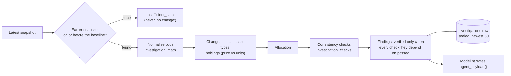
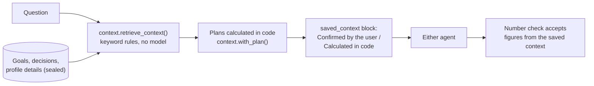
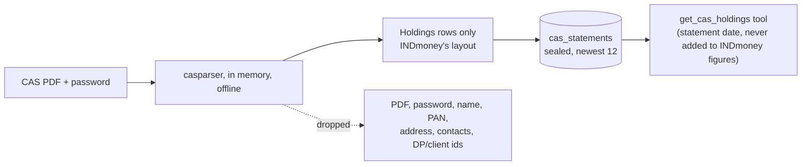

# Using CA Mode

[← Back to the README](../README.md)

- [Use the agents](#use-the-agents)
- [Daily portfolio snapshots](#daily-portfolio-snapshots)
- [Portfolio change investigations](#portfolio-change-investigations)
- [Activity and the answer trace](#activity-and-the-answer-trace)
- [Goals and saved context](#goals-and-saved-context)
- [Holdings at other brokers (CAS)](#holdings-at-other-brokers-cas)

## Use the agents

Choose **Finance Agent** for general topics such as budgeting, saving, tax basics, and how financial products work. It never sees your INDmoney account.

Choose **Portfolio Analyzer** for questions about your account and the market. It needs a connected INDmoney account. It uses these tools when INDmoney's MCP server offers them; anything else the server exposes is ignored (`mcp_client.filter_portfolio_tools()`):

| Tool | What it retrieves |
| --- | --- |
| `get_portfolio_snapshot` | Figures computed from the saved daily snapshot: totals, P&L, splits by asset type and broker, concentration, holdings (local) |
| `get_networth_history` | Daily net worth from saved snapshots, up to 365 days (local) |
| `networth_snapshot` | Live portfolio and net-worth summary |
| `networth_allocation_breakdown` | Breakdown for an asset class |
| `networth_holdings` | Holdings for an asset class |
| `lookup_ind_keys` | Resolve stock, index, derivative, and fund names to INDmoney identifiers |
| `get_indian_stocks_ohlc` | Historical OHLC candles for Indian stocks, indices, and derivatives |
| `get_indian_stocks_details` | Indian market prices, analyst data, and news |
| `get_indian_stocks_option_chain` | Option-chain strikes, premiums, open interest, and implied volatility |
| `get_indian_stocks_greeks_history` | Historical option Greeks and volatility measures |
| `user_watchlist` | Indian and US stock watchlists |
| `indian_stocks_sips` | Indian stock SIPs |
| `get_mf_by_category` | Mutual-fund category search and ranking |
| `get_mf_funds_details` | Mutual-fund profiles, returns, benchmarks, and allocations |
| `mf_sips` | Mutual fund SIPs |
| `get_us_stocks_details` | US market prices, analyst data, and news |
| `us_stocks_sips` | US stock SIPs |

For account questions it also has the general analysis tools (`inspect_result`, `calculate`, `option_strategy`, `price_levels`, `date_facts`); see [the general agent](how-it-works.md#the-general-agent-portfolio-analyzer).

For net worth, allocation, holdings, and trends it reads the saved snapshot first and says when it was captured. For live prices, SIPs, watchlists, options, or anything the snapshot lacks, it calls INDmoney live. All INDmoney tools are read-only: CA Mode cannot place trades, change SIPs, move money, or change account settings.

**What the AI model sees:** your messages and recent chat history; for Portfolio Analyzer, also your profile details and the snapshot or INDmoney data needed to answer. With the local model this stays on your computer; with OpenAI or Groq it is sent to that company.

## Daily portfolio snapshots

- Captured right after you connect INDmoney, then every day at 09:00 IST (before the 09:15 market open, so values reflect the previous close).
- The app must be running to capture. If it was closed or the computer was asleep at 09:00, it captures within five minutes of starting or waking. A failed attempt is retried at most once an hour.
- **Refresh snapshot now** in the portfolio card captures one on demand.
- Kept for the retention the profile chose (30, 90, 180, or 365 days; never longer than `SNAPSHOT_RETENTION_DAYS`). **Disconnect** deletes the profile's snapshots.
- Not captured for profiles in private mode or profiles that haven't accepted the current privacy notice.
- The net-worth total is read from INDmoney's `networth_snapshot` result. If it cannot be read, the trend line is hidden and the agent works from the raw snapshot text.

The capture flow is drawn in [How it works](how-it-works.md#the-daily-snapshot).

## Portfolio change investigations

Ask Portfolio Analyzer "Why did my portfolio change?" (or "What changed since 2026-09-01?"), or call `POST /api/investigations`. A fixed, read-only workflow in code, not the model, then runs:

1. Loads the latest saved snapshot and the comparable earlier one (the previous saved day, or the snapshot on or before the date you name). With no earlier snapshot it says there is not enough history; it never reports that as "no change".
2. Normalises both (`app/investigation_math.py`): totals, holdings identified by asset type, INDmoney code and broker, duplicates merged, changed codes matched by name, and missing values kept distinct from zero.
3. Calculates the changes in net worth, current value, invested amount and liabilities, each asset type, and each holding (split into the effect of price and of units held), plus asset-type shares of the latest total. Everything uses exact decimals.
4. Runs the consistency checks (`app/investigation_checks.py`): same account scope and currency, freshness, totals that add up, holdings that match INDmoney's per-type totals, holdings missing from one snapshot, which total each percentage is measured against, valid percentages, change arithmetic, and USD kept apart from INR. Each check reports `passed`, `warning`, `failed` or `not_checked` with its evidence. A finding is marked verified only when every check it depends on passed.
5. Saves the run (status, steps with timings, checks and result, sealed with your PIN; the last 50) and returns the findings with their snapshot ids, warnings, limitations and suggested follow-ups.

The answer shows an evidence card with the findings, the change by asset type, the allocation chart, the largest movers, the data checks, the calculations, the source snapshots and the steps. Runs have a 10-second step timeout and a 30-second deadline; a saved-snapshot read is retried once if the database is briefly locked. Investigations report what changed, not why: they never claim a cause such as market news.

## Activity and the answer trace

**Activity** in the sidebar (`#/activity`) lists the saved investigations (newest 50) and saved answer runs with their status, start time, duration, outcome and where they came from, filtered by All, Running, Completed or Failed. Open an investigation to see its evidence card and step timeline, open the chat that ran it, or run a failed or cancelled one again (it only reads saved snapshots, and it never reruns on its own). Open an answer run (`#/activity/answer-<id>`) to see the question, the contract's checks, counts and tokens, and every recorded step. Nothing in CA Mode waits for approval, so there is no approval filter.

Under each answer, *How this answer was made* is a timeline of the request: how it was classified, each model call, and each tool with its arguments and a preview of its output, with durations and statuses. A step that never reported back shows as *Did not finish*, never as completed. Long traces keep the first 3 and last 8 steps with "n steps not shown" between. Tokens, secrets, PINs and PAN numbers are masked before the trace is saved or shown.

Answers are not streamed: the trace arrives with the finished answer. Activity reloads from the server on every visit, when the tab regains focus or the network returns, and every few seconds while a run is in progress; an older response never overwrites a newer status.

## Goals and saved context

The **Goals** page keeps up to 10 goals and 50 decisions, sealed with your PIN like your chats.

- **A goal** has a name, a target amount in INR, USD, EUR or GBP, a target date, the savings you have already earmarked, a planned monthly contribution, an optional yearly return you assume, and optional notes. Amounts are never converted or added across currencies.
- **Its plan** is calculated in code (`app/goal_planning.py`, `Decimal`) each time the goal is shown or a question needs it, and never stored: the gap still to save, progress, months left, and for each scenario the projected amount, the shortfall or surplus, and the monthly contribution that would reach the target (rounded up) and how much more that is than planned. The scenarios are no growth, and when you give an assumption, that return and 2 points either side of it. Contributions are made at the start of each month, returns compound monthly, and inflation is added to the target only when you give a rate. Missing details give "missing details" rather than guesses, and a goal with no months left says so.
- **Drafts and horizons.** A goal can be saved as a draft with only a name and finished later. The target can be a date or "in N years", which is converted to a date when you save. Types include financial independence and custom. Optional answers (can the date move, might you need the money early, comfort with ups and downs, how badly a fall would hurt, yearly inflation) feed the suitability check; any you leave out are assumed in the cautious direction and CA Mode asks for them instead of guessing.
- **More in the plan.** Total planned contributions; the target raised by inflation when you give a rate (read as today's money); whether the plan is covered with no growth, depends on your assumed return, or falls short; and, when it is not covered, ways to close the gap (raise the monthly amount, move the date, lower the target, or earmark a lump sum), each tagged "no growth" (plain arithmetic) or "at your X%" (an illustration under your assumption).
- **Which kinds of investment fit** (`app/goal_suitability.py`): fixed rules, not a model, rate six broad categories (liquid and overnight, short-duration debt, conservative hybrid, balanced and multi-asset, large/flexi/index equity, mid and small cap) as allowed, caution or unsuitable from the time to the target date, risk tolerance, capacity for loss, liquidity need and flexibility, and say why. Equity is unsuitable under 36 months, and a fixed goal with low capacity for loss rules out equity at any horizon. This is not advice.
- **Fund figures, dated and sourced, never ranked** (`app/fund_data.py`). "Show fund figures" on a goal card (and Portfolio Analyzer's `get_goal_fund_comparison` tool) fetches INDmoney's listing for each category the goal does not rule out: the largest schemes by assets, shown by name, with expense ratio, 1/3/5-year returns, risk level and benchmark. Every figure shows its source and date: returns are as of the scheme's NAV date, figures older than `FUND_STALE_DAYS` (5) are marked old, and the expense ratio, risk label and benchmark, which INDmoney gives without a date, are shown as undated with the time they were fetched. A missing figure says why (not given, a return of 0, which INDmoney also sends for "no figure", or a period longer than the scheme has existed); it is never shown as zero. Only INDmoney categories that clearly fit one of the six are compared (for example flexi-cap and Nifty 50 index funds count as large/flexi/index equity; aggressive hybrid, multi-cap, sector and credit-risk funds are not compared), and a scheme INDmoney files elsewhere is left out with the reason. INDmoney's ratings and ranks are dropped. Nothing is stored: figures are cached in memory for six hours. This is not advice. The response layout was recorded with `python -m scripts.inspect_indmoney_shapes --funds --labels`. Overlap between holdings needs scheme holdings and is still reported as not assessable.
- **Assign what you hold to goals.** On the Goals page, "Your investments and goals" lists the holdings in your latest snapshot. Give each holding's value to goals in whole percent (the total for a holding cannot pass 100%); each share is valued from the snapshot, rounded down, and counted once. "Earmarked savings" is money not held in assigned holdings. Holdings that are no longer in the snapshot are listed as value unknown and not counted. Rupee holdings count only toward rupee goals. This is bookkeeping: nothing is bought or sold.
- **Decisions** are short notes in your own words (for example "keep six months of expenses in a liquid fund"), optionally dated and linked to a goal.
- **What the assistant can use** on the Goals page lists your profile details, decisions, and the observed data (snapshot and CAS dates) with when each was saved. You can delete any item, or remove all goals, decisions and profile details at once. Chats, snapshots and statements stay.

Before each answer, `app/context.py` picks what bears on the question with fixed keyword rules (no model, no vector store). It picks goals named in the question, or all goals when it is about goals or saving for something, plus related decisions and, for risk or allocation questions, your profile details. The earlier turns count only when the question reads as a follow-up. The selection goes into the prompt as "Confirmed by the user" and "Calculated in code" sections, and the answer trace shows a **Use your saved goals and details** step naming each item. CA Mode never saves anything the assistant infers from a chat. Goals saved by earlier versions (inside the profile, with a target year) move to the new store the next time you enter your PIN, with the target date set to 31 December of that year.

## Holdings at other brokers (CAS)

INDmoney may not see every broker you use. A **Consolidated Account Statement (CAS)** does: NSDL and CDSL email one each month listing every demat account at every broker, plus mutual fund folios and NPS. CAMS and KFintech statements (mutual funds only) are also accepted.

1. Find the latest CAS email from NSDL or CDSL (or request one on their websites) and save the PDF.
2. In the **Other brokers** card on the right (shown on windows at least 1280px wide), choose the PDF, enter its password (usually your PAN in capital letters), and select **Upload statement**.
3. Ask Portfolio Analyzer, for example "Using my latest CAS statement, list my holdings grouped by broker".

The PDF is read in memory with [`casparser`](https://github.com/codereverser/casparser), offline. Only the holdings are kept (name, ISIN, broker, units, price, value, and cost where the statement gives one), sealed with your PIN like snapshots; the last 12 statements are kept. The PDF, its password, and your name, PAN, address, contact details, and DP/client IDs are never stored. CAS figures are as of the statement date, not live, and overlap INDmoney's, so the agent never adds the two together. Demat statements usually give no purchase cost for shares, so their P&L covers only holdings with a cost.
