# Future enhancements

[← Back to the README](../README.md)

These are proposals, not commitments. Each one comes from a gap the code or the evals already show, and names where the change would go.

```mermaid
flowchart LR
    subgraph Now["Next"]
        A1["Record the general agent's live eval"]
        A2["Retire the previous loop and planner"]
        A3["Stream answers and the trace"]
    end
    subgraph Soon["Soon"]
        B1["Fewer arithmetic and lakh errors"]
        B2["Better clarifying questions"]
        B3["Model availability when the Mac sleeps"]
        B4["Checkout for paid plans"]
    end
    subgraph Later["Later"]
        C1["Several account scopes"]
        C2["Fund overlap"]
        C3["Sourced explanations of changes"]
        C4["Shared rate-limit store"]
    end
    Now --> Soon --> Later
```

## Agent and answers

| Enhancement | Why | Where |
| --- | --- | --- |
| **Record the general agent's live results** | `scripts.eval_workflows --provider ollama --runs 3` and its `--baseline` have no published scores yet, so there is no evidence that the graph beats the previous loop | [evals.md](evals.md#the-general-agent) |
| **Retire the previous loop and the `submit_plan` planner** | Once the graph scores at least as well, `AGENT_GRAPH_ENABLED=false`, `planner.py` and the duplicate retry rules in `stream_agent()` are two code paths to keep in step | `app/agent.py`, `app/planner.py`, `scripts/eval_tasks.py`, `tests/conftest.py` |
| **Use the graph for Finance Agent and general questions** | Today they stay on the previous loop; one loop with different tool sets would be simpler | `app/agent.py` `stream_agent()` |
| **Stream answers and the trace** | Answers arrive only when finished (p50 9–21 s on the local model). `stream_agent()` already yields events; sending them over server-sent events would make the trace live | `app/main.py` `/api/chat`, `frontend/js/app.js`, `trace.js` |
| **Fewer arithmetic and lakh errors** | The investigation eval passes arithmetic 21/30: lakh amounts written 100 times too large, model-made sums. Pushing every derived figure through `calculate` (as the graph's `unverified_figures` check already asks) and formatting rupees in code would close most of it | prompts in `app/agent.py`, `number_check.py` |
| **Better clarifying questions** | A goal with no amount or date gets a clarifying question 0/3 times in the task eval | `GOAL_TOOL_RULES`, `goal_portfolio.calculate_goal()` `followUps` |
| **Record the `user_watchlist` stock row layout** | It was not recorded (the watchlists were empty), so watchlist scans run on an assumed layout | `scripts/inspect_indmoney_shapes.py`, `tests/fixtures/indmoney_market.py` |

## Portfolio features

| Enhancement | Why | Where |
| --- | --- | --- |
| **Several account scopes** | Investigations check "same account scope", but the app has one scope today; the eval injects the second | `app/investigation_math.py`, `snapshots.py` |
| **Fund overlap between holdings** | Reported as not assessable: it needs each scheme's holdings, which are not fetched | `app/fund_data.py`, `goal_suitability.py` |
| **Sourced explanations of a change** | Investigations report what changed, never why. Linking a mover to dated news from `get_indian_stocks_details` (quoted, with its source) would answer "why" without guessing | `app/investigations.py` |
| **CAS and INDmoney side by side** | CAS figures are never added to INDmoney's because they overlap; matching holdings by ISIN would allow one de-duplicated view | `app/cas.py`, `portfolio_math.py` |

## Hosting and operations

| Enhancement | Why | Where |
| --- | --- | --- |
| **Model availability when the Mac sleeps** | Hosted chat answers stop when the Mac sleeps. Options: a GPU on the server, an opt-in cloud fallback per profile (with the privacy notice updated), or queueing questions until the model is back | `deploy/`, `app/agent.py` `provider_config()` |
| **Add `TRUSTED_PROXY` to `deploy/app.env.example`** | Rate limits behind the tunnel or Caddy need it, but the example file leaves it out | `deploy/app.env.example` |
| **Updates without everyone re-entering their PIN** | Every update restarts the app and drops the in-memory unlocked keys. Rolling restarts cannot keep them without weakening the design, so the realistic change is fewer restarts (batching updates, an update window) | `deploy/update.sh`, `ca-mode-update.timer` |
| **Shared rate-limit store** | Counters are in memory and assume one app process; more than one process would need SQLite or Redis counters | `app/limits.py` |
| **Off-site backups by default** | Server backups sit on the same disk until `pull-backups.sh` copies them to the Mac | `app/backup.py`, `deploy/pull-backups.sh` |

## Plans and accounts

| Enhancement | Why | Where |
| --- | --- | --- |
| **Checkout for paid plans** | There is no checkout; an operator sets plans with `scripts.plans` or the admin page | `app/plans.py`, `/pricing` |
| **Turn off profile claims automatically** | `ALLOW_PROFILE_CLAIMS` must be switched off by hand once everyone has claimed their profile | `app/accounts.py` |
| **More sign-in providers** | Only Google is supported in `AUTH_MODE=google` | `app/accounts.py` |
