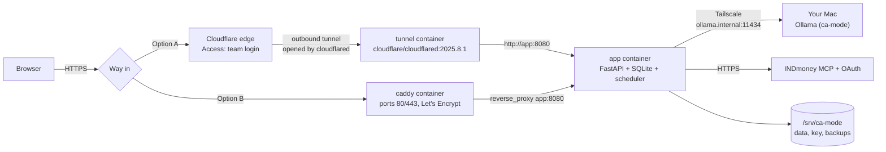
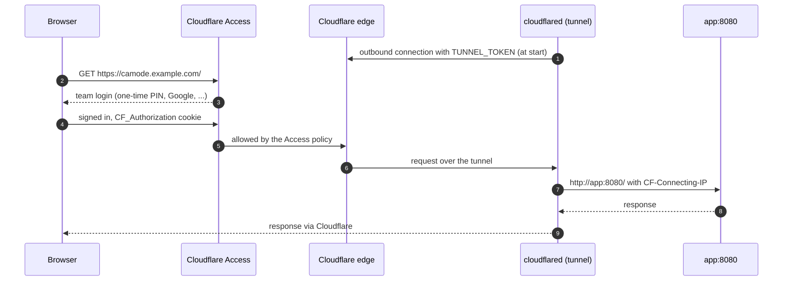
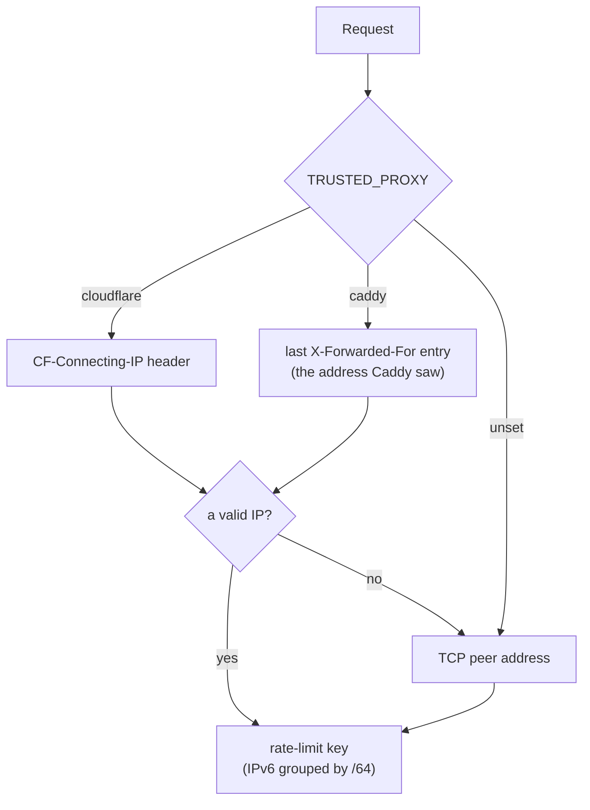
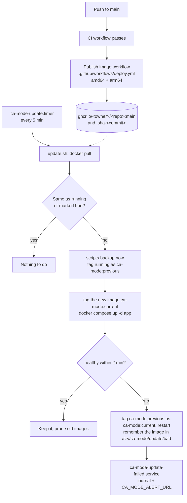

# Host on a server (model on your Mac)

[← Back to the README](../README.md)

For a small team: the app, its database and the daily snapshot job run on a cheap Linux server, and answers come from Ollama on your Mac. The two are joined by [Tailscale](https://tailscale.com), a private, encrypted network. The site reaches the internet in one of two ways:

| | Cloudflare Tunnel + Access (`deploy/docker-compose.tunnel.yml`) | Caddy (`deploy/docker-compose.caddy.yml`) |
| --- | --- | --- |
| Needs | A domain on Cloudflare | Nothing: a domain or `<ip-with-dashes>.sslip.io` |
| Ports open on the server | None (cloudflared dials out) | TCP 80, 443 and UDP 443 |
| Who can open the site | Only people Cloudflare Access lets in (team login) | Anyone on the internet |
| Sign-in | `local` (profile picker) is acceptable behind Access; `google` recommended | `AUTH_MODE=google` required |
| `COMPOSE_FILE` in `deploy/.env` | `docker-compose.yml:docker-compose.image.yml:docker-compose.tunnel.yml` | `docker-compose.yml:docker-compose.image.yml:docker-compose.caddy.yml` |
| `TRUSTED_PROXY` | `cloudflare` | `caddy` |
| TLS certificate | Cloudflare's | Let's Encrypt, kept in `/srv/ca-mode/caddy` |

The current hosted copy (`129-225-97-229.sslip.io`, on Oracle Cloud) uses Caddy.

- [Overall layout](#overall-layout)
- [1. On the Mac](#1-on-the-mac)
- [2. On the server](#2-on-the-server)
- [3a. Cloudflare Tunnel and Access](#3a-cloudflare-tunnel-and-access)
- [3b. Without a domain or Cloudflare: Caddy](#3b-without-a-domain-or-cloudflare-caddy)
- [Client addresses behind the proxy](#client-addresses-behind-the-proxy)
- [Backups and the master key](#backups-and-the-master-key)
- [Automatic updates](#automatic-updates)
- [Logs, restarts and monitoring](#logs-restarts-and-monitoring)
- [Upgrading an existing server](#upgrading-an-existing-server)

## Overall layout



When the Mac sleeps, sign-in, the portfolio pages, calculators and daily snapshots keep working; chat answers say the model is offline (model and classifier calls give up after a 10-second connect limit). A server with 1 vCPU and 2 GB of memory is enough (about €5–10 a month). Tailscale's and Cloudflare Access's free plans cover a small team.

## 1. On the Mac

Install Tailscale and sign in, then share Ollama with your tailnet only (Ollama itself keeps listening on `localhost`):

```bash
tailscale serve --bg --tcp 11434 tcp://localhost:11434
tailscale ip -4    # note this address
```

Keep Ollama opening at login, and stop the Mac sleeping on power (System Settings → Battery → Options → *Prevent automatic sleeping on power adapter when the display is off*; a closed MacBook still sleeps unless it has an external display).

## 2. On the server

Install Docker and Tailscale (`curl -fsSL https://tailscale.com/install.sh | sh`, then `sudo tailscale up` with the same account). Check that the Mac answers. Ollama bound to loopback refuses requests addressed to a Tailscale name or IP (HTTP 403), hence the `Host` header:

```bash
curl -H "Host: ollama.internal:11434" http://<mac-tailscale-ip>:11434/api/version
```

The app uses the same trick: `deploy/docker-compose.yml` maps `ollama.internal` to `MAC_TAILSCALE_IP` with `extra_hosts` and sets `OLLAMA_BASE_URL=http://ollama.internal:11434/v1`.

Get the code and the two settings files:

```bash
git clone <this repository> ca-mode && cd ca-mode/deploy
cp .env.example .env              # read by Docker Compose and update.sh
cp app.env.example app.env        # the app's own settings
sudo mkdir -p /srv/ca-mode/data /srv/ca-mode/key /srv/ca-mode/backups
# The app runs as uid 10001 inside the container, so its folders must belong to that user:
sudo chown -R 10001:10001 /srv/ca-mode/data /srv/ca-mode/key /srv/ca-mode/backups
sudo chmod 700 /srv/ca-mode/data /srv/ca-mode/key /srv/ca-mode/backups
```

`deploy/docker-compose.yml` starts only the app. The way in comes from a second file, picked with `COMPOSE_FILE` in `deploy/.env` (Compose reads it there, so a bare `docker compose up -d` in `deploy/` starts exactly that set):

| `COMPOSE_FILE` | Runs |
| --- | --- |
| `docker-compose.yml:docker-compose.caddy.yml` | app built from this checkout + Caddy |
| `docker-compose.yml:docker-compose.tunnel.yml` | app built from this checkout + Cloudflare Tunnel |
| add `:docker-compose.image.yml` after `docker-compose.yml` | the published image instead of a local build ([Automatic updates](#automatic-updates)) |

| File | Variable | Value |
| --- | --- | --- |
| `deploy/.env` | `COMPOSE_FILE` | the files to run (above) |
| `deploy/.env` | `MAC_TAILSCALE_IP` | the Mac's `tailscale ip -4` |
| `deploy/.env` | `CLOUDFLARE_TUNNEL_TOKEN` | the tunnel token (option A) |
| `deploy/.env` | `SITE_ADDRESS` | the site's host name (option B) |
| `deploy/.env` | `CA_MODE_HOME` | `/srv/ca-mode` (database, key, backups, Caddy data) |
| `deploy/app.env` | `APP_ORIGIN` | `https://<your host>`; INDmoney redirects to `<APP_ORIGIN>/auth/indmoney/callback`, Google to `<APP_ORIGIN>/auth/google/callback` |
| `deploy/app.env` | `TRUSTED_PROXY` | `cloudflare` or `caddy` (`app.env.example` has `caddy`) |
| `deploy/app.env` | `OLLAMA_MODEL`, `AI_PROVIDER` | `ca-mode`, `ollama`; leave `OPENAI_API_KEY` and `GROQ_API_KEY` empty so portfolio data only goes to the Mac |
| `deploy/app.env` | `DAILY_QUESTION_LIMIT`, `ADMIN_EMAILS`, `PRICING_CONTACT_EMAIL` | see [Accounts and access](accounts-and-access.md) |

Compose mounts `/srv/ca-mode/data` as `/app/.data`, `/srv/ca-mode/key` as `/run/ca-mode` (the master key) and `/srv/ca-mode/backups` as `/backups`. A healthcheck calls `/healthz` every 30 seconds.

The container runs one uvicorn worker as user `camode` (uid 10001), from a `python:3.12-slim` base pinned by digest in the `Dockerfile`. One worker is a rule, not a default: unlocked history keys, rate limits, private-mode chats, the model queue and the one-answer-at-a-time guard live in that process's memory, so the app takes an exclusive lock on `/app/.data/app.lock` at start and a second process (`--workers 2`, a second container on the same folder) refuses to start. (Docker Desktop's macOS file sharing does not always honour that lock on a freshly created folder; a Linux server's disk does.)

## 3a. Cloudflare Tunnel and Access

The tunnel is a `cloudflared` container next to the app. It opens an outbound connection to Cloudflare, and Cloudflare forwards requests for your host name down that connection. The app publishes no ports, so the only way to it is through Cloudflare, and Cloudflare Access asks for a team login before a request is forwarded.



**In Cloudflare** (your domain must use Cloudflare DNS):

1. **Create the tunnel.** Zero Trust → Networks → Tunnels → *Create a tunnel* → *Cloudflared*. Name it (for example `ca-mode`). On the install screen pick *Docker* and copy the token after `--token` into `CLOUDFLARE_TUNNEL_TOKEN` in `deploy/.env`. You don't run Cloudflare's command: Compose runs the container.
2. **Add a public hostname** on the tunnel: subdomain `camode`, domain `example.com`, service type **HTTP**, URL **`app:8080`**. `app` is the Compose service name, reachable from the `tunnel` container on the Compose network. Cloudflare creates the DNS record.
3. **Protect it with Access.** Zero Trust → Access → Applications → *Add an application* → *Self-hosted*. Use the same host name, and add a policy with action *Allow* that includes your team (for example *Emails ending in* `@yourcompany.com`, or a list of emails). Set the **session duration to 1 month**: when an Access session expires, the open app's API requests fail until the page is reloaded.
4. **Optional: lock the admin page.** Add a second Access application for path `camode.example.com/admin*` allowing only your email.

**On the server**, in `deploy/`:

```bash
# deploy/app.env
APP_ORIGIN=https://camode.example.com
TRUSTED_PROXY=cloudflare

# deploy/.env
COMPOSE_FILE=docker-compose.yml:docker-compose.tunnel.yml

docker compose up -d --build        # starts app and tunnel
docker compose logs -f tunnel       # "Registered tunnel connection" when it is up
```

What the Compose file runs (`deploy/docker-compose.tunnel.yml`):

```yaml
tunnel:
  image: cloudflare/cloudflared:2025.8.1    # pinned; the image updates only when this line changes
  restart: unless-stopped
  command: tunnel --no-autoupdate run
  environment:
    TUNNEL_TOKEN: ${CLOUDFLARE_TUNNEL_TOKEN}
  depends_on: [app]
```

Things to know:

- **OAuth callbacks go through the tunnel too.** INDmoney and Google redirect the browser to `APP_ORIGIN`, and the browser already holds the Access cookie, so nothing extra is needed. Add `https://camode.example.com/auth/google/callback` to the Google client's redirect URIs if you use Google sign-in or the admin page.
- **Access is what makes the profile picker acceptable.** In `local` mode the picker lists every profile to anyone who opens the site, and the PIN is a lock, not network-grade sign-in. Keep Access in front, or switch to `AUTH_MODE=google`. With `AUTH_MODE=local` and an `https://` `APP_ORIGIN` the app refuses to start unless `BEHIND_ACCESS=true` is set, so a copy without Access cannot open the picker to the internet by mistake.
- **Turnstile** (`TURNSTILE_SITE_KEY` / `TURNSTILE_SECRET_KEY`) is a separate Cloudflare product (bot check on sign-up), not part of the tunnel. See [Limits for a shared copy](accounts-and-access.md#limits-for-a-shared-copy).
- **The server opens no ports.** You can close everything inbound except SSH (or only allow SSH over Tailscale).

## 3b. Without a domain or Cloudflare: Caddy

Caddy serves the app over HTTPS on the server's own ports, with a free Let's Encrypt certificate for a domain pointing at the server or for `<ip-with-dashes>.sslip.io` (a free DNS name that points at that IP, e.g. `129-225-97-229.sslip.io`). The site is then public with no Cloudflare Access in front, so use it only with `AUTH_MODE=google` (the app refuses to start in `local` mode there). Prefer a domain you own over `sslip.io`: every `*.sslip.io` name counts as the same site, so cookies and requests from someone else's `sslip.io` page are not treated as cross-site by the browser; the app's same-origin check and `__Host-` cookies block that, but your own domain removes the shared neighbourhood. Open TCP 80 and 443 (and UDP 443) to the internet in the cloud firewall, then:

```bash
# in deploy/.env
SITE_ADDRESS=129-225-97-229.sslip.io
COMPOSE_FILE=docker-compose.yml:docker-compose.caddy.yml
# app.env: APP_ORIGIN=https://129-225-97-229.sslip.io and TRUSTED_PROXY=caddy
docker compose up -d --build
```

The `Caddyfile` compresses responses, sets `Strict-Transport-Security` and proxies to `app:8080`. Only `app` and `caddy` are started: the tunnel lives in its own file, so it never starts unless `COMPOSE_FILE` names it. Add `https://<SITE_ADDRESS>/auth/google/callback` as a redirect URI on the Google client. The address changes with the server's IP, so keep the IP (on Oracle Cloud an ephemeral public IP lasts as long as the instance; a reserved IP survives re-creating it).

## Client addresses behind the proxy

Rate limits and Turnstile need each visitor's address, but every request reaches the app from the proxy container. `limits.client_address()` reads it from the proxy:



Set `TRUSTED_PROXY` only when the app cannot be reached except through that proxy (the hosted Compose file publishes no app port). Otherwise anyone could send the header and choose their own address. Without it, everyone behind the tunnel shares one per-IP limit.

## Backups and the master key

Two kinds of backup share `/srv/ca-mode/backups`: the daily ones the app makes by itself (`codemode-<time>.sqlite3`, the newest `BACKUP_KEEP`, 14, kept) and manual ones (`codemode-<time>-manual.sqlite3`: `scripts.backup now`, every deploy by `update.sh`, the admin page's *Back up now*; the newest `BACKUP_MANUAL_KEEP`, 5, kept). Each kind is pruned on its own, so manual copies can never push the daily restore points out. Profiles cannot start backups on a hosted copy: `POST /api/backups` is only offered with `AUTH_MODE=local` and a localhost (or unset) `APP_ORIGIN`, or with `BACKUPS_IN_APP=true`, never with an admin page, and is rate limited (3 an hour per profile).

The master key is created in `/srv/ca-mode/key` on first start; keep a copy somewhere safe, away from the backups. It is only created while the database holds nothing encrypted: if the key file is missing (the volume not mounted, the file deleted) but the database has encrypted tokens, the app refuses to start and names the file, rather than making a new key that cannot read them. Restore the file, or set `APP_MASTER_KEY_FILE` to it. Daily backups go to `/srv/ca-mode/backups`, on the same disk, so also copy them off the server. `deploy/pull-backups.sh` does that from the Mac over Tailscale: `sh deploy/pull-backups.sh --install` schedules it with launchd (09:30, 21:30 and at login), copies new backups to `~/ca-mode-backups/server/`, checks the newest with SQLite's integrity check, keeps the newest 30 and shows a notification when a copy fails (log: `~/ca-mode-backups/server/pull.log`; `CA_MODE_BACKUP_HOST` defaults to this project's server). A backup is only readable with the master key, so keep a copy of `/srv/ca-mode/key/master.key` on the Mac too, apart from the backups.

To update by hand without the published image (no `docker-compose.image.yml` in `COMPOSE_FILE`): `git pull && docker compose up -d --build` (everyone enters their PIN again after a restart). With the image, let `update.sh` do it.

**Moving your existing data (optional).** On the Mac, run `python -m scripts.backup now` and stop the local app for good: two copies would both refresh the same INDmoney tokens. Before the server's first start, copy the backup file to `/srv/ca-mode/data/codemode.sqlite3` and `~/.config/ca-mode/master.key` to `/srv/ca-mode/key/master.key`. Otherwise everyone creates a profile on the server and connects INDmoney again.

## Automatic updates

Instead of building on the server, the server can run the image GitHub builds from `main`:



1. **GitHub publishes the image.** After CI passes on a push to `main`, the "Publish image" workflow (`.github/workflows/deploy.yml`, actions pinned to SHAs) builds the image for x86 and Arm, publishes it as `ghcr.io/<owner>/<repo>:sha-<commit>`, and then points `:main` at it, but only while that commit is still the head of `main` (checked before and after the build). A run for an older commit, finishing late or re-run, never moves `:main` back, so the server is never downgraded. The first time, make the package public on GitHub (your profile → Packages → the package → Package settings → Change visibility), so the server can pull it without a token. GitHub never connects to the server.
2. **The server picks it up.** `deploy/update.sh` pulls the image, and when it differs from the running one, backs up the database, tags it `ca-mode:current`, restarts the app on it and waits up to 2 minutes for it to be healthy. If it is not, it tags the previous image `ca-mode:current` again, restarts on it and skips the failed image from then on. `docker-compose.image.yml` always runs `ca-mode:current`, so that tag is the state the script and Compose share: a later plain `docker compose up -d` (after editing `app.env`, say) keeps the image the script deployed or went back to, never the one that failed. If the failed image is somehow running again, the next check goes back to the previous one. The script works in `CA_MODE_DEPLOY_DIR` (default `/srv/ca-mode/app`, the folder holding the Compose files and `.env`). A timer runs it every 5 minutes, and a failed run starts `ca-mode-update-failed.service`, which writes an error to the journal and, when `CA_MODE_ALERT_URL` is set in `deploy/.env`, POSTs a one-line alert there (an [ntfy.sh](https://ntfy.sh) topic works):

   ```bash
   # in deploy/.env
   COMPOSE_FILE=docker-compose.yml:docker-compose.image.yml:docker-compose.caddy.yml   # or :docker-compose.tunnel.yml
   sudo install -m 755 update.sh /usr/local/bin/ca-mode-update
   sudo install -m 644 ca-mode-update.service ca-mode-update-failed.service ca-mode-update.timer /etc/systemd/system/
   sudo systemctl daemon-reload && sudo systemctl enable --now ca-mode-update.timer
   sudo /usr/local/bin/ca-mode-update  # the first run tags ca-mode:current; Compose needs it before `up`
   journalctl -u ca-mode-update -f     # what each check did
   ```

A change on `main` is live about 5 to 10 minutes after CI passes; other branches and pull requests never deploy. Each update restarts the app, so everyone signed in enters their PIN again. `CA_MODE_IMAGE` in `deploy/.env` (or the environment, which wins) picks another image, for example a `:sha-<commit>` tag to stay on one version; `update.sh` reads it from `.env` itself. To leave a failed image behind for good, fix it on `main`; to try it again anyway, delete `/srv/ca-mode/update/bad`. Updates replace only the `app` container; the `tunnel` and `caddy` images change only when their pinned tags in the Compose files change.

The health check that decides a rollback is `/healthz`: it answers whenever the process serves requests, so a sleeping Mac never rolls a deploy back. `/readyz` (the database and Ollama) is for monitoring, below.

## Logs, restarts and monitoring

- **Log size.** Every service logs through Docker's `json-file` driver with rotation (`max-size: 10m`, `max-file: 5`), so logs stay under about 50 MB per container on the small disk.
- **Fields on every line.** Log lines are `LEVEL:logger:message` followed by their fields as `key=value` (`app/logs.py`), so `admin_*` lines name the admin (`admin=owner@example.com user_id=…`) and failures carry their `user_id`, broker or error type. `docker compose logs app | grep admin_` is the admin audit trail.
- **What the access log keeps.** uvicorn's request log drops query strings (OAuth callbacks carry one-time `code` and `state` values there) and leaves out `/healthz` and `/readyz`, which the healthcheck calls every 30 seconds (`app/logs.py`).
- **Restarts.** On a deploy, uvicorn stops taking new requests and gives those in flight `GRACEFUL_SHUTDOWN_SECONDS` (90) to finish; Compose's `stop_grace_period` (100 s) is a little longer, so Docker only kills a request that outlives that. A chat cut off that way still gives its daily question back: each counted question is also a `question_reservations` row until its answer is saved or fails, and the app releases every leftover reservation when it starts (and any older than 15 minutes on each scheduler tick).

- **Monitoring.** `GET /readyz` checks a database query and Ollama's `/api/tags` (3-second limit) and returns `503` when either fails. Point an external uptime monitor at `https://<host>/readyz` to hear about a sleeping Mac or a broken database; never use it to restart the app (Docker's healthcheck and `update.sh` use `/healthz`, which a sleeping Mac does not fail). The admin page shows the last successful model answer, the model queue and the latest backup.
- **The model queue and time budget.** One Ollama answers everyone, so at most `MODEL_CONCURRENCY` model calls run at once (set it to the Mac's `OLLAMA_NUM_PARALLEL`). A new question waits up to `MODEL_QUEUE_SECONDS` (20) for a slot, then gets `503` with `Retry-After` and the chat says the assistant is busy; an answer already under way keeps waiting for its next slot. Each profile has one answer in flight at a time (`429 chatInFlight` otherwise). A whole answer has `CHAT_DEADLINE_SECONDS` (240), then `504`. Keep that below the proxy's timeout: Caddy has none by default, Cloudflare's is 100 seconds, so set `CHAT_DEADLINE_SECONDS=90` behind the tunnel.

## Upgrading an existing server

Changes to the files in `deploy/` (Compose files, `update.sh`, systemd units) are **not** shipped by the automatic image updates: only the `app` image is. Repeat the relevant steps by hand when a release changes them. For the release that added the non-root image, the separate tunnel file, `ca-mode:current` and the failure alert:

1. **Before merging it** (the old image runs as root and ignores ownership, so this is safe early): `sudo chown -R 10001:10001 /srv/ca-mode/data /srv/ca-mode/key /srv/ca-mode/backups`. Without it the new image cannot open the database, fails its health check, and `update.sh` rolls back and marks it bad; then do this step and `sudo rm /srv/ca-mode/update/bad`.
2. After it is on `main`, in the deploy folder: `git pull`, then check `COMPOSE_FILE` in `.env` still names your way in (`docker-compose.caddy.yml`, or the new `docker-compose.tunnel.yml` instead of relying on `docker-compose.yml`), and add `CA_MODE_IMAGE=` and optionally `CA_MODE_ALERT_URL=` from `.env.example`.
3. Reinstall the script and units: `sudo install -m 755 update.sh /usr/local/bin/ca-mode-update`, `sudo install -m 644 ca-mode-update.service ca-mode-update-failed.service ca-mode-update.timer /etc/systemd/system/`, `sudo systemctl daemon-reload`.
4. `sudo /usr/local/bin/ca-mode-update` once (tags `ca-mode:current`), then `docker compose up -d` to apply the new log rotation and grace period to every container. `docker compose config --services` should list `app` and your way in only.

For the release that added the model queue, the chat time budget and `/readyz`, nothing on the server has to change: the defaults apply with the image. Optionally add `MODEL_CONCURRENCY` (the Mac's `OLLAMA_NUM_PARALLEL`), `MODEL_QUEUE_SECONDS` and `CHAT_DEADLINE_SECONDS` to `app.env` (then `docker compose up -d`), and point an uptime monitor at `/readyz`.
