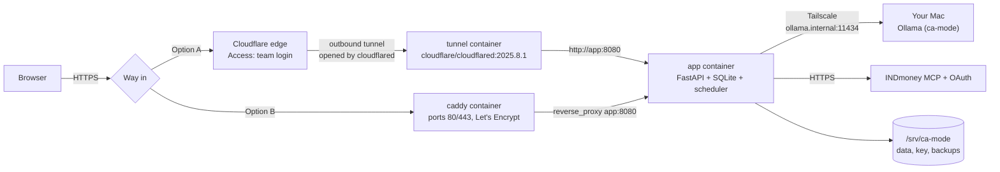
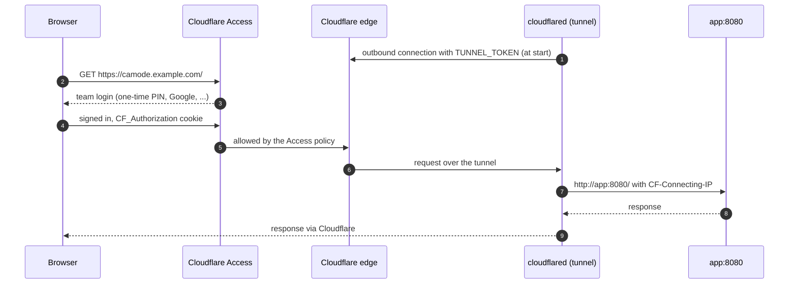
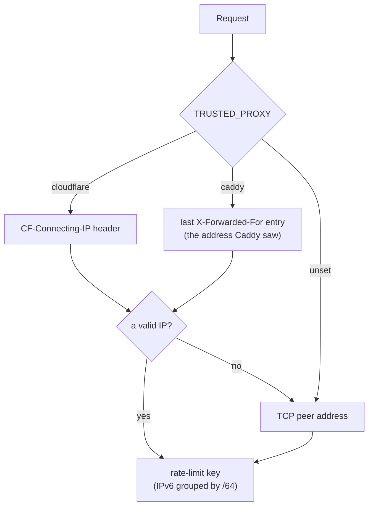
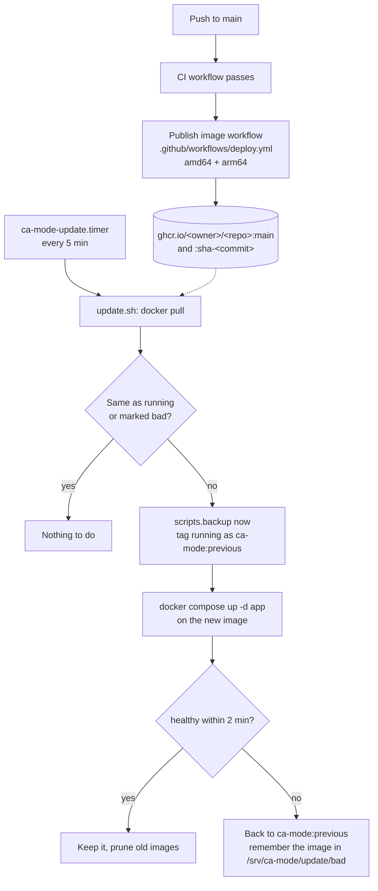

# Host on a server (model on your Mac)

[← Back to the README](../README.md)

For a small team: the app, its database and the daily snapshot job run on a cheap Linux server, and answers come from Ollama on your Mac. The two are joined by [Tailscale](https://tailscale.com), a private, encrypted network. The site reaches the internet in one of two ways:

| | Cloudflare Tunnel + Access (`deploy/docker-compose.yml`) | Caddy (`deploy/docker-compose.caddy.yml`) |
| --- | --- | --- |
| Needs | A domain on Cloudflare | Nothing: a domain or `<ip-with-dashes>.sslip.io` |
| Ports open on the server | None (cloudflared dials out) | TCP 80, 443 and UDP 443 |
| Who can open the site | Only people Cloudflare Access lets in (team login) | Anyone on the internet |
| Sign-in | `local` (profile picker) is acceptable behind Access; `google` recommended | `AUTH_MODE=google` required |
| `TRUSTED_PROXY` | `cloudflare` | `caddy` |
| TLS certificate | Cloudflare's | Let's Encrypt, kept in `/srv/ca-mode/caddy` |

The current hosted copy (`129-225-97-229.sslip.io`, on Oracle Cloud) uses Caddy.

- [Overall layout](#overall-layout)
- [1. On the Mac](#1-on-the-mac)
- [2. On the server](#2-on-the-server)
- [3a. Cloudflare Tunnel and Access](#3a-cloudflare-tunnel-and-access)
- [3b. Without a domain or Cloudflare: Caddy](#3b-without-a-domain-or-cloudflare-caddy)
- [Client addresses behind the proxy](#client-addresses-behind-the-proxy)
- [Backups and the master key](#backups-and-the-master-key)
- [Automatic updates](#automatic-updates)

## Overall layout



When the Mac sleeps, sign-in, the portfolio pages, calculators and daily snapshots keep working; chat answers say the model is offline (model and classifier calls give up after a 10-second connect limit). A server with 1 vCPU and 2 GB of memory is enough (about €5–10 a month). Tailscale's and Cloudflare Access's free plans cover a small team.

## 1. On the Mac

Install Tailscale and sign in, then share Ollama with your tailnet only (Ollama itself keeps listening on `localhost`):

```bash
tailscale serve --bg --tcp 11434 tcp://localhost:11434
tailscale ip -4    # note this address
```

Keep Ollama opening at login, and stop the Mac sleeping on power (System Settings → Battery → Options → *Prevent automatic sleeping on power adapter when the display is off*; a closed MacBook still sleeps unless it has an external display).

## 2. On the server

Install Docker and Tailscale (`curl -fsSL https://tailscale.com/install.sh | sh`, then `sudo tailscale up` with the same account). Check that the Mac answers. Ollama bound to loopback refuses requests addressed to a Tailscale name or IP (HTTP 403), hence the `Host` header:

```bash
curl -H "Host: ollama.internal:11434" http://<mac-tailscale-ip>:11434/api/version
```

The app uses the same trick: `deploy/docker-compose.yml` maps `ollama.internal` to `MAC_TAILSCALE_IP` with `extra_hosts` and sets `OLLAMA_BASE_URL=http://ollama.internal:11434/v1`.

Get the code and the two settings files:

```bash
git clone <this repository> ca-mode && cd ca-mode/deploy
cp .env.example .env              # read by Docker Compose only
cp app.env.example app.env        # the app's own settings
sudo mkdir -p /srv/ca-mode/data /srv/ca-mode/key /srv/ca-mode/backups
```

| File | Variable | Value |
| --- | --- | --- |
| `deploy/.env` | `MAC_TAILSCALE_IP` | the Mac's `tailscale ip -4` |
| `deploy/.env` | `CLOUDFLARE_TUNNEL_TOKEN` | the tunnel token (option A) |
| `deploy/.env` | `SITE_ADDRESS` | the site's host name (option B) |
| `deploy/.env` | `CA_MODE_HOME` | `/srv/ca-mode` (database, key, backups, Caddy data) |
| `deploy/app.env` | `APP_ORIGIN` | `https://<your host>`; INDmoney redirects to `<APP_ORIGIN>/auth/indmoney/callback`, Google to `<APP_ORIGIN>/auth/google/callback` |
| `deploy/app.env` | `TRUSTED_PROXY` | `cloudflare` or `caddy` (not in `app.env.example`: add it) |
| `deploy/app.env` | `OLLAMA_MODEL`, `AI_PROVIDER` | `ca-mode`, `ollama`; leave `OPENAI_API_KEY` and `GROQ_API_KEY` empty so portfolio data only goes to the Mac |
| `deploy/app.env` | `DAILY_QUESTION_LIMIT`, `ADMIN_EMAILS`, `PRICING_CONTACT_EMAIL` | see [Accounts and access](accounts-and-access.md) |

Compose mounts `/srv/ca-mode/data` as `/app/.data`, `/srv/ca-mode/key` as `/run/ca-mode` (the master key) and `/srv/ca-mode/backups` as `/backups`. A healthcheck calls `/healthz` every 30 seconds.

## 3a. Cloudflare Tunnel and Access

The tunnel is a `cloudflared` container next to the app. It opens an outbound connection to Cloudflare, and Cloudflare forwards requests for your host name down that connection. The app publishes no ports, so the only way to it is through Cloudflare, and Cloudflare Access asks for a team login before a request is forwarded.



**In Cloudflare** (your domain must use Cloudflare DNS):

1. **Create the tunnel.** Zero Trust → Networks → Tunnels → *Create a tunnel* → *Cloudflared*. Name it (for example `ca-mode`). On the install screen pick *Docker* and copy the token after `--token` into `CLOUDFLARE_TUNNEL_TOKEN` in `deploy/.env`. You don't run Cloudflare's command: Compose runs the container.
2. **Add a public hostname** on the tunnel: subdomain `camode`, domain `example.com`, service type **HTTP**, URL **`app:8080`**. `app` is the Compose service name, reachable from the `tunnel` container on the Compose network. Cloudflare creates the DNS record.
3. **Protect it with Access.** Zero Trust → Access → Applications → *Add an application* → *Self-hosted*. Use the same host name, and add a policy with action *Allow* that includes your team (for example *Emails ending in* `@yourcompany.com`, or a list of emails). Set the **session duration to 1 month**: when an Access session expires, the open app's API requests fail until the page is reloaded.
4. **Optional: lock the admin page.** Add a second Access application for path `camode.example.com/admin*` allowing only your email.

**On the server**, in `deploy/`:

```bash
# deploy/app.env
APP_ORIGIN=https://camode.example.com
TRUSTED_PROXY=cloudflare

docker compose up -d --build        # starts app and tunnel
docker compose logs -f tunnel       # "Registered tunnel connection" when it is up
```

What the Compose file runs (`deploy/docker-compose.yml`):

```yaml
tunnel:
  image: cloudflare/cloudflared:2025.8.1    # pinned; the image updates only when this line changes
  restart: unless-stopped
  command: tunnel --no-autoupdate run
  environment:
    TUNNEL_TOKEN: ${CLOUDFLARE_TUNNEL_TOKEN}
  depends_on: [app]
```

Things to know:

- **OAuth callbacks go through the tunnel too.** INDmoney and Google redirect the browser to `APP_ORIGIN`, and the browser already holds the Access cookie, so nothing extra is needed. Add `https://camode.example.com/auth/google/callback` to the Google client's redirect URIs if you use Google sign-in or the admin page.
- **Access is what makes the profile picker acceptable.** In `local` mode the picker lists every profile to anyone who opens the site, and the PIN is a lock, not network-grade sign-in. Keep Access in front, or switch to `AUTH_MODE=google`.
- **Turnstile** (`TURNSTILE_SITE_KEY` / `TURNSTILE_SECRET_KEY`) is a separate Cloudflare product (bot check on sign-up), not part of the tunnel. See [Limits for a shared copy](accounts-and-access.md#limits-for-a-shared-copy).
- **The server opens no ports.** You can close everything inbound except SSH (or only allow SSH over Tailscale).

## 3b. Without a domain or Cloudflare: Caddy

Caddy serves the app over HTTPS on the server's own ports, with a free Let's Encrypt certificate for a domain pointing at the server or for `<ip-with-dashes>.sslip.io` (a free DNS name that points at that IP, e.g. `129-225-97-229.sslip.io`). The site is then public with no Cloudflare Access in front, so use it only with `AUTH_MODE=google`. Open TCP 80 and 443 (and UDP 443) to the internet in the cloud firewall, then:

```bash
echo "SITE_ADDRESS=129-225-97-229.sslip.io" >> .env      # in deploy/
# app.env: APP_ORIGIN=https://129-225-97-229.sslip.io and TRUSTED_PROXY=caddy
docker compose -f docker-compose.yml -f docker-compose.caddy.yml up -d --build app caddy
```

The `Caddyfile` compresses responses, sets `Strict-Transport-Security` and proxies to `app:8080`. Only `app` and `caddy` are started, so no tunnel runs. Add `https://<SITE_ADDRESS>/auth/google/callback` as a redirect URI on the Google client. The address changes with the server's IP, so keep the IP (on Oracle Cloud an ephemeral public IP lasts as long as the instance; a reserved IP survives re-creating it).

## Client addresses behind the proxy

Rate limits and Turnstile need each visitor's address, but every request reaches the app from the proxy container. `limits.client_address()` reads it from the proxy:



Set `TRUSTED_PROXY` only when the app cannot be reached except through that proxy (the hosted Compose file publishes no app port). Otherwise anyone could send the header and choose their own address. Without it, everyone behind the tunnel shares one per-IP limit.

## Backups and the master key

The master key is created in `/srv/ca-mode/key` on first start; keep a copy somewhere safe, away from the backups. Daily backups go to `/srv/ca-mode/backups`, on the same disk, so also copy them off the server. `deploy/pull-backups.sh` does that from the Mac over Tailscale: `sh deploy/pull-backups.sh --install` schedules it with launchd (09:30, 21:30 and at login), copies new backups to `~/ca-mode-backups/server/`, checks the newest with SQLite's integrity check, keeps the newest 30 and shows a notification when a copy fails (log: `~/ca-mode-backups/server/pull.log`; `CA_MODE_BACKUP_HOST` defaults to this project's server). A backup is only readable with the master key, so keep a copy of `/srv/ca-mode/key/master.key` on the Mac too, apart from the backups.

To update by hand: `git pull && docker compose up -d --build` (everyone enters their PIN again after a restart).

**Moving your existing data (optional).** On the Mac, run `python -m scripts.backup now` and stop the local app for good: two copies would both refresh the same INDmoney tokens. Before the server's first start, copy the backup file to `/srv/ca-mode/data/codemode.sqlite3` and `~/.config/ca-mode/master.key` to `/srv/ca-mode/key/master.key`. Otherwise everyone creates a profile on the server and connects INDmoney again.

## Automatic updates

Instead of building on the server, the server can run the image GitHub builds from `main`:



1. **GitHub publishes the image.** After CI passes on a push to `main`, the "Publish image" workflow (`.github/workflows/deploy.yml`, actions pinned to SHAs) builds the image for x86 and Arm and publishes it as `ghcr.io/<owner>/<repo>:main` (and `:sha-<commit>`). The first time, make the package public on GitHub (your profile → Packages → the package → Package settings → Change visibility), so the server can pull it without a token. GitHub never connects to the server.
2. **The server picks it up.** `deploy/update.sh` pulls the image, and when it differs from the running one, backs up the database, restarts the app on it and waits up to 2 minutes for it to be healthy. If it is not, it goes back to the previous image and skips that image from then on. The script works in `CA_MODE_DEPLOY_DIR` (default `/srv/ca-mode/app`, the folder holding the `deploy/` files). A timer runs it every 5 minutes:

   ```bash
   # in deploy/.env
   COMPOSE_FILE=docker-compose.yml:docker-compose.image.yml   # add :docker-compose.caddy.yml when serving through Caddy
   sudo install -m 755 update.sh /usr/local/bin/ca-mode-update
   sudo install -m 644 ca-mode-update.service ca-mode-update.timer /etc/systemd/system/
   sudo systemctl daemon-reload && sudo systemctl enable --now ca-mode-update.timer
   journalctl -u ca-mode-update -f     # what each check did
   ```

A change on `main` is live about 5 to 10 minutes after CI passes; other branches and pull requests never deploy. Each update restarts the app, so everyone signed in enters their PIN again. `CA_MODE_IMAGE` (in `deploy/.env` or the environment) picks another image, for example a `:sha-<commit>` tag to stay on one version. Updates replace only the `app` container; the `tunnel` and `caddy` images change only when their pinned tags in the Compose files change.
