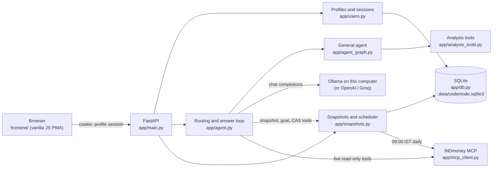
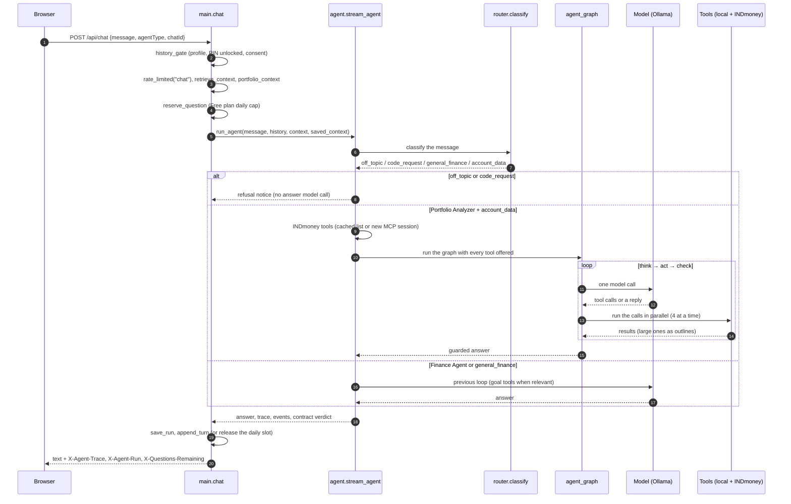
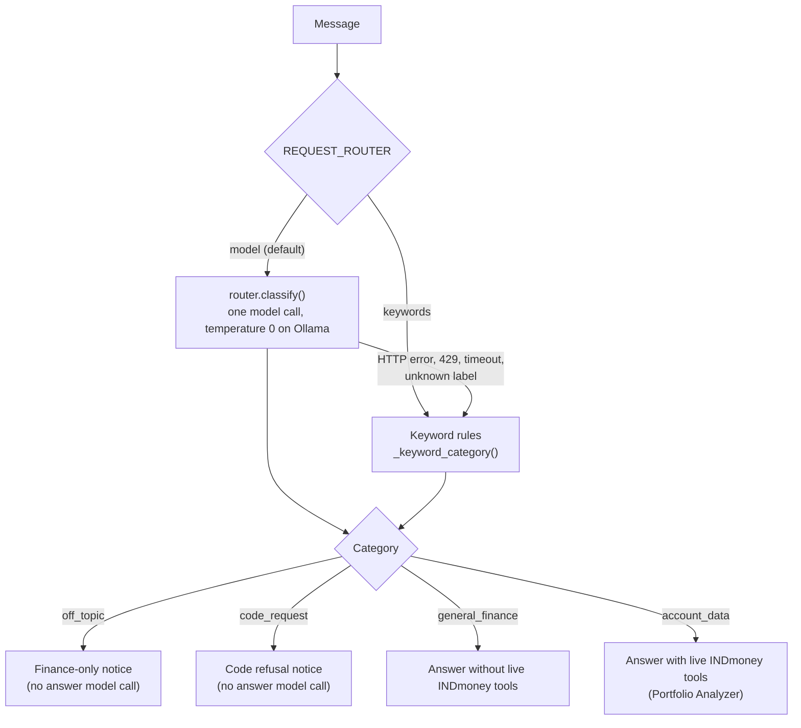
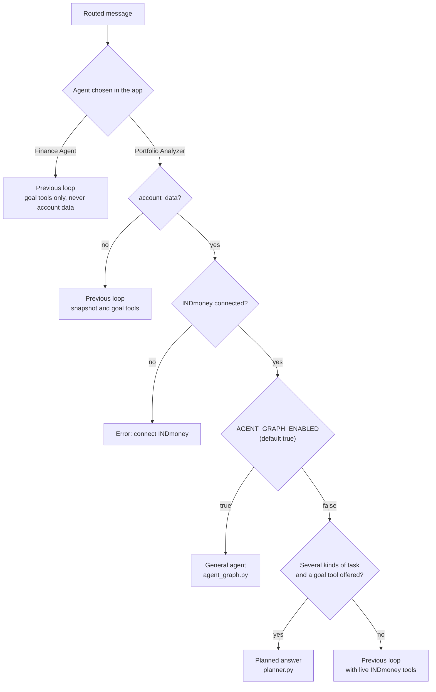
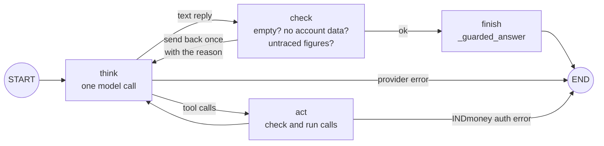
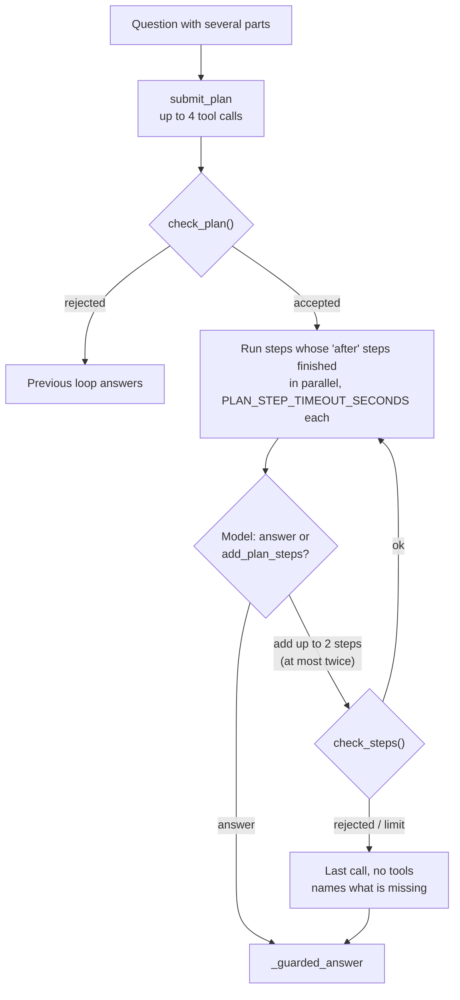
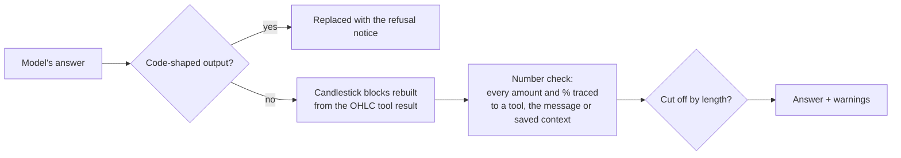
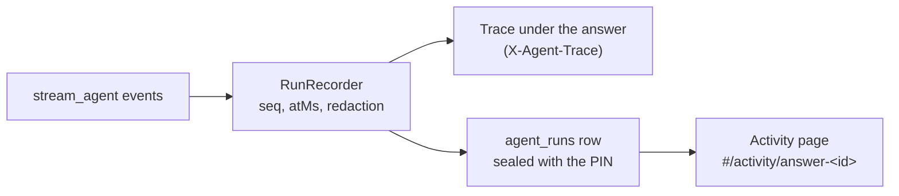
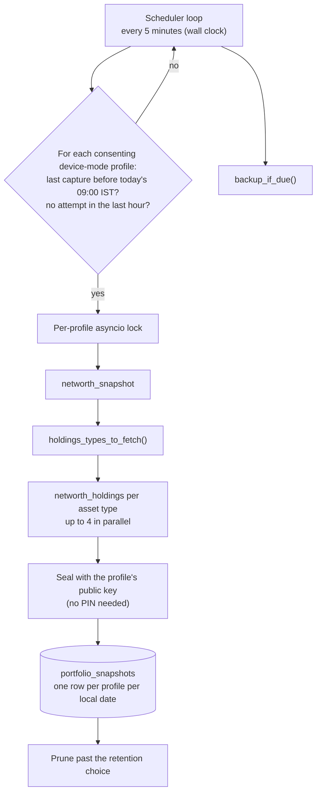

# How it works

[← Back to the README](../README.md)

This page follows one chat question from the browser to the answer, then covers the parts the answer passes through: routing, the agent paths, the checks on every answer, and how the numbers are computed.

- [Components](#components)
- [A chat request, end to end](#a-chat-request-end-to-end)
- [Request routing](#request-routing)
- [Which agent path answers](#which-agent-path-answers)
- [The general agent (Portfolio Analyzer)](#the-general-agent-portfolio-analyzer)
- [The previous loop and planned answers](#the-previous-loop-and-planned-answers)
- [Checks on every answer](#checks-on-every-answer)
- [Answer records and task contracts](#answer-records-and-task-contracts)
- [How the numbers are computed](#how-the-numbers-are-computed)
- [The daily snapshot](#the-daily-snapshot)

## Components

## A chat request, end to end

`POST /api/chat` (`app/main.py`) does the following, in order:

1. **Gates.** The session cookie identifies the signed-in profile. Without one the API returns `401 {"profileRequired": true}` and the app shows the profile picker (or, with Google sign-in, the **Sign in with Google** screen). `history_gate()` then requires the PIN to be entered in this browser session (`403 {"unlockRequired": true}`) and the current privacy notice to be accepted (`403 {"consentRequired": true}`). Rate limits apply when switched on.
2. **Saved context.** `context.retrieve_context()` picks the goals, decisions and profile details the question is about (keyword rules, no model).
3. **Tools.** For Portfolio Analyzer, `snapshots.portfolio_context()` builds the local tools: snapshot, net-worth history, CAS (when a statement was uploaded), the investigation tool, and goal and fund tools (when the profile has a goal).
4. **Daily cap.** On the Free plan, `limits.reserve_question()` holds one of today's questions. It is released again if no answer comes back.
5. **The answer.** `agent.run_agent()` routes the message and answers (below). If INDmoney reports an expired sign-in, `main.chat` refreshes the token and asks once more.
6. **Saving.** The run's events are saved (`agent_runs.save_run()`), the turn is added to the chat (last 20 messages kept), and the answer is returned as plain text with the trace in `X-Agent-Trace`, the run id in `X-Agent-Run` and, when counted, `X-Questions-Remaining`. Answers are not streamed.

## Request routing

`agent._route_request()` labels every message with one classifier call (`router.classify()`): a forced `classify_request` tool call, the user's text sent as a JSON object of untrusted data, and the last 3 user turns as context. The label is checked against the allowed values in code.

- The route is the first step of the trace (`kind: "route"`, `source: "model"` or `"keywords"`).
- The classifier uses `OLLAMA_ROUTER_MODEL` / `OPENAI_ROUTER_MODEL` / `GROQ_ROUTER_MODEL`, else the provider's chat model.
- If Portfolio Analyzer was not given the live tools but writes a tool call as JSON text, the request is rerun once as `account_data` (`force_account_data`).

## Which agent path answers

- **Finance Agent** never sees an INDmoney, snapshot or profile tool. It gets only the goal tools (`get_goal_plans`, `plan_goal_what_if`, `calculate_goal_plan`) when they apply.
- **Portfolio Analyzer** always gets its local snapshot tools. The live INDmoney tools are added only for `account_data`. INDmoney's tool list is cached for 24 hours, so a snapshot-only answer makes no INDmoney calls.

## The general agent (Portfolio Analyzer)

For account and market questions, Portfolio Analyzer runs a LangGraph `StateGraph` (`app/agent_graph.py`). Nothing is written for a particular question. The model works out the steps, chooses every tool and argument, reads the results and decides when it has enough. Requests such as "build me a Nifty iron condor for the next monthly expiry with 15-delta short legs", "suggest a put spread that hedges a 5% fall", "health-check my portfolio" or "scan my watchlist for breakouts" are all planned by the model.

**think**
- Sends the conversation with every tool offered. The system prompt adds `ANALYSIS_GUIDE` with today's IST date and time (facts about INDmoney's data: unlabelled expiries, `buy_price` / `sell_price`, `14d` is calendar days, `investment_code` as `fund_ids`...).
- A malformed tool call (Ollama "error parsing tool call", Groq `tool_use_failed`) is asked for again twice, then the model answers without tools (`plan_stop` `partial`).
- At 14 model calls (`MAX_MODEL_CALLS`), 36 tool calls (`MAX_TOOL_CALLS`) or `AGENT_DEADLINE_SECONDS` (300) it asks once more without tools and the answer says what is missing (`plan_stop` `budget` or `deadline`).

**act**
- Refuses, with an error the model can act on: an unknown tool, arguments that are not a JSON object or fail the tool's schema (required fields, `enum` values) (`invalid_arguments`), the exact same call again (`rejected`, pointing at its `resultId`), and calls past the budget or `MAX_CALLS_PER_REPLY`.
- Runs the rest together, 4 at a time (`CONCURRENCY`), each under `AGENT_STEP_TIMEOUT_SECONDS` (60). A timeout, 429 or 5xx is retried once (`transient_tool_error`).
- A result made only of error fields counts as `rejected`.
- INDmoney and saved-data results go into the `ResultStore`. A large result (a 60-strike option chain, a year of candles) reaches the model as an outline with a `resultId`; the model reads the rows it needs with `inspect_result`.
- An INDmoney auth failure ends the run so the token can be refreshed.

**check**: sends the reply back once each for an empty reply (`empty_reply`), an account question answered without an account tool (`no_account_tool`), and figures the number check cannot find in the messages or in any stored result in full (`unverified_figures`).

**finish**: runs `_guarded_answer()` (see [Checks on every answer](#checks-on-every-answer)) and emits the answer.

The general tools the model can call:

| Tool | What it does |
| --- | --- |
| `inspect_result` | Reads part of a stored result: a path, text or object conditions (`put_data.delta between -0.2 -0.1`), fields, sort, limit |
| `calculate` | Exact `Decimal` arithmetic with named steps, for any figure the model derives |
| `option_strategy` | Any set of option legs: net credit or debit, maximum profit and loss (or unlimited), breakevens, payoff at scenario prices, rupees per lot, a theta estimate |
| `price_levels` | The latest completed session against the highs and lows of the sessions before it (today's candle left out before 15:30 IST) |
| `date_facts` | Weekdays, days and trading days to go, and which listed expiry is the last of its month |

These analysis tools never count as reading account data (`tasks.ANALYSIS_TOOLS`).

## The previous loop and planned answers

The previous tool-calling loop in `agent.stream_agent()` answers Finance Agent, Portfolio Analyzer questions that are not `account_data`, and everything when `AGENT_GRAPH_ENABLED=false`. It retries once when Portfolio Analyzer skips the tools on an account question, and once when a goal answer states its own figures instead of calling the calculator (`GOAL_CALCULATOR_NUDGE`).

**Planned answers** (`app/planner.py`) run only on the previous loop (graph switched off), for a Portfolio Analyzer question that asks for account data and a goal calculation at once ("What is my net worth and how much must I invest monthly to reach ₹50 lakh in 8 years?"):

1. The model proposes up to 4 tool calls in one `submit_plan` call. The plan is checked in code: only offered tools, arguments that fit each tool, each step waiting only for earlier steps, no repeated call, and at least one step that reads account data. A plan that fails is set aside and the usual loop answers.
2. Steps that don't depend on each other run at the same time, each with `PLAN_STEP_TIMEOUT_SECONDS` (60).
3. The model then answers, or adds up to 2 more calls (at most twice). A call rejected for its arguments may be fixed once; an unavailable call is never repeated; an expired INDmoney sign-in ends the answer.
4. At most 8 tool calls, 6 model calls and `PLAN_DEADLINE_SECONDS` (240). When a limit is reached, the answer says which part it could not complete.

The local model's habits are accepted: `name` for `tool`, `args` for `arguments`, steps referred to as "step1". A plan ending one character wrong (an Ollama HTTP 500) is repaired when only trailing characters or closing brackets are off.

## Checks on every answer

`agent._guarded_answer()` runs on every answer, on every path:

- **Code output** (other than `chart` blocks) is replaced with the refusal notice.
- **Charts.** `charts.ground_candlestick_charts()` replaces every candlestick block with the latest `get_indian_stocks_ohlc` result as compact `ohlc` rows. Candles the model wrote are always replaced; with no OHLC data the block becomes a note. Chart blocks are stripped from the history the model sees.
- **Numbers.** `number_check.unverified_numbers()` checks each amount and percentage against the tool results, allowing for rounding and lakh/crore. Unmatched figures get a warning under the answer ("I couldn't match these figures to your INDmoney data"). This is a safety net, not proof: a wrong figure that happens to equal another number in the data is not caught.
- **Length.** An answer cut off by `finish_reason == "length"` is marked.

## Answer records and task contracts

Every chat answer records its steps as events (`app/agent_events.py`): the route, the task contract, each model call (with prompt and completion tokens), each tool call and how it failed if it did (`invalid_arguments`, `rejected`, `unavailable`, `auth` or `failed`), every retry and why, the checks on the answer, and how it ended (`answered`, `refused`, `failed`, `auth_failed`). Tool arguments and results are redacted and capped; the answer text is reduced to its length.

Each request gets a **task contract** from fixed rules (`app/tasks.py`): a declined request, general finance, a goal calculation (the calculator, or a clarifying question when inputs are missing) or account data (a snapshot, investigation, CAS, fund comparison or INDmoney tool). The finished answer is checked against it. Contracts only report, with one rule enforced: an account question is not satisfied by the goal calculator alone.

Saved runs: the newest 200, none older than 30 days, only when the profile saves history.

## How the numbers are computed

Portfolio figures are calculated in code (`app/portfolio_math.py`, exact `Decimal` arithmetic), not by the model. The model receives finished figures and is told to quote them, never to add up or work out percentages itself:

- Net worth, current value, invested amount, and liabilities as INDmoney reports them.
- P&L only over holdings with a reported invested amount. Linked (non-INDmoney) brokers often report it as 0; those holdings are left out of P&L instead of showing a 100% gain, and the answer says so.
- Shares of the whole portfolio for each holding, asset type, asset class, and broker. INDmoney's own `holding_percent` is a share of one asset type only.
- Concentration: the largest holding and the top 5 and top 10 as a share of the portfolio.
- US stocks in INR and USD separately; USD is never added to INR totals.
- INDmoney labels Indian stocks `STOCK` in `networth_snapshot`, which `networth_holdings` rejects; `portfolio_math.canonical_asset_type()` maps it to `IND_STOCK`.

Goal plans (`app/goal_planning.py`), investigations (`app/investigation_math.py`), option payoffs (`app/options_math.py`) and price levels (`app/price_action.py`) are also `Decimal` code, never the model.

## The daily snapshot

Because it checks the wall clock (macOS monotonic time pauses during sleep), it catches up after the app starts or the laptop wakes. Partial results are kept. Snapshots are SQLite rows, not vector-database chunks: net worth and holdings are exact numbers that need latest-value, date-range and sorting queries, which similarity search cannot answer reliably.
