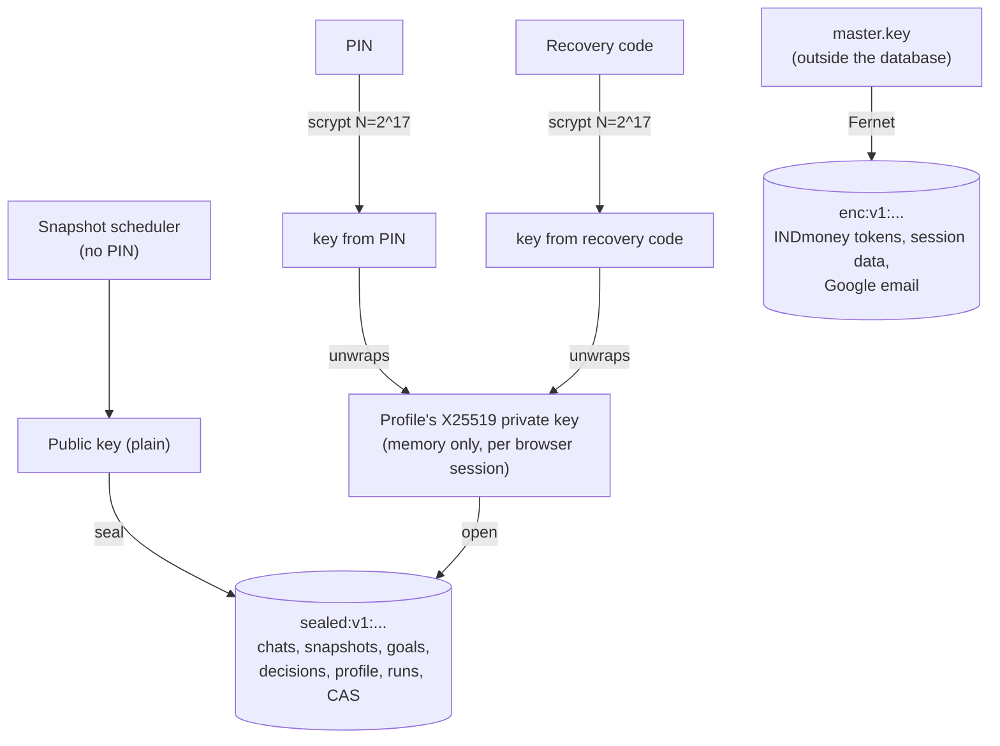
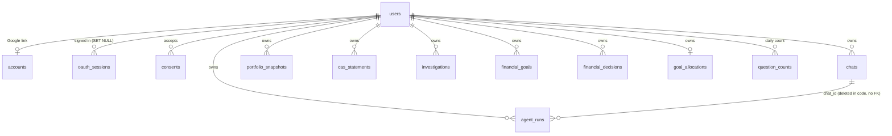

# Privacy and data

[← Back to the README](../README.md)

- [Local data and privacy](#local-data-and-privacy)
- [Consent and storage modes](#consent-and-storage-modes)
- [Database reference](#database-reference)
- [Backups](#backups)

## Local data and privacy

The full notice is also published at `/privacy` (linked from the sign-in screen and **Your data and privacy**), so it can be read before creating a profile. The app has no third-party analytics or tracking; the only outside requests the browser makes on its own are to Google Fonts and the Plotly CDN (and Cloudflare Turnstile on sign-up when it is switched on).

**Page-view counts.** For profiles that save history, the app adds one to a daily count per page opened (`page_views` table: date, page name, number; nothing about the profile, browser or IP). Counts are kept 90 days, never leave the computer, and are not part of exports or profile deletion because they are not linked to a profile. Read them with `python -m scripts.page_views` (`--days 7`, `--daily`); set `PAGE_VIEWS_ENABLED=false` to stop counting.

The SQLite database at `.data/codemode.sqlite3` (`APP_DATA_DIR`; `/srv/ca-mode/data/codemode.sqlite3` on a hosted copy) holds profiles, chats, INDmoney OAuth tokens, and portfolio snapshots. Each profile sees only its own data. Every table and column, and how each value is protected, is in the [database reference](#database-reference).



- PINs are stored as salted scrypt hashes. Five wrong PINs or recovery codes lock the profile for five minutes.
- **Saved chats, snapshots, goals, decisions, and profile details are locked with your PIN.** Each profile has its own keypair (X25519, via PyNaCl). Its private key is stored only encrypted with a key derived from your PIN, and a second copy with one derived from your recovery code (scrypt N=2^17). The daily snapshot job seals new snapshots with the public key, so it needs no PIN. Reading anything back needs the PIN: nobody else on the computer, and nobody with the database and the master key, can read it.
- After the app restarts, each browser asks for the PIN again ("Welcome back"), because unlocked keys are kept only in memory.
- **Forgot your PIN?** on the unlock screen sets a new PIN with your recovery code and gives you a new code (the old one stops working). **New recovery code** under **Your data and privacy** replaces a lost code. If both the PIN and the recovery code are lost, the profile's saved history cannot be recovered.
- Profiles from before this version get their keys and a recovery code the next time they enter their PIN; their existing chats, snapshots, and profile details are encrypted at that point. Until then, new snapshots for them are saved unencrypted.
- INDmoney tokens, and the OAuth data held while you sign in to INDmoney, are encrypted (Fernet: AES-128 with HMAC-SHA256) with a master key stored outside the database, at `~/.config/ca-mode/master.key` by default. A copy of `.data/` alone does not reveal them. Existing plaintext tokens are encrypted the first time the app starts. If the key is lost or replaced, stored tokens can't be read: those profiles show as disconnected and need to reconnect INDmoney, and the log shows `stored_secrets_unreadable`.
- **Disconnect** revokes the INDmoney access token and deletes the profile's snapshots; its chats are kept.
- **Delete this profile** (in the profile dialog, confirmed with the PIN) removes the profile with its chats, snapshots, goals, decisions, and INDmoney connection.
- Chats expire 30 days after their last message; each profile keeps at most 50 chats.

The PIN is a local lock for people sharing one computer, not internet-grade authentication: a short numeric PIN can be brute-forced offline by someone who has a copy of the database, so use a longer PIN if that matters to you. Profile names, settings, dates, and consent records are not encrypted. Before exposing CA Mode to a network, switch on [Google sign-in](accounts-and-access.md#open-it-to-other-people-google-sign-in) so each person signs in with their own account.

Keep `.env`, `.data/`, and any database backups private; none of them should be committed to Git.

## Consent and storage modes

Each profile must accept the privacy notice before it can chat, connect INDmoney, or have snapshots captured. Every acceptance, including a later change of storage settings, is recorded in the `consents` table with the notice version and a timestamp. When the notice changes (`POLICY_VERSION` in `app/privacy.py`), every profile is asked again, and its snapshots pause until it accepts.

- **Save history**: chats and daily snapshots are stored in SQLite as described above.
- **Private mode**: chats are kept only in server memory and disappear when you sign out or the app restarts. No snapshots are captured. Switching to private mode deletes the chats and snapshots already saved for the profile. INDmoney tokens, profile details, goals and decisions are still saved; **Disconnect** removes the tokens, and the Goals page removes the rest.

Under **Your data and privacy** in the profile dialog you can change these choices, read the notice, **Export my data** (a JSON file of your profile details, goals, decisions, consent history, chats, snapshots, and the email address you sign in with, without your PIN hash or tokens; confirmed with your PIN), or **Clear saved chats and snapshots** while keeping the profile and INDmoney connection.

In both modes, your messages, recent chat history, the profile details, goals and decisions relevant to the question (with figures calculated from them), and any INDmoney data Portfolio Analyzer reads go to the AI model you select: they stay on this computer with the local model and are sent to OpenAI or Groq if you pick one of those.

## Database reference

Everything CA Mode keeps is in one SQLite file (WAL mode, so the app and the snapshot scheduler read and write at the same time). There is no vector database and no other datastore.

**Three kinds of value.** Each column is stored one of three ways:

| Kind | Stored as | Readable by |
| --- | --- | --- |
| Plain | the value itself | anyone with the file |
| Encrypted with the master key | `enc:v1:<Fernet token>` (AES-128-CBC with HMAC-SHA256), `app/vault.py` | the app, with `master.key`, which never goes into the database or its backups |
| Sealed with the profile's keys | `sealed:v1:<base64 libsodium sealed box>`, `app/sealing.py` | only that profile, once its PIN or recovery code has unlocked its private key in this browser session |

Each profile has an X25519 keypair. The public key is plain (`users.history_public_key`), so the scheduler can seal new snapshots without the PIN. The private key is stored twice, wrapped with a key derived by scrypt (N=2^17, r=8, p=1) from the PIN (`history_key_pin`) and from the recovery code (`history_key_recovery`), as `scrypt$N$r$p$salt$box` (a NaCl SecretBox). Unlocked private keys live only in server memory, per browser session, which is why everyone enters their PIN again after a restart. Plaintext rows from before a profile had keys pass through unchanged and are sealed the next time it enters its PIN.

### Tables

Profile, session, chat, investigation and CAS statement ids are random 256-bit URL-safe base64 strings, answer run ids are UUIDs, and goal and decision ids are short random strings; times are milliseconds since 1970 (UTC), and `as_of_date` and `day` are local dates (`YYYY-MM-DD`).



**`users`**: one row per profile.

| Column | Type | Kind | Holds |
| --- | --- | --- | --- |
| `id` | TEXT, primary key | plain | profile id |
| `display_name` | TEXT, NOCASE | plain | profile name (unique only in local mode) |
| `pin_hash` | TEXT | plain | scrypt hash of the PIN |
| `profile` | TEXT, default `{}` | sealed | profile details (risk appetite, horizon, income and so on) with `updatedAt` |
| `indmoney` | TEXT, default `{}` | master key | INDmoney OAuth: `accessToken`, `refreshToken`, `expiresAt`, `clientId`, `clientSecret`; an empty `{}` stays plain so SQL can test "connected" with `indmoney <> '{}'` |
| `mcp_tools`, `mcp_tools_fetched_at` | TEXT, INTEGER | plain | cached list of INDmoney's read-only tools (names and schemas, nothing personal) and when it was fetched |
| `snapshot_attempted_at` | INTEGER | plain | last scheduled snapshot attempt (for hourly retries) |
| `storage_mode` | TEXT | plain | `device` (save history) or `private` |
| `snapshot_retention_days` | INTEGER | plain | 30, 90, 180 or 365 |
| `plan` | TEXT | plain | `free`, `individual` or `team` |
| `plan_started_at`, `credit_period_start`, `credits_used`, `topup_credits` | TEXT, TEXT, INTEGER, INTEGER | plain | Individual plan credits: when the plan was given, the current month's start, credits used this month, top-up credits left |
| `history_public_key` | TEXT | plain | the profile's X25519 public key |
| `history_key_pin`, `history_key_recovery` | TEXT | wrapped | the private key, wrapped with the PIN and with the recovery code |
| `failed_logins`, `locked_until` | INTEGER | plain | wrong PIN or recovery code count, and the end of a 5-minute lock |
| `created_at`, `updated_at` | INTEGER | plain | times |

**`accounts`**: one Google account per profile (`AUTH_MODE=google`).

| Column | Kind | Holds |
| --- | --- | --- |
| `provider`, `subject` (primary key together) | plain | `google` and Google's account id (`sub`), for lookup; never exported |
| `user_id` | plain, unique | the profile |
| `email` | master key | the Google email address |
| `created_at`, `last_sign_in_at` | plain | when it was linked and last used |

**`oauth_sessions`**: one row per browser session (the `indmoney_session` cookie, and the separate `ca_admin` cookie on the admin page).

| Column | Kind | Holds |
| --- | --- | --- |
| `id` | plain | the cookie value |
| `data` | master key | short-lived state: a Google sign-in in progress (`state`, `nonce`, PKCE verifier), a Google account waiting to create or claim a profile, the admin sign-in (email, time), INDmoney OAuth in progress |
| `updated_at` | plain | last use; a session idle for 30 days is deleted when next read |
| `user_id` | plain | the signed-in profile (never set for admin sessions) |

**`consents`**: every acceptance of the privacy notice and every change of storage settings, kept for the life of the profile. Columns: `id` (autoincrement), `user_id`, `policy_version`, `storage_mode`, `snapshot_retention_days`, `accepted_at`, all plain. The newest row decides whether the profile accepted the current notice.

**Profile history**: in each of these tables `data` (or `title` and `messages`) is sealed; the other columns are plain so lists can be sorted, counted and pruned without the PIN.

| Table | One row per | Plain columns | Sealed content | Kept |
| --- | --- | --- | --- | --- |
| `chats` | saved chat | `id`, `user_id` (primary key together), `updated_at`, `expires_at`, `agent_type` | `title`; `messages` (JSON list of turns, each answer with its trace and `runId`) | 30 days after the last message, at most 50 per profile, at most 20 messages each |
| `agent_runs` | chat answer or failed attempt | `id`, `user_id`, `chat_id`, `status`, `created_at` | the run: start of the question, task contract and verdict, recorded events (model and tool calls, token counts, retries, checks), summary; never the answer text | newest 200, none older than 30 days |
| `portfolio_snapshots` | profile and local date | `user_id`, `as_of_date` (primary key together), `captured_at`; `networth_inr` (always empty once sealed) | `{results, errors, networthInr}`: INDmoney's raw `networth_snapshot` and `networth_holdings:<TYPE>` responses | the profile's retention choice (capped by `SNAPSHOT_RETENTION_DAYS`) |
| `cas_statements` | uploaded CAS | `id`, `user_id`, `uploaded_at` | holdings rows in INDmoney's layout and the statement date; never the PDF, password, investor name, PAN, address, contact details or DP/client ids | newest 12 |
| `investigations` | portfolio change investigation | `id`, `user_id`, `kind`, `status`, `created_at`, `updated_at` | the record: snapshots compared, figures, checks, findings | newest 50 |
| `financial_goals` | goal | `id`, `user_id` (primary key together), `created_at`, `updated_at` | name, kind, currency, amounts, dates, assumptions, suitability inputs, `source: user_entered` | at most 10 |
| `financial_decisions` | recorded decision | `id`, `user_id` (primary key together), `created_at`, `updated_at` | text, date, linked goal, `source: user_entered` | at most 50 |
| `goal_allocations` | profile | `user_id` (primary key), `updated_at` | `{holdingKey: {name, assetType, broker, goals: {goalId: pct}, generalWealthPct}}` | one row |

**Counts not tied to history**

| Table | Primary key | Columns (all plain) | Kept |
| --- | --- | --- | --- |
| `question_counts` | `user_id`, `day` | `questions`: answered questions on a local day, for the Free plan's daily cap | today and yesterday |
| `page_views` | `day`, `route` | `views`: how often each app page was opened; no profile, session, IP or browser | 90 days |

`chats_legacy` appears only in databases from before profiles existed: the old chats, adopted by the first profile that signs in from the same browser.

### Relationships, indexes and changes

- Every table above that has `user_id` references `users(id)` with `ON DELETE CASCADE` (foreign keys are switched on for each connection), so deleting a profile deletes everything it owns. The exceptions are `oauth_sessions`, whose `user_id` is set to NULL, and `page_views`, which is not linked to anyone.
- Indexes serve each profile's newest-first lists: `chats(user_id, updated_at DESC)`, `consents(user_id, id DESC)`, `cas_statements(user_id, uploaded_at DESC)`, `investigations(user_id, created_at DESC)`, `agent_runs(user_id, created_at DESC)`.
- `app/db.py` creates missing tables at startup and adds columns introduced later (`_ADDED_USER_COLUMNS`) in place; there is no separate migration tool. Writes that must not race (PIN lockouts, the daily question count, goal limits, allocations) run in `BEGIN IMMEDIATE` transactions.

### Why no vector database

The data is exact and structured: amounts, dates, holdings and statuses that are read by profile, date and type, and figures are computed in code with `Decimal`, never estimated by a model. A vector database finds text that is roughly similar, which would not help here, and an extra store would be one more place holding personal data. The context the assistant gets is picked by keyword rules (`context.retrieve_context()`), not embeddings.

### Outside the database

| Where | What |
| --- | --- |
| `~/.config/ca-mode/master.key` (`APP_MASTER_KEY_FILE`; `/srv/ca-mode/key/master.key` hosted) | the Fernet master key; never copied into backups |
| `BACKUP_DIR` (`~/ca-mode-backups`; `/srv/ca-mode/backups` hosted) | daily database copies, newest 14; [`deploy/pull-backups.sh`](hosting.md#backups-and-the-master-key) copies a server's to the Mac (newest 30) |
| Server memory, lost on restart | unlocked private keys per session, private-mode chats, rate-limit counters, INDmoney fund figures (6-hour cache) |
| `/srv/ca-mode/caddy` (hosted with Caddy) | the site's Let's Encrypt certificate |
| The browser | the `indmoney_session` and `ca_admin` cookies (HttpOnly); theme, agent and model choice in `localStorage` (`code-mode-theme`, `ca-mode-agent`, `ca-mode-provider`) |

Never stored anywhere: the PIN or recovery code themselves (only hashes and wrapped keys), CAS PDFs and their passwords, and anything the assistant infers from a chat.

## Backups

While the app runs, it backs up the database once a day to `~/ca-mode-backups` (`BACKUP_DIR`) and keeps the last 14. **Back up now** under **Your data and privacy** makes one immediately. With the [admin page](accounts-and-access.md#admin-page) on (`ADMIN_EMAILS` set), backups are the operator's job: the profile dialog hides them, `/api/backups` returns 404 to profiles, and **Back up now** is on `/admin` instead, so nobody else sees the server's backup folder or backs up every profile's data. Backups use SQLite's online backup API, so they are consistent while the app is running, and each is checked with SQLite's integrity check before it is kept.

- Chats, snapshots, and profile details in a backup stay sealed with each profile's PIN, so the file is safe to copy to an external drive or cloud folder. Point `BACKUP_DIR` there for copies that survive losing this disk.
- The master key (`~/.config/ca-mode/master.key`) is never copied into backups, because keeping it beside the database would undo the token encryption. Losing it only means reconnecting INDmoney; keep a copy in a password manager if you want to avoid that.
- Keep your recovery code too: a restored profile unlocks with the PIN it had when the backup was made.

```bash
python -m scripts.backup list                 # backups, newest first
python -m scripts.backup verify FILE          # integrity check and row counts
python -m scripts.backup restore FILE         # stop the app first; the current database is moved aside, not deleted
```
