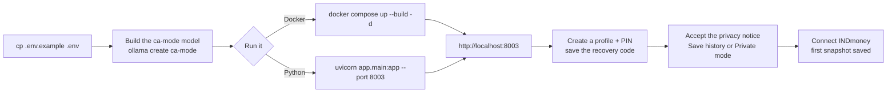

# Setup and first run

[← Back to the README](../README.md)

- [Requirements](#requirements)
- [Configure](#configure)
- [Use the local model](#use-the-local-model)
- [Run with Docker](#run-with-docker)
- [Run with Python](#run-with-python)
- [First run](#first-run)



## Requirements

- Docker Desktop, or Python 3.12 or newer
- [Ollama](https://ollama.com/download) and about 13 GB of disk and 16 GB of memory for the local model, or an OpenAI or Groq API key
- An INDmoney account to use Portfolio Analyzer

## Configure

Copy the example environment file. It uses the local model (see [Use the local model](#use-the-local-model)); add an OpenAI or Groq key only if you want a cloud model too:

```bash
cp .env.example .env
```

| Variable | Default | Purpose |
| --- | --- | --- |
| `OLLAMA_MODEL` | – | Enables the local model; `ca-mode` once built from `ollama/Modelfile` |
| `OLLAMA_BASE_URL` | `http://localhost:11434/v1` | Ollama's address (Docker Compose sets `host.docker.internal`) |
| `OLLAMA_TIMEOUT_SECONDS` | `300` | How long to wait for a local answer |
| `OPENAI_API_KEY` | – | Enables OpenAI |
| `OPENAI_MODEL` | `gpt-4o` | OpenAI model |
| `GROQ_API_KEY` | – | Enables Groq |
| `GROQ_MODEL` | `openai/gpt-oss-120b` | Groq model |
| `OPENAI_BASE_URL`, `GROQ_BASE_URL` | provider default | OpenAI-compatible endpoint override |
| `AI_PROVIDER` | `ollama` | Provider selected when the app opens (`ollama`, `openai` or `groq`) |
| `REQUEST_ROUTER` | `model` | How each message is classified before answering: `model` (an AI call) or `keywords` (offline rules) |
| `OLLAMA_ROUTER_MODEL`, `OPENAI_ROUTER_MODEL`, `GROQ_ROUTER_MODEL` | the chat model | Model for that classification; a smaller one is cheaper and faster |
| `GROQ_INPUT_TOKEN_BUDGET` | `5600` | Groq input budget; older chat history is dropped to fit |
| `GROQ_COMPLETION_TOKEN_LIMIT` | `1200` | Groq answer length limit |
| `MCP_SERVER_URL` | `https://mcp.indmoney.com/mcp` | INDmoney MCP endpoint |
| `APP_ORIGIN` | request host | Public address used for the INDmoney and Google OAuth callbacks |
| `AUTH_MODE` | `local` | `google` for [Google sign-in](accounts-and-access.md#open-it-to-other-people-google-sign-in) |
| `GOOGLE_CLIENT_ID`, `GOOGLE_CLIENT_SECRET` | – | Google OAuth client, for Google sign-in and the admin page |
| `ALLOW_PROFILE_CLAIMS` | `true` | Google sign-in: let a Google account claim an existing profile |
| `ADMIN_EMAILS` | – | Google accounts allowed into [`/admin`](accounts-and-access.md#admin-page) (unset: admin off) |
| `AGENT_GRAPH_ENABLED` | `true` | Answer account questions with the [general agent](how-it-works.md#the-general-agent-portfolio-analyzer); `false` returns to the previous loop and planner |
| `AGENT_STEP_TIMEOUT_SECONDS`, `AGENT_DEADLINE_SECONDS` | `60`, `300` | General agent: time per tool call and per answer |
| `PLAN_STEP_TIMEOUT_SECONDS`, `PLAN_DEADLINE_SECONDS` | `60`, `240` | Planned answers: time per step and per answer |
| `SNAPSHOT_TIME` | `09:00` | Daily snapshot time |
| `SNAPSHOT_TIMEZONE` | `Asia/Kolkata` | Time zone for `SNAPSHOT_TIME` |
| `SNAPSHOT_RETENTION_DAYS` | `365` | How long snapshots are kept |
| `SNAPSHOT_SCHEDULER_ENABLED` | `true` | Set to `false` to stop the background snapshot job |
| `INVESTIGATION_TOLERANCE_PCT` | `0.5` | Investigations: percentage part of the tolerance for two amounts to agree |
| `INVESTIGATION_TOLERANCE_INR` | `1` | Investigations: rupee floor of that tolerance |
| `INVESTIGATION_STALE_HOURS` | `36` | Investigations: age after which the latest snapshot is flagged as stale |
| `FUND_STALE_DAYS` | `5` | Fund figures: days after a scheme's NAV date before its returns are marked old |
| `APP_DATA_DIR` | `.data/` | Folder for the SQLite database |
| `BACKUP_DIR` | `~/ca-mode-backups` | Where daily database backups are written |
| `BACKUP_KEEP` | `14` | How many backups to keep |
| `BACKUP_ENABLED` | `true` | Set to `false` to stop daily backups |
| `APP_MASTER_KEY_FILE` | `~/.config/ca-mode/master.key` | File holding the key that encrypts stored INDmoney tokens (created on first start) |
| `APP_MASTER_KEY` | – | The key itself, instead of a file (a Fernet key) |
| `PAGE_VIEWS_ENABLED` | `true` | Anonymous local page-view counts |
| `LOG_LEVEL` | `INFO` | Server log level |
| `PORT` | `8080` | Port inside the Docker container |
| `DAILY_QUESTION_LIMIT` | – (unlimited) | Answered chat questions per Free-plan profile per day in `SNAPSHOT_TIMEZONE`: never more than the Free plan's allowance in code (`FREE_DAILY_QUESTIONS` in `app/limits.py`, now 10), so a larger number is lowered to it; see [Plans and pricing](accounts-and-access.md#plans-and-pricing) |
| `PRICING_CONTACT_EMAIL` | – | Where the `/pricing` page's "Choose Individual" and "Contact us" buttons send an email; unset, the page says to ask whoever runs the copy |
| `RATE_LIMITS_ENABLED` | `false` | Request rate limits per IP and per profile on chat, sign-up, sign-in and investigations |
| `TRUSTED_PROXY` | – | `cloudflare`: take the client IP from `CF-Connecting-IP`; `caddy`: from the last `X-Forwarded-For` entry. Only when the app is reachable solely through that proxy (see [Hosting](hosting.md#client-addresses-behind-the-proxy)) |
| `TURNSTILE_SITE_KEY`, `TURNSTILE_SECRET_KEY` | – | Both set: sign-up asks for a Cloudflare Turnstile check |

You can configure several providers and switch in the app. Provider keys stay in the server environment and are never sent to the browser. Leave `OPENAI_API_KEY` and `GROQ_API_KEY` empty to make sending data to an AI company impossible.

## Use the local model

CA Mode's local model is [gpt-oss-20b](https://huggingface.co/openai/gpt-oss-20b) (Apache 2.0), the smaller sibling of the `gpt-oss-120b` model used on Groq. Install [Ollama](https://ollama.com/download), then build the `ca-mode` model once:

```bash
ollama pull gpt-oss:20b                      # about 13 GB
ollama create ca-mode -f ollama/Modelfile    # same weights, with a 32k-token context window
```

Keep `OLLAMA_MODEL=ca-mode` in `.env`. The Modelfile matters: Ollama's default context window is 4,096 tokens on Macs with less GPU memory, and its OpenAI-compatible API silently drops the start of a longer prompt, including the instructions and your portfolio data. CA Mode checks the window of the loaded model and refuses to answer below 16,384 tokens.

The model loads on the first question (a few seconds) and stays in memory for five minutes. With Docker, Compose points the app at `host.docker.internal`; if the container cannot reach Ollama, start Ollama with `OLLAMA_HOST=0.0.0.0:11434`, which also makes it reachable from your network.

**How it was chosen.** Candidates had to run fully on the GPU of a 24 GB Mac (roughly 16–18 GB usable), which rules out the 27–35B models (Qwen3.8-27B, Qwen3.6-35B-A3B, GLM-4.7-Flash). Each remaining model was scored on this repo's two evals on an M5 Pro:

| Model (Ollama tag) | Memory at 32k context | Portfolio numbers (3 runs × 8) | Request routing (3 runs × 58) | Time per portfolio answer |
| --- | --- | --- | --- | --- |
| **`gpt-oss:20b`** | 12 GB | **23/24** | 88–93% | **~9 s** |
| `qwen3.5:9b` | 6.6 GB | 20/24 | **98.3%** | ~12 s |
| `qwen3:8b` | 9.8 GB | 21/24 | 96.6% (1 run) | ~30 s |

gpt-oss-20b gets the numbers right most often and answers fastest, which matters most for a finance assistant. The routing set has since grown to 64 cases (price-history and candlestick requests, and the concepts behind them); with the classifier call at temperature 0, gpt-oss-20b scores 60/64 on every run (59–61 at the model's default temperature, which once sent a candlestick request to the general-finance path). Its routing misses are mostly prompt-injection test cases sent to Finance Agent, which then declines anything that isn't finance, and a routing call that fails falls back to the keyword rules. On a Mac with 8–16 GB of memory, use `FROM qwen3.5:9b` in the Modelfile instead. `gemma4:26b` was shortlisted but not scored.

## Run with Docker

After configuring `.env`, build and start the app:

```bash
docker compose up --build -d
```

Open [http://localhost:8003](http://localhost:8003) and keep using this address for INDmoney sign-in (the OAuth callback is `http://localhost:8003/auth/indmoney/callback`). The database lives in `./.data` on your computer, and the snapshot job runs inside the container, so keep the container running for the daily 09:00 capture. The container also mounts `~/.config/ca-mode`, so it uses the same token encryption key as running with Python.

```bash
docker compose logs -f   # view logs
docker compose down      # stop
```

## Run with Python

```bash
python3 -m venv .venv
source .venv/bin/activate
python -m pip install -r requirements.txt
uvicorn --env-file .env app.main:app --host 127.0.0.1 --port 8003
```

Run `uvicorn` from the activated virtual environment (or call `.venv/bin/uvicorn` directly). A globally installed `uvicorn`, such as Homebrew's, does not have the project's packages. The server does not reload code changes on its own: restart it after pulling an update.

Open [http://localhost:8003](http://localhost:8003) and keep using this address during INDmoney sign-in.

## First run

1. **Create a profile.** The first screen asks "Who's using CA Mode?". Enter your name and a PIN of at least four characters. Other people on the same computer add their own profiles with **+ Add a profile**. You then see a **recovery code** once: write it down. It is the only way back into your saved history if you forget your PIN.
2. **Review the privacy notice.** It explains what is saved, where, and what is sent to the AI provider. Choose **Save history** (chats and daily snapshots, with a snapshot retention of 30 days to 1 year) or **Private mode**, then accept. You can't chat or connect INDmoney until you accept.
3. **Fill in your profile (optional).** Click your name at the bottom of the sidebar to set risk appetite, horizon, goal, monthly investment, and age band. Portfolio Analyzer uses these to relate its analysis to your goals; it is not personalised investment advice.
4. **Connect INDmoney.** Select **Connect**, sign in to INDmoney, and approve read-only access. The first snapshot is saved straight away, and the portfolio card shows your net worth.

### Upgrading from a version without profiles

The first start of the profiles version reorganises the database. Stop the server, back up the data folder, then start the new version:

```bash
cp -R .data .data-backup-$(date +%F)
```

Then create (or unlock) a profile **in the browser you used before**: that browser's existing chats and INDmoney connection move into the profile.
